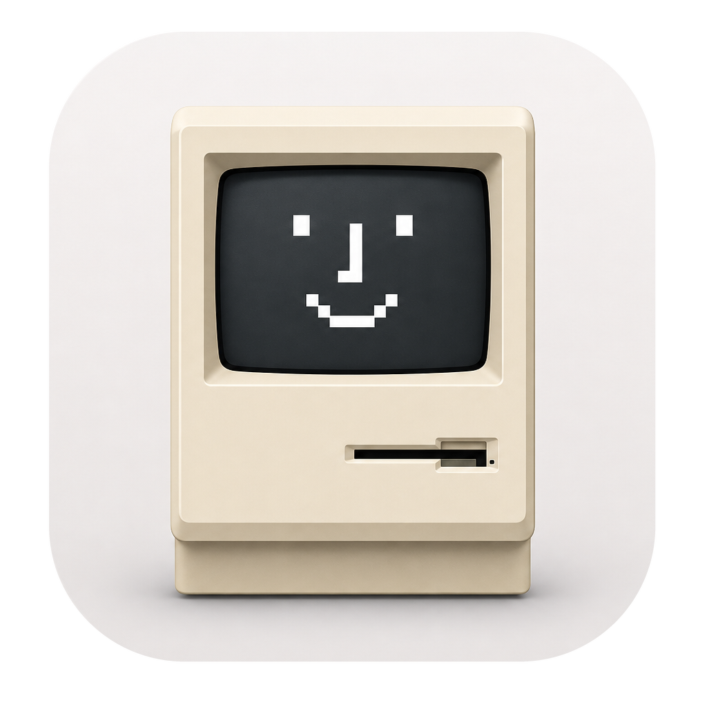
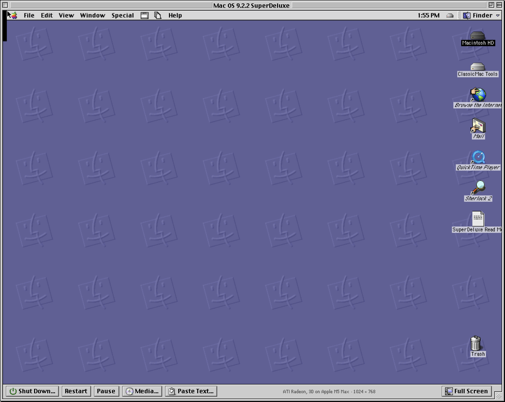
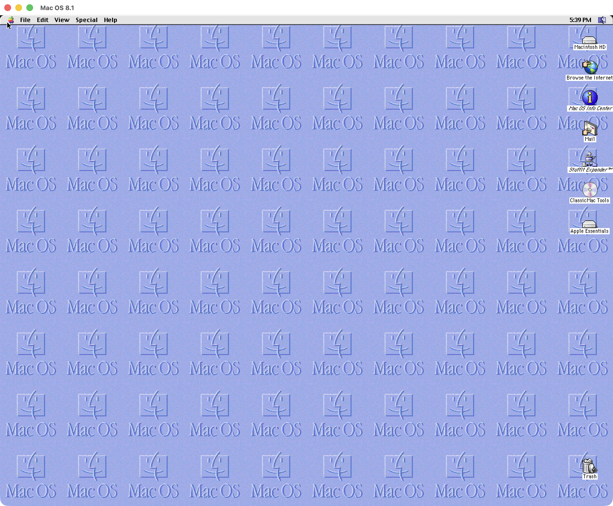
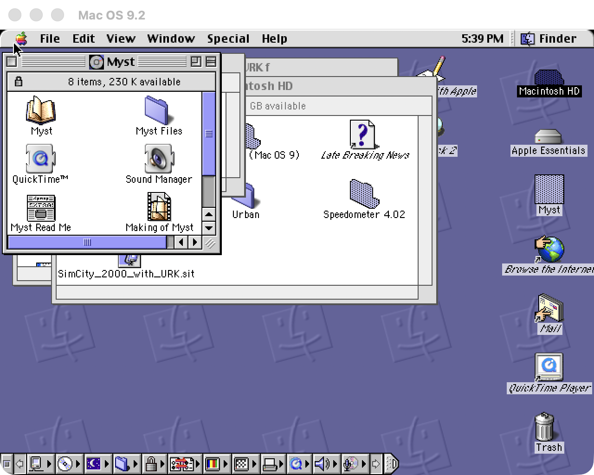
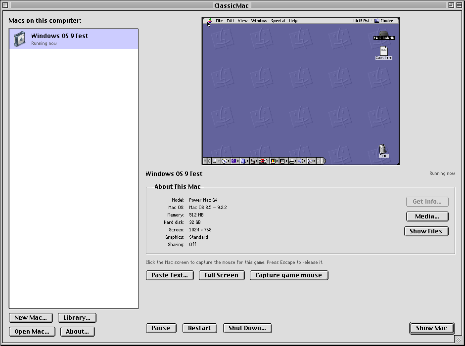
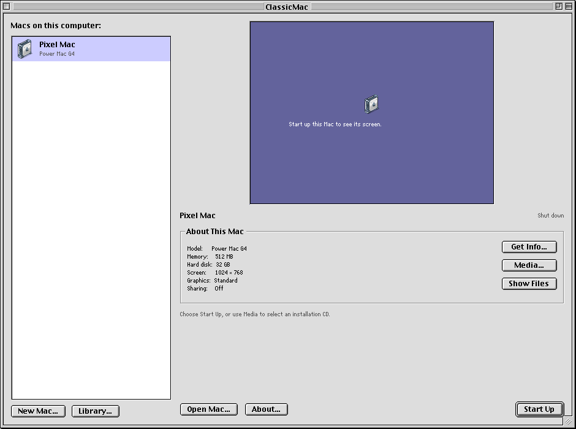
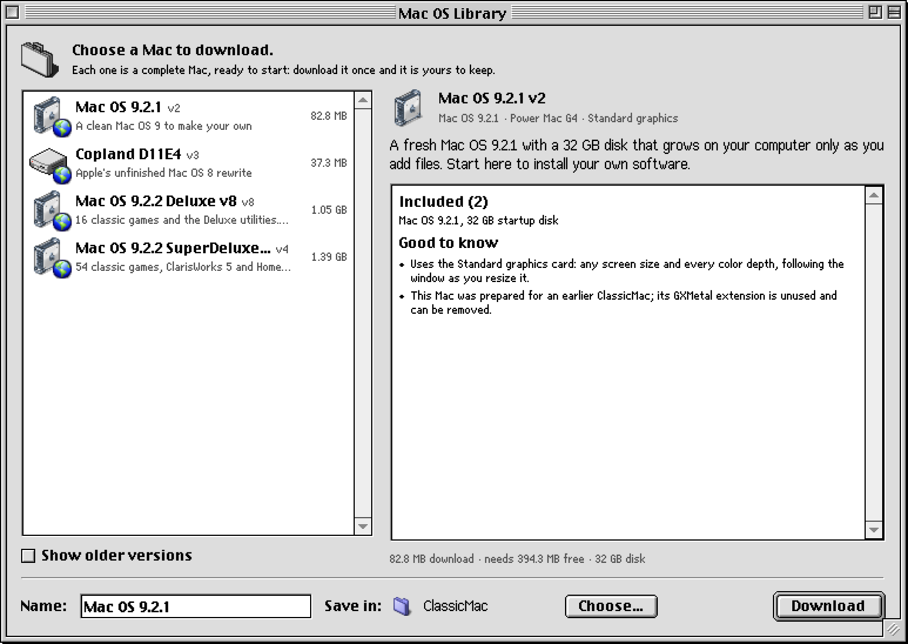
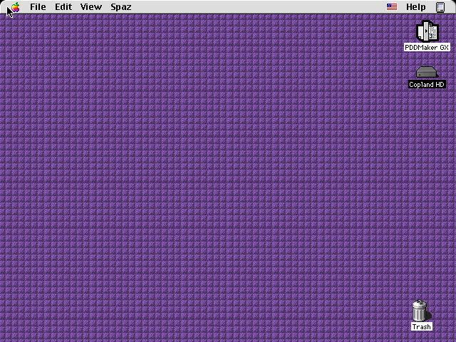

<p align="center">
  
</p>

<h1 align="center">ClassicMac</h1>

<p align="center">
  <strong>The classic Mac OS era on macOS, Windows and Linux.</strong><br>
  A self-contained desktop app that emulates a Motorola 68040 Quadra 800 and a PowerPC Power Mac G4<br>
  on a custom build of QEMU, with the Apple Platinum appearance.
</p>

<p align="center">
  
  
  
  
  
</p>

---

<p align="center">
  
</p>

<p align="center">
  
  
</p>

## New in ClassicMac 4.1.1

- **Quake III mouse controls.** Power Macs provide a USB mouse for
  InputSprocket games. Click the game screen to capture; Control–Option on
  macOS or Escape on Windows/Linux releases it. Finder keeps seamless input.
- **Smooth id intro playback.** Radeon startup initializes the synchronization
  state expected by the classic Mac OpenGL driver, avoiding repeated waits.
- **Reliable Power Mac audio.** DMA completion follows the sample clock and
  keeps the guest's sound-buffer interrupts separate.

## New in ClassicMac 4.1

- **Windows and Linux desktop editions.** Native x64 QEMU runtimes and a shared
  Platinum desktop front end, with `.classic` machine creation/import,
  settings, CD/floppy images, power controls and an authenticated local display.
- **The Library on every desktop.** Ready-to-run Mac OS 9 editions download
  with pause/resume, exact size/SHA-256 checks and bounded archive extraction.
- **Paste Text on every desktop.** Review plain text before typing it with the
  Mac US keyboard layout; unsupported characters are rejected before typing.
- **Linux folder sharing.** A selected host folder mounts through classicvirtio
  9p. Windows does not provide this QEMU backend; Copland remains Mac-only.
- **Reference-tested Platinum controls.** The Mac appearance corrects system
  font widths, raw grays, pressed/disabled controls, popup arrows and title-box
  artwork. [The audit](docs/platinum-fidelity-audit.md) documents the 32 control
  references and 95 system glyphs, and the remaining whole-app fidelity gaps.

| Download | Host | Install |
| --- | --- | --- |
| macOS DMG | Apple Silicon, macOS 15+ | Drag ClassicMac to Applications |
| Windows ZIP | Windows 11, x64 | Extract and run `ClassicMac.exe`, keeping its companion files |
| Linux DEB | Ubuntu 24.04+/Debian 13, x64 | Install the package with your package manager |
| Linux tar.gz | Same Linux baseline | Extract and run `classicmac`; the host must support Chromium sandboxing |

The [latest release](https://github.com/amcchord/ClassicMac/releases/latest)
contains the applications, checksums and corresponding engine sources. The
macOS app is Developer ID signed and notarized. Windows binaries are unsigned.
See the [desktop build and platform support guide](desktop/README.md).

<p align="center">
  
  
</p>

## New in ClassicMac 4.0

- **Apple Platinum, top to bottom.** Every ClassicMac window is now drawn in
  the Mac OS 8/9 Platinum appearance it runs: pinstriped title bars with
  close, zoom and WindowShade boxes, a grow box, movable modal dialogs, the
  default-button ring that flashes when you press Return, beeping caution
  alerts, Platinum pop-up menus that open with the current item under the
  pointer, lavender lists and scroll bars, and the barber-pole progress bar.
  Control artwork uses one point per Mac pixel and is tested at 1× and
  2×. Some SwiftUI text and other states still need fidelity work. The look, fonts and icons are shared with RetroBoot through the
  new `PlatinumKit` module, which also builds for iPad.
- **Your Mac in a Platinum window.** Each running Mac's screen now appears
  in a ClassicMac Platinum window instead of QEMU's: sharp whole-number
  scaling, a close box that shuts Mac OS down safely, zoom and WindowShade,
  a Standard-card screen that follows the window's size, and a toolbar with
  Shut Down, Restart, Pause, Media, Paste Text and Full Screen. From
  power-on it shows the classic gray checkerboard with a startup Mac until
  Mac OS draws its own screen, so firmware black and OpenBIOS yellow never
  appear. QEMU hands its screen over through the new `-display classicmac`
  backend, ported from RetroBoot (see [`display/README.md`](display/README.md)).
- **The Mac OS Library.** **File → Mac OS Library…** (⇧⌘L) lists every
  ready-to-run Mac with what is inside it: Mac OS 9.2.2 SuperDeluxe (54
  games, ClarisWorks, Home Page), Deluxe (16 games, After Dark, music,
  benchmarks), a clean Mac OS 9.2.1 and Copland. Downloads resume, verify and
  show a classic copy-progress dialog.
- **3D through an emulated ATI Radeon, with no custom drivers.** Power Macs
  can use an emulated ATI Radeon (R100, PCI "Radeon Mac Edition") that Mac OS
  9's own ATI software drives, so QuickDraw 3D RAVE and OpenGL games render on
  your Mac's GPU. The Library's Deluxe Macs start on it. GXMetal is retired.
- **Get Info** replaces Settings, with General, Display and Sharing panes;
  **About This Mac** in the main window shows the GPU drawing a running Mac's
  3D.
- **Classic icons by The Iconfactory.** The Power Mac G4, Quadra 800 and
  Power Mac 7500 use Iconfactory artwork included with permission. No extra
  download is needed. **ClassicMac → Iconfactory Icons…** credits the artists
  and lets you add more collections from your own copies.

<p align="center">
  
</p>

<p align="center">
  
  
</p>

## Copland preview

ClassicMac 3.2 adds a downloadable **Copland D11E4** machine, Apple's unfinished
Mac OS 8 rewrite. Choose **File → Download a Mac**, select Copland, and start it.
A dedicated Power Mac 7500 engine boots the included disk with 32 MB RAM.



This is experimental: some Finder actions trigger developer assertions or
crashes. Use **Continue Copland** in ClassicMac when it reports an assertion.
Sound, networking, shared folders, removable media and browser viewing are
unavailable. See [Copland setup, controls and source credits](copland/README.md).

## New in ClassicMac 3.0

- **Download a ready-to-run Mac OS 9.** Choose **File → New Machine** and
  the recommended **Download a Mac** option
  for a clean Mac OS 9.2.1 machine with GXMetal 2.3.0 already installed.
  Downloads support pause/resume, integrity checks, and a choice of name and
  save location. Each download creates its own independent machine.
- **A simpler machine home.** Start or return to your Mac from its preview;
  hardware, display, and sharing options live in a separate Settings window.
- **Compact GXMetal status.** A toolbar icon opens current graphics activity
  and test/repair guidance. The native guest window also has **View → GXMetal**.
- **Paste Text into Mac.** Review and edit text before typing it into the
  guest, with progress and cancellation. Available from the app, native guest
  menu, and browser toolbar; requires the guest's US keyboard layout.
- **One media window.** Manage discs, Tools, recent images, and startup choice
  from the library or guest. Power Mac changes are saved for the next startup;
  Quadra floppy eject waits for the guest to finish its writes.

See the [3.0 validation report](docs/3.0-validation.md) for test results and
known limits, or the [numbered roadmap](docs/polish-roadmap.md) for future ideas.

## iPad beta

ClassicMac now has an iPad-only beta for iPadOS 14 and newer. It can create and
run both Quadra 800 and Power Macintosh G4 machines entirely on-device, import
existing machine packages, and uses the same ClassicMac icon and focused
Classic Mac OS setup flow.

The iPad build uses UTM SE's App Store-compatible QEMU threaded-code
interpreter because iPadOS cannot launch the macOS app's bundled emulator
processes. That makes it slower than the Apple Silicon Mac build. This first
beta also uses upstream UTM display hardware, so ClassicMac's GXMetal renderer
and custom `nubus-qfb` display device are not included yet. See
[`ios/README.md`](ios/README.md) for the pinned build and TestFlight workflow.

## 3D games: the emulated ATI Radeon

`Mac OS 9 game → ATI's own Mac OS 9 drivers → emulated Radeon R100 in QEMU → OpenGL on your Mac's GPU`

Choose **Get Info → Display → ATI Radeon (3D acceleration)** for a Power
Mac, or download a Deluxe Mac from the Library, which starts on it. The card
is QEMU's `ati-vga` with RetroBoot's R100 model: register file, display
modes and EDID, command processor, 2D engine and a 3D engine whose draws run
on a host OpenGL 4.1 thread (Apple's OpenGL over Metal). Mac OS 9's stock
*ATI Driver Update*, *ATI Radeon 3D Accelerator*, *ATI Resource Manager* and
*OpenGLRendererATI* do the rest; nothing is installed from ClassicMac. On an
Apple M5 Max the Quake III Arena demo runs at about 150 frames per second.

- Mac OS starts at 640 × 480 and switches to the size you chose (640 × 480
  up to 1920 × 1440) during startup through RetroBoot Display (in the
  Library's Macs) or ClassicMac Display (on the Tools disk). The size stays
  fixed while the Mac runs; colors are 256, Thousands or Millions.
- A Mac without ATI's software still starts on the card, at 640 × 480 with
  no 3D. Installer and CD starts always use the Standard card.
- The Standard card remains the default: any size, live window resizing and
  every color depth.

See the [engine report](docs/engine-4.0-ati.md) for the design, provenance,
argument sets and test evidence. GXMetal, the 3.x paravirtual renderer,
remains in the history of the
[v3.2.1 release](https://github.com/amcchord/ClassicMac/releases/tag/v3.2.1).

## What it is

ClassicMac wraps a custom QEMU build in a native SwiftUI app and covers the entire classic Mac OS era with two machines:

| Machine | CPU | Runs | Highlights |
| --- | --- | --- | --- |
| **Macintosh Quadra 800** | Motorola 68040 | System 7.1 – Mac OS 8.1 | Enhanced paravirtualized framebuffer (`nubus-qfb`), writable removable floppy images, any resolution up to 3840x2160, all QuickDraw depths incl. Thousands |
| **Power Mac G4** | PowerPC (`mac99`) | Mac OS 8.5 – 9.2.2 | Boots through OpenBIOS firmware, screamer (AWACS) sound, browser-native display, custom `qemu_vga.ndrv` |

Everything is bundled into a single `ClassicMac.app`: the two QEMU system emulators, firmware, guest video drivers, folder-sharing drivers, and a guest-additions Tools CD. No Homebrew, nothing to hunt down, nothing to install inside the guest.

You bring your own Mac OS installation media: every classic Mac OS version is available in the [WinWorld operating system library](https://winworldpc.com/library/operating-systems), and ClassicMac imports the disc image with a couple of clicks. Mac OS 8.5, 8.6, 9.2.1, and the [Mac OS 9.2.2 Universal Install CD](https://macintoshgarden.org/apps/mac-os-922-universal) all boot reliably on the Power Mac — see the note in Getting started.

## Built on the shoulders of giants

ClassicMac exists because of years of brilliant work by other engineers. The patches and drivers that make it possible deserve top billing:

- [QEMU](https://www.qemu.org/) and the m68k / q800 maintainers (incl. the `nubus-virtio-mmio` transport) — the emulation core underneath everything.
- [SolraBizna/qemu](https://github.com/SolraBizna/qemu) for the `nubus-qfb` paravirtualized framebuffer (ported here onto QEMU 11.0.2) that gives the Quadra arbitrary resolutions and rich color.
- [elliotnunn/classicvirtio](https://github.com/elliotnunn/classicvirtio) for the classic Mac OS virtio drivers used for folder sharing and Quadra floppy images (68k card firmware and the PowerPC ndrvloader), and for the ndrv link recipe used to build the Power Mac video driver.
- [QemuMacDrivers](https://github.com/qemu/QemuMacDrivers) (Benjamin Herrenschmidt, Mark Cave-Ayland) for the `qemu_vga.ndrv` Power Mac video driver that `ppcvid/driver` extends with live host-window resizing.
- [mcayland/qemu](https://github.com/mcayland/qemu/tree/screamer) for the screamer (AWACS) PPC audio device and screamer-aware OpenBIOS (ported here onto QEMU 11.0.2).
- [Retro68](https://github.com/autc04/Retro68) for the 68k and PPC classic Mac OS cross toolchain.
- [noVNC](https://github.com/novnc/noVNC) for the browser-native VNC client used by the private local display page.

## Features

- **Native window or optional browser viewing.** Each machine opens in its own native window by default, with resize, full-screen, input, and removable-media controls. Turn on **View in browser (VNC)** per machine when a private loopback browser display is more convenient; Fit, Actual Size, Full Screen, modifier-key, and game-mouse controls stay close at hand there.
- **Enhanced video on the Quadra** (`-M q800,fb=qemu`): arbitrary resolutions up to 3840x2160, every QuickDraw depth including Thousands (16-bit), gamma correction, and multiple monitors — far beyond what stock QEMU's macfb can do.
- **Zero guest setup on the Power Mac.** It boots through OpenBIOS firmware, and a custom `qemu_vga.ndrv` is handed to Mac OS over fw_cfg at boot, so live resizing and millions of colors work with nothing installed in the guest.
- **Host folder sharing on both machines.** Pick a folder and it mounts on the emulated desktop as a read/write disk (classicvirtio + virtio-9p). Resource forks and type/creator codes round-trip via `.rdump`/`.idump` sidecars.
- **Writable floppy images on the Quadra.** Attach a raw `.img`, `.dsk`, `.ima`, or `.raw` image in Media settings before startup and it appears as a writable classic Mac disk.
- **Clean, working sound.** The Quadra's Apple Sound Chip is patched to feed silence when idle (no more idle buzz), and the Power Mac gets the screamer (AWACS) device with a screamer-aware OpenBIOS.
- **Self-contained `.classic` machine documents.** Each VM is a single Finder package holding its config, disk, and PRAM. Keep it anywhere, double-click to boot, move it between Macs.
- **Classic input helpers.** Secondary click opens contextual menus as Control+click, and the scroll wheel becomes arrow-key taps. Turn both off in machine settings for guests with real drivers (e.g. USB Overdrive).
- **A guest-additions Tools volume** (StuffIt Expander, Disk Copy, USB Overdrive, Transmit, Lido, patched HD SC Setup...) built from `guestcd/manifest.tsv`. On Power Macs it mounts automatically at startup as a read-only Virtio disk, using the same guest-driver path as folder sharing instead of unreliable OS 9 IDE hot-plug. Everything is pre-expanded and ready to run.
- **3D on the emulated ATI Radeon.** Mac OS 9's own ATI drivers drive an
  emulated Radeon R100 whose 3D engine renders through your Mac's GPU, so RAVE
  and OpenGL games such as Quake III, Nanosaur and Cro-Mag Rally run
  accelerated with nothing installed from ClassicMac.
- **An Apple Platinum interface.** Pixel-exact Mac OS 8/9 windows, controls,
  menus, dialogs and alerts, with original MIT fonts and icons shared with
  RetroBoot.
- **The Mac OS Library.** Ready-to-run Macs with games and classic software,
  described edition by edition, downloaded with resume and integrity checks.
- **Native machine control.** Pause / Resume, Restart, and Shut Down from the app, live screen previews in the library, a visible browser URL, and a "Match Display" button that chooses a screen-sized boot resolution.
- **Safe, faster shutdown cycles.** The app's Shut Down command presses the
  virtual Mac's Power key and confirms Mac OS's own dialog, allowing HFS/HFS+
  to unmount cleanly so the next boot does not pay the recovery penalty.
- **Signed, notarized, stapled DMG** for distribution — recipients get a clean Gatekeeper experience even offline.

## Getting started

1. Grab **ClassicMac.dmg** from the [latest release](../../releases/latest), drag ClassicMac to Applications, and launch it.
2. In the welcome panel choose **The Mac OS Library**, or open it later with
   **File → Mac OS Library…** (⇧⌘L). Pick a Mac (SuperDeluxe and Deluxe come
   with games and classic software and start on the ATI Radeon card), name
   it, and click **Download**.
3. Select your Mac and click **Start Up** (⌘R). Its screen opens in a
   Platinum window with a toolbar for common commands; **Show Mac** brings it
   forward. Every key, Command combinations included, goes to the Mac while
   its screen has focus; Control-Command-F toggles full screen, and games
   that capture the mouse release it with Control-Option. To use your browser instead, turn on
   **Get Info → Display → Show the Mac in a web browser** before startup.
4. Use **Media…** to attach discs and **Get Info** (⌘I) for memory, display,
   graphics card and a shared folder, which appears in the guest as a
   writable disk.

For a manual installation, choose **File → New Mac…** (⌘N): a Quadra 800
(System 7.1–8.1) or Power Mac G4 (Mac OS 8.5–9.2.2), memory, a virtual disk up
to 120 GB and your Mac OS CD image. The Mac starts from the CD; once Mac OS is
installed it starts from its hard disk by itself. To use the ATI Radeon card
on a Mac you installed yourself, install ATI's Mac OS 9 drivers from your
Mac OS 9.2 CD and ClassicMac Display from the Tools disk.

New Power Mac disks default to 32 GB. New disks use sparse storage: their
capacity is available to the classic Mac, while the file on your modern Mac
starts small and grows as data is written. The Library shows the download
size, virtual disk capacity, and free space needed separately. Existing
machines keep their current disk sizes.

> [!IMPORTANT]
> **Installing Mac OS 9?** Initialize the destination with Drive Setup from
> the CD first. In the Installer's final **Install Software** screen, open
> **Options…** and turn off **Update Apple Hard Disk Drivers**, then perform a
> regular installation. ClassicMac's QEMU build fixes the MacIO IDE/DBDMA
> completion race that made some 9.2.1 and 9.2.2 installers freeze around
> "About 4 minutes remaining," so a frozen partial System Folder is no longer
> expected or considered a successful install. During a Power Mac CD boot,
> ClassicMac leaves the Tools tray empty so the selected startup disc boots
> cleanly. Tools stays deferred for that installer boot; after installation,
> restart or shut down. ClassicMac detects the blessed System Folder and makes
> the hard disk the next startup device automatically, while leaving the disc
> inserted. The read-only **ClassicMac Tools** volume then mounts automatically.

New machines are created as `.classic` documents (default `~/Documents/ClassicMac/`). Double-click one in Finder to boot it.

Requirements: an Apple Silicon Mac (M1 or later) running macOS 15 or newer.

## Display & sound notes

- The resolution you pick is the *boot* resolution and the depth is the *deepest available* mode; classic Mac OS chooses the active depth at startup (a fresh system comes up in B&W until you pick Thousands/Millions once in Monitors — it's remembered per machine).
- Machines use the native window by default. The per-machine **View in browser** toggle is available under **Settings → Display** and takes effect on the next start.
- The browser's **Fit** mode prefers the largest whole-number scale that fits the tab and uses sharp nearest-neighbor edges when it must shrink the image. Choose **Actual Size** for one guest pixel per browser pixel, and use the page's **Fullscreen** button to enter or leave browser fullscreen.
- The browser toolbar provides sticky Command, Option, and Control modifiers plus a dedicated Escape button, which makes host-reserved key combinations practical. Games that ask for relative mouse movement reveal a **Capture game mouse** control; press Escape to leave pointer lock.
- Power Mac widths snap down to a multiple of 8 (a VGA hardware constraint).
- The Power Mac's packed low-bpp patch adds Black & White, 4 and 16 colors to the Monitors panel alongside 256/thousands/millions.
- Mac OS 9 wants **less than 1 GB of RAM** for stable sound, so the app's presets stop at 896 MB.
- On the Quadra, folder sharing arrives through the classicvirtio NuBus card firmware (new machines start from a pre-seeded PRAM so it boots reliably). On the Power Mac it arrives through `virtio-9p-pci` and the classicvirtio ndrvloader placed in guest RAM at boot; while booting from CD (e.g. an OS install) sharing is temporarily inactive.

## Building from source

```bash
# 1. Build the emulator (clones mainline QEMU 11.0.2, applies the ClassicMac
#    patch set and the ATI Radeon R100 last, compiles qemu-system-m68k +
#    qemu-system-ppc, and checks the host OpenGL path) and the Copland engine
./scripts/build-qemu.sh
./scripts/build-copland.sh

# 2. Build the guest-additions Tools CD (cached downloads, hfsutils/unar),
#    including ClassicMac Display for the ATI card
./scripts/build-guest-cd.sh

# 3. Build the app and bundle QEMU + firmware + dylibs into
#    dist/ClassicMac.app (code-signed). APP_VERSION, APP_BUILD_VERSION and
#    DIST_DIR override the version and output folder.
APP_VERSION=4.0.0 APP_BUILD_VERSION=4.0.0 ./scripts/bundle-qemu.sh

# 4. Notarize and package a distributable disk image (DIST_NAME and
#    DMG_VOLUME_NAME name the outputs)
./scripts/make-dmg.sh

# 5. Verify the exact signed/stapled artifact, including versions, Gatekeeper,
#    the bundled Tools CD and both Power Mac display cards
./scripts/verify-release.sh dist/ClassicMac.dmg 4.0.0 4.0.0
```

All scripts are idempotent and safe to re-run. Building needs the Xcode command line tools and [Homebrew](https://brew.sh).

The Platinum fonts and icons are generated from the MIT sources in
`platinum/` with `python3 platinum/tools/build_platinum_swift.py`; see
[`platinum/README.md`](platinum/README.md).

The guest-side binaries are committed, so a normal build needs no cross toolchain. If you change them, rebuild with:

```bash
# 68k qfb card firmware + driver (builds Retro68 into vendor/ on first run)
./scripts/build-qfb-rom.sh          # -> qfb/mac_qfb.rom

# PPC video driver (adds Retro68 PPC compilers + Universal Interfaces)
./scripts/build-ppcvid-ndrv.sh      # -> ppcvid/qemu_vga.ndrv

# Classicvirtio Quadra card firmware and Power Mac NDRV loader
./scripts/build-classicvirtio-floppy.sh  # -> shared/declrom + shared/ndrvloader

# Power Mac OpenBIOS firmware with the ATI Radeon node and the sound-objects
# fix (uses the OpenBIOS Linux builder container)
./scripts/build-openbios.sh               # -> screamer/openbios-ppc
```

## Repository layout

```
ClassicMac/
  app/                      # the ClassicMac app and PlatinumKit (SwiftPM package)
  display/                  # -display classicmac: QEMU hands its screen to the app
  platinum/                 # MIT Platinum fonts, icons and asset generators
  ati/                      # emulated ATI Radeon R100: QEMU, macOS GL and OpenBIOS patches
  browser/                  # branded loopback-only noVNC display client
  Resources/                # app icon, machine icon, bundled firmware
  qfb/                      # nubus-qfb enhanced framebuffer device + 68k driver
    driver/                 #   68k card firmware + driver source (Retro68)
  ppcvid/                   # PPC live-resize: VGA host-resize + packed-depth patches
    driver/                 #   qemu_vga.ndrv source (QemuMacDrivers fork, Retro68)
  classicvirtio/            # removable floppy + Power Mac startup-driver patches
  powermac/                 # QEMU and OpenBIOS Mac OS 8 compatibility patches
  virtio/                   # QEMU removable VirtIO block device patch
  screamer/                 # screamer (AWACS) PPC audio device + OpenBIOS
  shared/                   # classicvirtio card firmware + ndrvloader + PRAM seed
  cocoaui/                  # Cocoa display patches: menus, input helpers, media names
  audio/                    # CoreAudio backend patch
  ide/                      # PPC MacIO IDE/DBDMA timing fix + tracepoints
  guestcd/                  # Tools CD manifest + HFS copy tooling
  scripts/                  # build-qemu, bundle-qemu, build-guest-cd, make-dmg, notarize...
```

> Mac OS installation media is **not** committed; download the version you want from the [WinWorld operating system library](https://winworldpc.com/library/operating-systems) (Mac OS 8.5, 8.6, 9.2.1, and the [9.2.2 Universal Install CD](https://macintoshgarden.org/apps/mac-os-922-universal) are supported) and import it through the app.

## How the interesting parts work

- **Optional browser display** — when enabled for a machine, its run gets an HTTP server and QEMU VNC WebSocket bound only to `127.0.0.1`. The bundled noVNC client renders the framebuffer, sends keyboard and pointer input, scales it to the tab, reconnects across Power Mac restarts, and understands QEMU's relative-pointer extension for games. Otherwise QEMU uses ClassicMac's native Cocoa window.
- **Quadra video** — `nubus-qfb`, a paravirtualized NuBus framebuffer (ported from [SolraBizna/qemu](https://github.com/SolraBizna/qemu) onto QEMU 11.0.2) with 68k card firmware and a driver built with Retro68.
- **Power Mac video** — QEMU's std VGA gains packed low-color and optimized framebuffer paths. The bundled `qemu_vga.ndrv` supplies the full classic Mac display-mode set without a guest installation.
- **ATI Radeon 3D** — `ati-vga,model=r100` (from RetroBoot) emulates the card Mac OS 9's ATI drivers expect, down to its command processor and 3D engine. 3D draws run on a separate thread through Apple's OpenGL 4.1 (loaded at run time, so QEMU never links OpenGL); finished frames return to the card's VRAM for display. OpenBIOS names the card `ATY,Rage6p` and programs its boot mode, and the emulated monitor's EDID offers exactly the screen size you chose.
- **Platinum interface** — `PlatinumKit` draws every control from measured Mac OS 8.1 pixel tables with a one-Mac-pixel-per-point painter, uses bitmap fonts compiled to pixel-square TrueType, and hosts SwiftUI content in borderless windows with their own pinstriped frames, WindowShade and modal dialog handling.
- **Restart and installer handoff** — both models exit and relaunch cleanly at a reset boundary. This works around QEMU's broken in-place `mac99` reset and gives ClassicMac a safe point to recognize a newly blessed hard disk before the next boot.
- **Sound** — the ASC is patched to output silence when idle (`qfb/asc-silence.patch`); the Power Mac uses Mark Cave-Ayland's screamer device with a screamer-aware OpenBIOS build.
- **Power Mac storage** — MacIO IDE/DBDMA holds the final DMA descriptor for 1 ms before publishing completion. Real hardware cannot finish in the same scheduling window in which the driver starts an operation; without this small latency, cached host I/O can beat Mac OS 9's synchronous-wait setup and lose its wakeup, freezing Installer mid-copy. Focused MacIO/DBDMA tracepoints remain available for regression runs.
- **Mac OS 9 hard-disk startup** — hard-disk boots use a startup-only accounted instruction clock, zero-delay cached IDE completion, and PowerPC TCG fast paths so Mac OS 9's hardware and timebase polling does not sleep on the host. QEMU recognizes Finder's menu bar directly in guest VRAM—even headless and at arbitrary supported resolutions—then atomically returns the virtual clock and 25 MHz PowerPC timebase to real time before applications run. A 15-second app fallback covers unusual themes; installer-CD boots retain normal timing and the 1 ms IDE race safeguard. Six 512 MB cold boots of the 1920×1080 OS 9.2.2 test machine reached the automatic handoff in 9.92–10.22 seconds, including a reboot after verified clean shutdown, versus roughly 18.5 seconds on the former real-time-only path; exact results vary with host load and guest configuration.
- **Power Mac Mac OS 8 startup** — the machine uses a CUDA/G3 profile with an original-iMac OpenBIOS identity and classic Mac NVRAM/RTAS services. During CD startup, a read-only Virtio mirror lets the Mac OS 8.5/8.6 ROM read the selected disc before its IDE driver is active; the ordinary IDE CD stays present for Installer and Finder.
- **Quadra floppy storage** — a removable `virtio-blk-device` rides on the existing classicvirtio NuBus transport. A small extension to the 68k block driver adds writes, flushes, media-change events, and a host/guest eject handshake so Finder owns the unmount before QEMU removes the raw image.
- **Emulation speed** — both machines run on QEMU's TCG JIT; an Apple Silicon Mac runs them comfortably faster than the original hardware.
