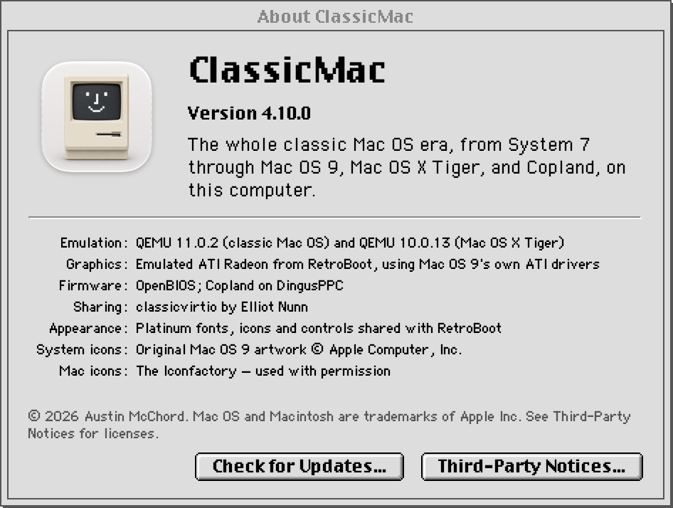
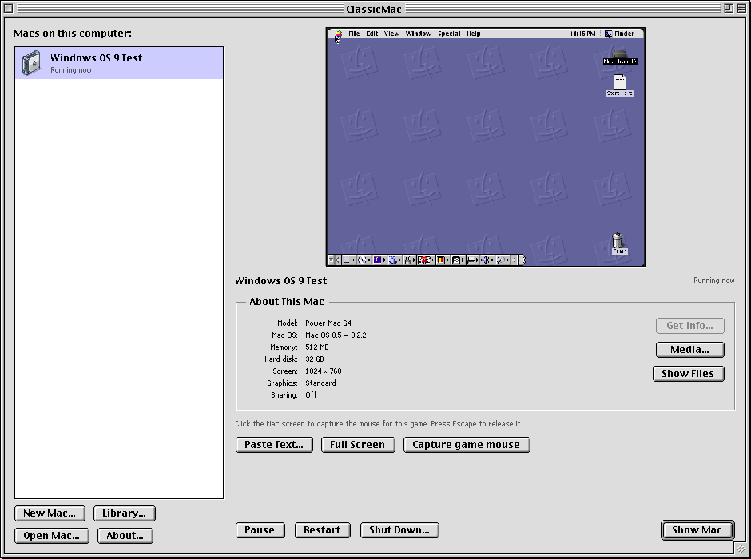
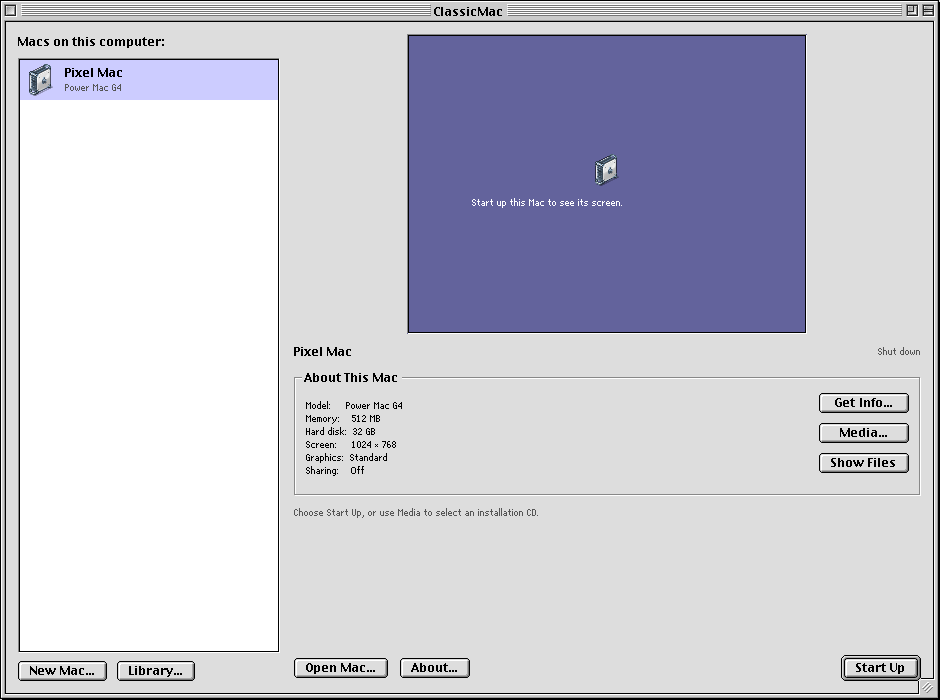
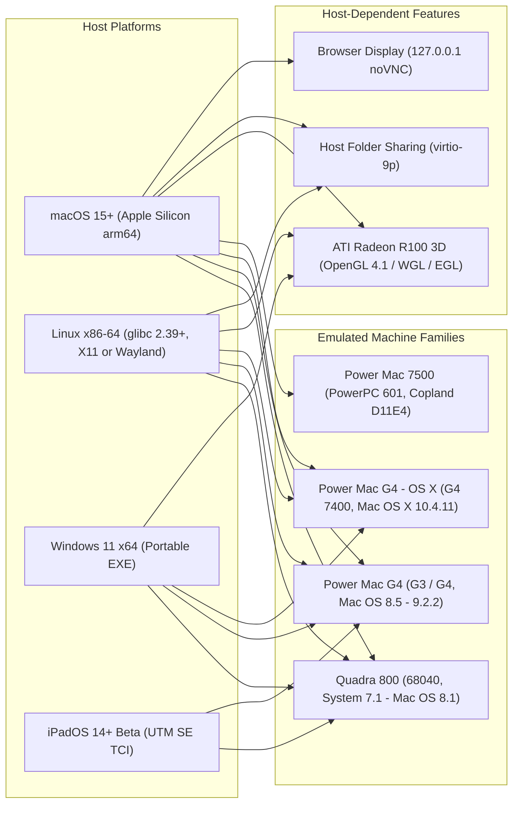

# Chapter 1: System Requirements & Supported Platforms

ClassicMac 4.10.0 runs genuine Motorola 68040, PowerPC, and early PowerPC Mac OS X environments inside a self-contained desktop application styled in Apple's Mac OS 8/9 Platinum appearance. Every desktop build bundles its own emulation engines, firmware, guest drivers, and the `ClassicMacTools.iso` guest-additions image—no Homebrew installation, external QEMU setup, or guest-side setup is required for standard machines.

  

---

## Host Platform Matrix

ClassicMac ships native applications for **macOS**, **Windows**, and **Linux**, plus a separate **iPadOS beta** built on UTM SE.

| Host Platform | Release Artifact | Minimum OS / Runtime | Frontend Stack | Signing & Packaging | Platform-Specific Capabilities & Limits |
| :--- | :--- | :--- | :--- | :--- | :--- |
| **macOS** | `ClassicMac-4.10.0.dmg`, `ClassicMac-4.10.0.zip` | Apple Silicon (`M1` or later, `arm64`), **macOS 15+** | Native SwiftUI + `PlatinumKit` + AppKit | Developer ID signed, notarized, and stapled | Full feature set: `-display classicmac`, optional loopback Browser Display (`noVNC`), `classicvirtio` folder sharing, auto-provisioned OS 9 printing, APFS `F_PUNCHHOLE` & `clonefile` checkpoints, and experimental Copland D11E4 |
| **Windows** | `ClassicMac-4.10.0-windows-x64.exe` | **Windows 11 x64** (`_WIN32_WINNT=0x0A00`) | Compiled C++17 + Qt 6.4+ (`Widgets`, `Network`, `Concurrent`) | Unsigned single portable EXE (self-extracting via `$LOCALAPPDATA`) | Direct Qt RFB display with Per-Monitor V2 DPI whole-pixel zoom, ATI Radeon 3D via WGL, NTFS sparse virtual disks, virtual printing (LPD/IPP/JetDirect -> WinSpool or PDF). No `virtio-9p` folder sharing or Copland |
| **Linux** | `ClassicMac-4.10.0-linux-x64.AppImage` | **x86-64**, `glibc 2.39+` (Ubuntu 24.04+ / Debian 13+), X11 or Wayland | Compiled C++17 + Qt 6.4+ (`Widgets`, `Network`, `Concurrent`) | Portable AppImage (`--appimage-extract-and-run` without FUSE) | Direct Qt RFB display, ATI Radeon 3D via EGL/GLES (`libEGL.so.1` / `libGLESv2.so.2`), `virtio-9p` folder sharing, `FICLONE` / `--reflink` checkpoints, virtual printing (CUPS `lp` / PDF). No Copland |
| **iPadOS (Beta)** | TestFlight / Xcode (`ios/README.md`) | **iPadOS 14+** (iPad-only; `PlatinumKit` targets iOS 18) | SwiftUI + UTM SE frameworks | Unsigned archive or TestFlight IPA via `upload-ipad-testflight.sh` | Runs `m68k` and `ppc` engines using QEMU's threaded-code interpreter (no JIT). Uses upstream UTM display hardware: no `nubus-qfb` or emulated ATI Radeon 3D |

  

  

---

## Host-to-Emulated-Machine Compatibility

Not every emulated machine family or feature is available on every host OS. The diagram below summarizes which emulated machines and subsystems each host platform supports.

---

## CPU, RAM, Disk Space & GPU Requirements

### Host Resource Guidelines

All desktop builds run QEMU's TCG JIT (`-accel tcg,tb-size=512` on PowerPC), which translates 68k and PowerPC instructions at native host speeds comfortably faster than original hardware on Apple Silicon and modern x86-64 processors.

- **Host CPU**: Apple Silicon (`M1` or later) on macOS; modern 64-bit x86-64 CPU on Windows 11 and Linux.
- **Host RAM**: At least **4 GB** host RAM is recommended for running Classic Mac OS guests (which top out at 896–1000 MB), and **8 GB+** host RAM is recommended when running PowerPC Mac OS X Tiger with its 1024–2048 MB guest memory presets.
- **Host Disk Space**:
  - ClassicMac creates **sparse raw virtual disks** (`disk.img`) using `qemu-img create -f raw -o preallocation=off`, `F_PUNCHHOLE` on macOS APFS, `Model::makeSparse` on Windows NTFS, and sparse/reflink allocations on Linux.
  - A default **32 GB** Power Mac disk or **2 GB** Quadra disk only consumes host storage for blocks actually written by the guest OS (plus a 256 MB safety reserve checked during Library extraction).
  - Keep at least **2–6 GB free** for ready-to-run Library editions (especially Mac OS 9 Deluxe/SuperDeluxe or Mac OS X Tiger), and up to the configured capacity if you plan to fill large virtual drives or disable sparse storage on non-APFS volumes.
- **Host GPU & OpenGL (for ATI Radeon 3D)**:
  - **Standard graphics** (`-vga std`, `nubus-qfb`, `macfb`) require no host 3D acceleration.
  - **ATI Radeon R100 3D acceleration** renders guest RAVE and OpenGL calls on a host OpenGL thread:
    - **macOS**: Dynamically loads `/System/Library/Frameworks/OpenGL.framework/OpenGL` (OpenGL 4.1 Core over Apple Metal) via `dlopen()` at runtime.
    - **Linux**: Dynamically loads `libEGL.so.1` and `libGLESv2.so.2` (`EGL_MESA_platform_surfaceless`) from the host graphics stack.
    - **Windows**: Uses the host GPU driver's WGL OpenGL context.
  - If no host OpenGL context can be created (`gl=off` in `x-accel-stats`), the emulated Radeon continues working as a 2D card at 640×480–1920×1440, but 3D software draws nothing visible.

### Guest Machine Memory, Disk & Display Limits

Each machine family enforces specific hardware bounds in `VMConfig.swift` and `native/src/machine.cpp`:

| Machine Profile | Guest OS Range | CPU Options | RAM Presets (Default) | Virtual Disk Presets (Default) | Display Modes & Resolution Bounds |
| :--- | :--- | :--- | :--- | :--- | :--- |
| **Macintosh Quadra 800** (`quadra800`) | System 7.1 – Mac OS 8.1 | Motorola 68040 | `64`, **`128`**, `256`, `512`, `1000` MB (native clamp `16–1000` MB) | `1`, **`2`**, `4`, `8`, `16`, `32`, `64`, `120` GB | **Enhanced (`nubus-qfb`)**: `512×384` to `3840×2160` (`8`/`16`/`24`-bit). **Built-in (`macfb`)**: `640×480`, `800×600`, `1152×870` (256 colors at `1152×870`) |
| **Power Mac G4** (`powerMacG4`) | Mac OS 8.5 – 9.2.2 | PowerPC `7400` (G4, default) or `g3` (required for Mac OS 8.5–8.6) | `128`, `256`, **`512`**, `768`, `896` MB *(capped at `896` MB; Mac OS 9 sound/stability breaks at >= 1 GB)* | `2`, `4`, `8`, `16`, **`32`**, `64`, `120` GB | **Standard (`-vga std`)**: `512×384` to `3840×2160` (width multiple of `8`; `15`-bit Thousands or `32`-bit Millions, plus `1/2/4/8`-bpp). **ATI Radeon (`ati-vga`)**: `640×480` to `1920×1440` (width multiple of `8`, max pixel clock `162 MHz`) |
| **Power Mac G4 — Mac OS X** (`powerMacOSX`) | PowerPC Mac OS X (10.2–10.4.11 Tiger) | PowerPC `7400` (G4) | `256`, `512`, `768`, **`1024`**, `1536`, `2048` MB *(capped by host RAM during Library import)* | `2`, `4`, `8`, `16`, **`32`**, `64`, `120` GB | **Standard (`-vga std`)**: `512×384` to `3840×2160` (width multiple of `8`), locked to `32`-bit Millions (`64 MB` VRAM) |
| **Power Mac 7500** (`powerMac7500`, macOS-only) | Copland D11E4 (experimental) | PowerPC 601 | **`32` MB** (fixed) | **`1` GB** (fixed) | Fixed **`640×480`**, `8`-bit (`256` colors) |

---

## Emulated Hardware Matrix

ClassicMac uses four specialized emulation backends depending on the selected `MachineFamily`:

| Subsystem | Quadra 800 (`quadra800`) | Power Mac G4 (`powerMacG4`) | Power Mac G4 — OS X (`powerMacOSX`) | Power Mac 7500 (`powerMac7500`) |
| :--- | :--- | :--- | :--- | :--- |
| **Engine & Machine** | `qemu-system-m68k` (QEMU 11.0.2), `-M q800` | `qemu-system-ppc` (QEMU 11.0.2), `-M mac99,via=cuda` | Dedicated `qemu-system-ppc` / `qemu-system-ppc-osx` (QEMU 10.0.13), `-M mac99,via=pmu,usb=off` | `dingusppc`, `-m pm7500` (macOS only) |
| **Graphics Hardware** | `nubus-qfb` (Enhanced Video, default) or `macfb` (Built-in) | **Standard**: `-vga std` (`64 MB`, live host resize) · **3D**: `ati-vga,id=ati0,model=r100` (`ATY,Rage6p`, `32 MB` VRAM) | `-vga std` (`64 MB` VRAM, `VGA.romfile=` with widescreen OpenBIOS + `qemu_vga.ndrv`) | Built-in Power Mac 7500 video (`640×480`, 256 colors) |
| **Sound Device** | Apple Sound Chip (`asc`, patched with `qfb/asc-silence.patch` to silence idle buzz) | `screamer` (AWACS 44.1 kHz audio) | `screamer` (`screamer.osx-codec=on`, `screamer.dma-lead-us=0` on hard-disk boot) | Silent DMA audio pull (`384` frames/ms, no host audio output) |
| **Networking** | Onboard SONIC (`dp83932`) via QEMU SLIRP `user` networking | Onboard `sungem` (default) or `rtl8139` (legacy 8.5/8.6 VirtIO profile) | Onboard `sungem` via QEMU SLIRP `user` networking | Unavailable |
| **Storage & Media** | `scsi-hd` (`IBM OEM DFMSS4F`) ID `0`; `scsi-cd` ID `3` (user CD) & ID `4` (Tools CD); `virtio-blk-device` removable floppy | MacIO IDE hard disk & optical (`cd0`/`tools0`), or `virtio-blk-pci` (`useVirtioDisk`); Tools mounted as read-only `virtio-blk-pci` | MacIO IDE ATA hard disk (`index=0`) & IDE CD-ROM (`index=2`) | `disk.img` via `--hdd_img` (no removable media) |
| **Input & Sharing** | ADB keyboard/mouse; `virtio-tablet-device` & `virtio-9p-device` on `nubus-virtio-mmio` | ADB + `usb-mouse` (for InputSprocket games); `virtio-tablet-pci` & `virtio-9p-pci` via `ndrvloader` | `pci-ohci` USB (`usb-kbd` + `usb-tablet` or `usb-mouse`) | Caps Lock boot hold gesture; `Ctrl+G` mouse capture (no sharing) |
| **Startup Memory** | `pram.img` (`if=mtd`, patched at `0x78..0x7B` for `DefStartRec`) | OpenBIOS NVRAM / RTAS services | 16 KiB dual-bank Core99 flash `nvram.img` (`macio-nvram.osx-flash=on`) | `nvram.bin` (`8,209` bytes) + `copland-rtc.bin` |

> [!NOTE]
> **Windows & Folder Sharing:** The Windows QEMU build does not support `virtio-9p` host folder sharing. On macOS and Linux, host folder sharing works on both Quadra 800 and classic Power Mac G4 machines (while booted from their hard disk, not an installer CD).

---

## Bundled Firmware & Guest Software

ClassicMac verifies that all required firmware files exist before launching an engine (`AppPaths.missingFirmware(for:)` on macOS, `Engine::start()` in `native/src/engine.cpp` on Windows/Linux):

| Machine Family | Bundled Firmware & Driver Files | Purpose |
| :--- | :--- | :--- |
| **Quadra 800** | `Quadra800.rom`, `qemu/pc-bios/mac_qfb.rom`, `declrom`, `pram-seed.img` | 1 MiB Apple Quadra 800 ROM; `nubus-qfb` declaration ROM; `classicvirtio` NuBus card firmware for floppy, tablet, and 9p sharing; pre-booted PRAM seed so new VMs never hang on zeroed PRAM |
| **Power Mac G4 (Classic)** | `qemu/pc-bios/openbios-ppc`, `qemu/pc-bios/vgabios-stdvga.bin`, `qemu/pc-bios/qemu_vga.ndrv`, `ndrvloader` | Screamer- & ATI-aware OpenBIOS firmware (`ATY,Rage6p` node + black boot console); VGA option ROM; live-resizing ClassicMac `qemu_vga.ndrv` Mac OS video driver; `classicvirtio` PPC NDRV loader injected at `0x4000000` (`boot-command=init-program go`) |
| **Power Mac G4 — Mac OS X** | `qemu-osx/openbios-ppc-osx`, `qemu-osx/macosx-flash-seed.img`, `qemu-osx/qemu_vga.ndrv` | Dedicated OpenBIOS for Core99 Mac OS X (`10.2–10.4.11`); 16 KiB dual-bank flash seed template; widescreen EDID `qemu_vga.ndrv` |
| **Power Mac 7500 (Copland)** | `bootrom.bin` (`4 MiB`), `nvram.bin` (`8,209 B`) | Matched ROM and NVRAM travel inside each downloaded Copland `.classic` package (SHA-256 verified at launch by `CoplandMachine`) |
| **Guest Additions** | `ClassicMacTools.iso` | Read-only HFS guest tools volume containing StuffIt Expander, Disk Copy, USB Overdrive, Transmit, Lido, patched HD SC Setup, and **ClassicMac Display** (for manual ATI resolution switching) |

---

## Next Steps

- Understand how ClassicMac orchestrates these engines, handles `.classic` bundles, and speeds up startup in [Chapter 2: Architecture & How It Works](02-architecture-how-it-works.md).
- Ready to install and start your first Macintosh? Proceed to [Chapter 3: Installation & First Run](03-installation-and-first-run.md).
