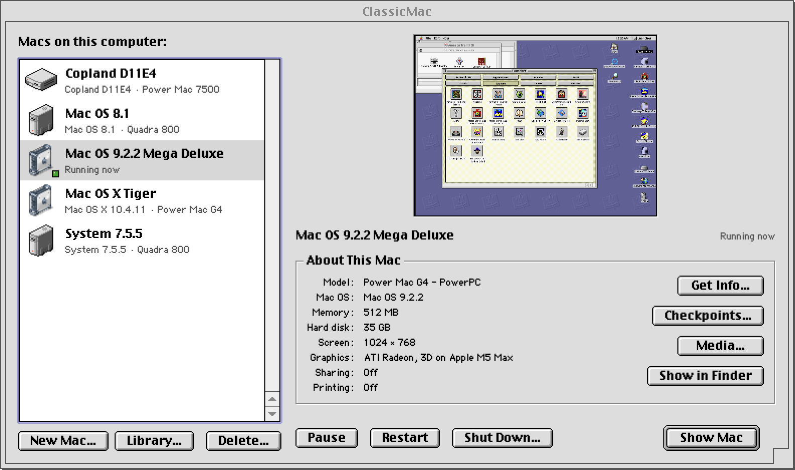
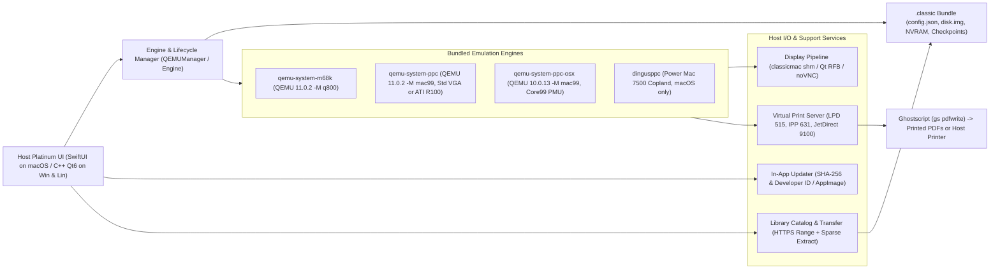
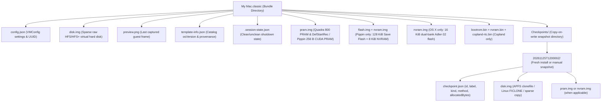
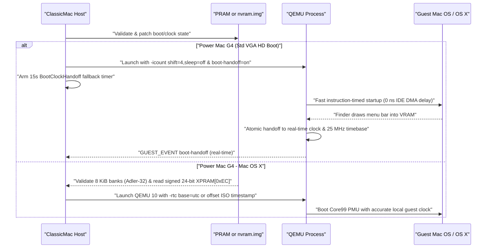

# Chapter 2: Architecture & How It Works

ClassicMac separates the **native desktop interface** from the **emulated hardware processes**. Every virtual machine is stored as a portable `.classic` folder (a Finder package on macOS) and launched as an isolated subprocess managed over local sockets, pipes, and shared memory.

  

---

## High-Level System Architecture

ClassicMac uses two native host frontends sharing the exact same Apple Platinum pixel tables, BDF/TrueType bitmap fonts, Icon Services artwork, `.classic` bundle schema, and QEMU patch stack:

- **macOS (`app/`)**: A native **Swift / SwiftUI / AppKit** application using `PlatinumKit` for pixel-exact Platinum chrome, `CDisplaySocket` for the `-display classicmac` shared-memory stream socket, and `CMachineArchive` (`sparse_tar.c`) for GNU sparse 1.0 extraction. Each machine family launches from its own helper bundle inside `ClassicMac.app/Contents/Helpers/` (`Quadra 800.app`, `Power Mac G4.app`, `Power Mac G4 for OS X.app`, and `Power Mac 7500.app`) so running Macs get dedicated Dock names and icons.
- **Windows & Linux (`native/`)**: A compiled **C++17 / Qt 6 Widgets** application (`classicmac`)—with zero Electron, Chromium, or Node runtime—communicating with `qemu-system-m68k`, `qemu-system-ppc`, and `qemu-system-ppc-osx` over `stdio` QMP pipes and an authenticated loopback RFB/VNC socket.

### IPC & the 104-Byte Unix Socket Workaround

On macOS, QEMU exposes an HMP monitor socket (`<UUID>.sock`), a QMP event socket (`<UUID>.qmp.sock`), and (when Browser Display is enabled) a private VNC socket (`<UUID>.vnc.sock`). Because macOS limits `sockaddr_un.sun_path` to **104 bytes** (including the NUL terminator), storing sockets inside long `~/Library/Application Support/ClassicMac/...` paths fails `bind()`/`connect()`.

To stay well under the 57-byte directory budget (`104 - 1 - 45 - 1`), `AppPaths.runtimeSocketDir` creates a private mode-`0700` directory verified to belong to the current UID at:
- **`/tmp/ClassicMac-<uid>`** (primary), falling back to `$TMPDIR/cm-<uid>` or `/tmp/cm-<uid>-<pid>` if needed.
- **`/tmp/ClassicMac/<UUID>.display.sock`** (`GuestDisplaySession.socketPath(for:)`) for the `-display classicmac` shared-memory display socket.

On Windows and Linux, `native/src/engine.cpp` avoids Unix socket path limits altogether by running QMP over `stdio` and binding the guest VNC display to an ephemeral port on `127.0.0.1` (`5900+`) protected by an 8-byte per-run random password.

### Display Pipelines

ClassicMac provides three display architectures tailored to the host platform and user preference:

1. **Native Platinum Window on macOS (`-display classicmac`)**:
   - Defined in `display/` and `GuestDisplaySession.swift`, QEMU connects as a stream-socket client to `/tmp/ClassicMac/<UUID>.display.sock`.
   - QEMU allocates a shared-memory framebuffer (`shm_open` unlinked immediately on macOS, `mmap(MAP_SHARED)`, `XRGB8888` format) and passes its file descriptor via `SCM_RIGHTS` inside the `SURFACE` message.
   - Dirty regions are compared in **64×16 tiles** and coalesced into `DAMAGE` rectangles. `GuestScreenNSView` renders the shared framebuffer through double-buffered hardware `IOSurface` textures updated only for accumulated `DAMAGE` rectangles, with `CALayer` (`magnificationFilter = .nearest`) synchronized to an active `CADisplayLink` that pauses automatically when occluded or covered by Full Screen. Pointer motion is coalesced and flushed over non-blocking `DispatchSourceWrite` I/O, and refresh intervals match 60–120 Hz displays for ATI Radeon while capping Standard VGA, Quadra, and Mac OS X at 60 Hz (`16 ms`).
   - From power-on until Mac OS draws its desktop, `StartupCurtain` displays a classic 50% checkerboard with a compact startup Mac so firmware black and OpenBIOS yellow never flash on screen.
2. **Native Platinum Window on Windows & Linux (`VNC` + `GuestView`)**:
   - `native/src/vnc.cpp` connects to QEMU's `127.0.0.1` RFB endpoint, authenticates with the per-session password, renders frames into a `QImage`, and paints them in `GuestView::paintEvent` with nearest-neighbor scaling snapped to whole physical pixels (`NativeDisplay::imageRect`).
3. **Optional Browser Display on macOS (`BrowserDisplayServer`)**:
   - When **Get Info → Display → Show the Mac in a web browser** is enabled, `BrowserDisplayServer` starts a loopback-only `NWListener` on `127.0.0.1` with a random port and per-run `actionToken`.
   - It serves the bundled **noVNC** client (`browser/novnc`) and proxies `/websockify?token=<actionToken>` to QEMU's private `<UUID>.vnc.sock` after validating both the HTTP `Origin` header and constant-time token match.

### Emulated ATI Radeon R100 & Virtual Print Pipelines

- **ATI Radeon 3D (`ati-vga,id=ati0,model=r100`)**: Inside `qemu-system-ppc`, Mac OS 9's stock ATI drivers (*ATI Driver Update*, *ATI Radeon 3D Accelerator*, *ATI Resource Manager*, *OpenGLRendererATI*) write to an emulated PCI Radeon (`1002:5144`, `ATY,Rage6p`). Draw commands run on a dedicated `ati-gl` host thread using OpenGL 4.1 Core (macOS CGL over Metal via `dlopen`), WGL (Windows), or EGL/GLES2 (Linux), rendering into FBOs and copying finished frames back to emulated VRAM.
- **Virtual Print Server (`PrintServer` / `Printer::Server`)**: When enabled, ClassicMac binds three loopback TCP servers—**LPD (`515`)**, **IPP (`631`)**, and **AppSocket/JetDirect (`9100`)**—and forwards guest TCP traffic destined for `10.0.2.4` via QEMU SLIRP `guestfwd` rules (`nc 127.0.0.1 <port>` on macOS, `--tcp-bridge` on Linux/Windows). PostScript jobs are converted with **Ghostscript** (`gs -q -dBATCH -dNOPAUSE -dSAFER -sDEVICE=pdfwrite`) into `Printed PDFs/` or dispatched to the host OS spooler (`lp` on macOS/Linux, `WinSpool` on Windows).

---

## Anatomy of a `.classic` Bundle

Each virtual machine lives in a self-contained `<Name>.classic` directory (`VMConfig.packageExtension = "classic"`). On macOS, Finder presents it as a single double-clickable document package; on Windows and Linux, it is a regular directory.

| File / Folder | Present On | Purpose |
| :--- | :--- | :--- |
| `config.json` | All machines | Persists `id`, `name`, `machineFamily`, `ramMB`, `diskSizeGB`, display size/depth, graphics card, media paths, input flags, sharing, and printing settings |
| `disk.img` | All disk-based Macs | Raw sparse disk image (`preallocation=off`). Directly mountable via `hdiutil` on macOS and compatible with classic Mac OS Apple Hard Disk drivers (omitted on `pippin`) |
| `flash.img` | Apple / Bandai Pippin | 128 KiB (`131,072` bytes) raw Save Flash initialized to `0xFF` (`if=pflash`), persisting Pippin Navigator settings and game saves |
| `pram.img` | Quadra 800 / Pippin | 256/512-byte parameter RAM (`pram-seed.img` on Quadra; 256 B CUDA PRAM on `if=mtd,index=1` on Pippin) |
| `nvram.img` | Power Mac G4 — OS X / Pippin | 16 KiB Core99 dual-bank flash NVRAM (`macosx-flash-seed.img`) on OS X, or 8 KiB (`8,192` bytes, `if=mtd,index=0`) on Pippin |
| `bootrom.bin`, `nvram.bin`, `copland-rtc.bin` | Copland D11E4 | Matched 4 MiB Power Mac 7500 ROM, 8,209-byte NVRAM (`DINGUSPPCNVRAM`), and persistent RTC checkpoint preventing date-rewind assertions |
| `preview.png` | All machines | Last useful screen capture saved on shutdown (`MachinePreviewQuality.isUseful` filters blank/neutral boot frames) |
| `.session-state.json` | All machines | Records `clean`, `lastExitReason`, `lastStartedAt`, `lastStoppedAt`, and `recoveryPrompted` so crashes can trigger an automatic `Pre-recovery backup` checkpoint |
| `Checkpoints/` | All machines | Subdirectories keyed by UTC timestamp (`YYYYMMDDTHHMMSSZ`), each storing `checkpoint.json`, cloned `disk.img`, and any family NVRAM/PRAM |

---

## 4.x Engineering Deep Dives

### 1. Boot Clock Handoff & Mac OS X `XPRAM[0xEC]` RTC Sync

Classic Mac OS 9 spends several seconds during hard-disk startup polling hardware and timebase timers for devices that `mac99` does not expose. For Standard-card Power Mac G4 hard-disk boots (`!bootingFromUserCD && !useVirtioDisk && graphicsCard == .standard`), ClassicMac accelerates startup and then restores real-time fidelity:

1. QEMU launches with `-icount shift=4,sleep=off` (an instruction-counted virtual clock), `-global macio-ide.dma-completion-delay-ns=0`, `-global macio-ide.pio-status-drain=on`, and `-global VGA.classicmac-boot-handoff=on`.
2. During boot, QEMU inspects guest VRAM directly to recognize Finder's menu bar (even headless or at custom resolutions).
3. As soon as Finder appears, QEMU atomically hands the virtual clock and 25 MHz PowerPC timebase back to real time and emits a `GUEST_EVENT` (`{"event":"boot-handoff","clock":"real-time",...}`). If an unusual desktop theme prevents VRAM detection, `BootClockHandoff` sends `classicmac-boot-complete` over HMP after a **15.0-second** fallback timer.
4. Installer CD boots intentionally omit `-icount` and retain `macio-ide.dma-completion-delay-ns=1000000` (1 ms) so cached host I/O cannot complete a DBDMA transfer before the Mac OS 9.2.x Installer arms its synchronous wait.

For **PowerPC Mac OS X**, XNU subtracts a signed 24-bit timezone offset stored at `XPRAM[0xEC]` from the hardware RTC. Before launch, `OSXNVRAM` (and `Model::osxRtcBase` in `native/src/machine.cpp`) validates `nvram.img` (`16,384` bytes), checks both `8,192`-byte flash banks (`0x5A` magic, generation `2`, header checksum, and Adler-32 over `20..<8192`), selects the newest valid bank, extracts `XPRAM[0xEC]` from the `"APL,MacOS75"` partition, and passes `-rtc base=YYYY-MM-DDTHH:MM:SS` (or `base=utc` if offset is `0`).

### 2. Offline Guest Printer Provisioning (`GuestPrinterProvisioner`)

On macOS, when **Printing** is enabled for a Power Mac G4 booting from its hard disk, `GuestPrinterProvisioner.ensurePrinterIfApplicable(for:)` configures Mac OS 9 automatically before QEMU starts—without touching any user-created Desktop Printers:

1. Attaches `disk.img` offline using `/usr/bin/hdiutil attach -imagekey diskimage-class=CRawDiskImage -nobrowse -plist`.
2. Checks `System Folder/Extensions/LaserWriter 8` and verifies no custom non-ClassicMac Desktop Printer already exists.
3. Moves `Desktop Printer Spooler`, `Desktop PrintMonitor`, `Desktop Printer Menu`, and the `Printer Selector` Control Strip module out of `*(Disabled)` folders if needed.
4. Builds `Desktop Folder/ClassicMac Printer/` containing a `Desktop Printer Spooler` copy and an invisible `Configuration` (`dtpc`/`dcdc`) resource fork with `PAPA -8192` targeting `10.0.2.4` (`=LPR`, queue `classicmac`) and an `alis -8192` pointing to the best matching PPD in `Printer Descriptions`.
5. Registers the Desktop Printer in `TheVolumeSettingsFolder/DesktopPrinters DB` (`alis 18772`) and updates `System` (`STR  -8192`, `alis -8192`) and `LaserWriter 8` (`PAPA -8192`), then cleanly detaches the volume.

### 3. Mac OS X Visual Apple-Menu Shutdown Detector (`OSXShutdown`)

Because PowerPC Mac OS X guests running under QEMU 10 do not respond to classic ADB power-key shutdown sequences cleanly in all states, ClassicMac's **Shut Down…** and **Restart** commands drive the guest's **Apple menu** via HMP `sendkey` while verifying every visual state transition (`OSXShutdownController` + `OSXShutdownDetector` on macOS, `Engine::performOsxShutdown` on Windows/Linux):

1. Captures a baseline RGB frame (`before`).
2. Sends `ctrl-f2` + `down` to open the Apple menu and verifies pixel changes in the top-left menu region (`detectMenuOpened`).
3. Sends `end` + `up` (once for **Shut Down**, twice for **Restart**) and verifies the menu highlight moved (`detectMenuSelectionMoved`).
4. Sends `ret` and verifies a centered confirmation modal appeared (`detectConfirmationDialog` / `modalChangeBox`, checking menu-bar title dimming and bounding box geometry).
5. Only after the confirmation dialog is visually verified does ClassicMac send the final `ret`. Unexpected screens or dialogs abort safely and prompt the user rather than pressing Return blindly.

### 4. APFS Sparse Extraction (`F_PUNCHHOLE`) & Copy-on-Write Checkpoints

Library templates are distributed as gzipped PAX/USTAR archives (including **GNU sparse 1.0** headers parsed by `CMachineArchive/sparse_tar.c`) and `retroboot-thin-1` chunks. During extraction:
- `MachineTemplateInstaller` checks `statfs` for `apfs` on macOS and tracks block allocations against `requiredStorageBytes`. Any 1 MiB chunk of zeros in `disk.img` is punched with `fcntl(fd, F_PUNCHHOLE, ...)` instead of allocating zero blocks on disk.
- On Windows, `Model::makeSparse` marks `disk.img` as an NTFS sparse file (`FSCTL_SET_SPARSE`); on Linux, `sparse_tar.c` seeks across sparse extents.
- **Checkpoints** (`VMCheckpointStore.swift` / `native/src/checkpoint.cpp`) use `Darwin.clonefile` on macOS APFS, `ioctl(FICLONE)` (falling back to `cp --reflink=auto --sparse=always`) on Linux, and sparse chunk copies on Windows—so creating a **Fresh install**, manual, **Pre-restore backup**, or **Pre-recovery backup** checkpoint takes milliseconds and zero extra disk blocks until sectors diverge.

---

## Next Steps

- Walk through installing ClassicMac, completing the 4-step Welcome Wizard, and using the Platinum Home window in [Chapter 3: Installation & First Run](03-installation-and-first-run.md).
- Explore all downloadable editions in [Chapter 4: Mac OS Library & Downloadable Editions](04-mac-os-library-and-editions.md).
