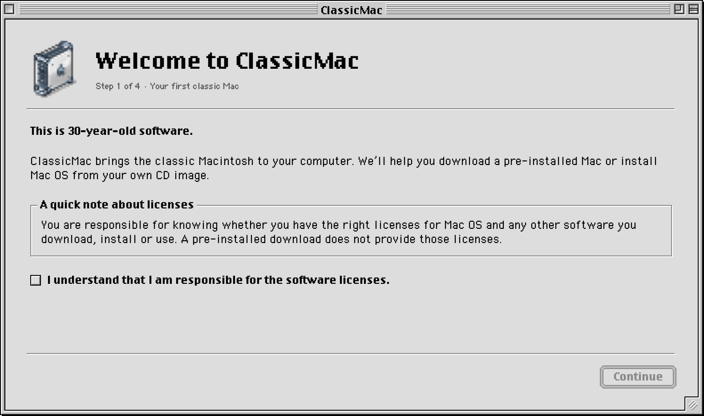
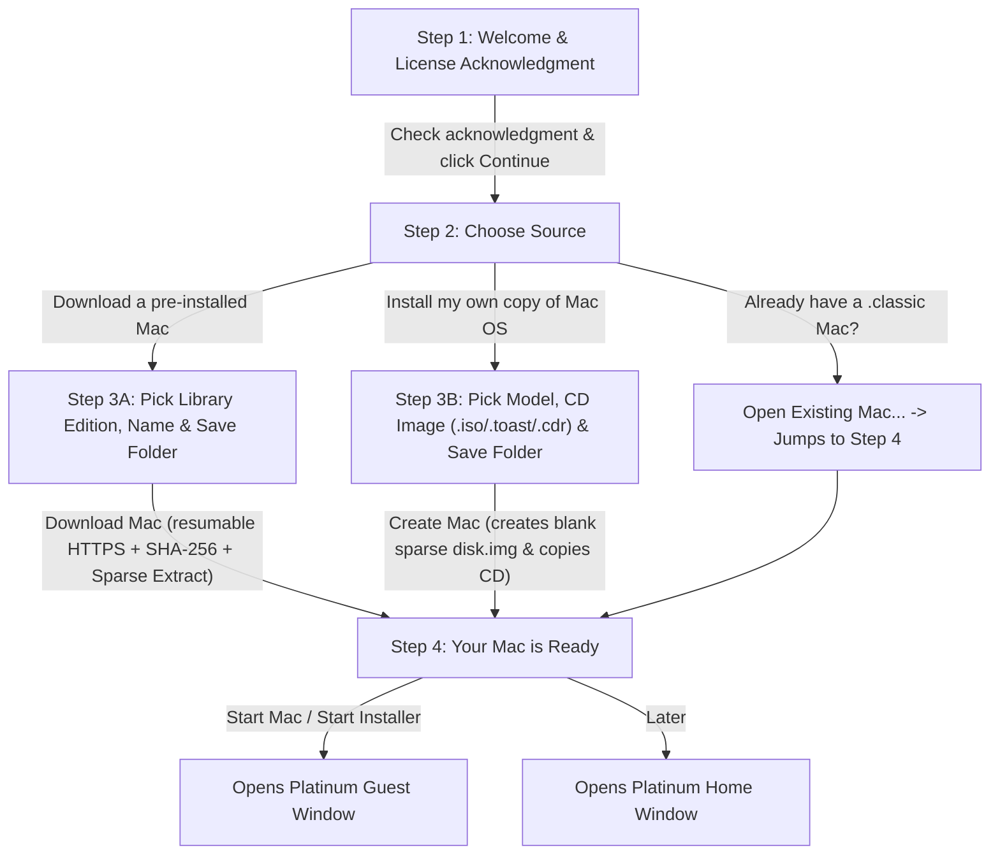
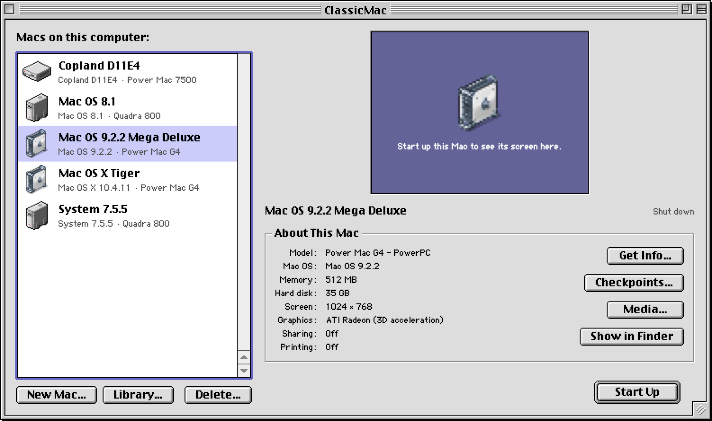
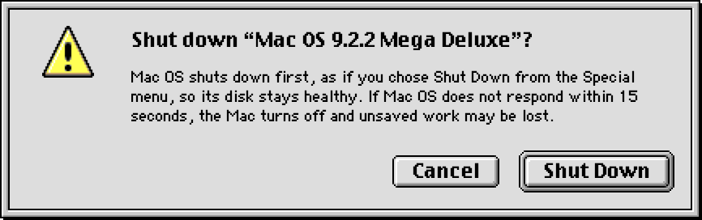

# Chapter 3: Installation & First Run

ClassicMac installs as a single self-contained bundle or executable on **macOS**, **Windows**, and **Linux**. On your first launch, a guided four-step Platinum wizard helps you either download a ready-to-run Macintosh from the Library or configure a new machine from your own installation disc.

---

## Installing ClassicMac

### macOS (Apple Silicon, macOS 15+)

1. Download **`ClassicMac-5.1.0.dmg`** (or `ClassicMac-5.1.0.zip`) from the [ClassicMac Releases](https://github.com/amcchord/ClassicMac/releases/latest) page.
2. Open the disk image and drag **ClassicMac.app** into your **Applications** folder.
3. Launch **ClassicMac**. Official releases are **Developer ID signed, notarized, and stapled**, so Gatekeeper verifies the app offline without warnings.

### Windows (Windows 11 x64)

1. Download **`ClassicMac-5.1.0-windows-x64.exe`**.
2. Double-click the executable to launch ClassicMac directly—no separate installer or system-wide setup is required.
   - The portable executable caches its extracted runtime inside `%LOCALAPPDATA%` and waits for the native Qt6 app to exit.
   - To inspect or replace dynamic libraries (such as Qt6 or OpenSSL DLLs), pass `--extract="C:\path\to\folder"` from a terminal and run `classicmac.exe` from that directory.
3. Because the Windows binary is **unsigned**, Windows SmartScreen may prompt you on first launch; choose **More info → Run anyway** after verifying the release SHA-256 checksum.

### Linux (x86-64, `glibc 2.39+`)

1. Download **`ClassicMac-5.1.0-linux-x64.AppImage`**.
2. Mark the AppImage executable and launch it:

```bash
chmod +x ClassicMac-5.1.0-linux-x64.AppImage
./ClassicMac-5.1.0-linux-x64.AppImage
```

- If FUSE is unavailable on your distribution or container, run `./ClassicMac-5.1.0-linux-x64.AppImage --appimage-extract-and-run` (or `--appimage-extract` and run `squashfs-root/AppRun`).

### Building from Source

#### macOS (SwiftUI + QEMU + DingusPPC)
Requires Xcode Command Line Tools and Homebrew (`dylibbundler` and build tools):

```bash
./scripts/build-qemu.sh         # QEMU 11.0.2 (qemu-system-m68k, qemu-system-ppc, qemu-img)
./scripts/build-osx-qemu.sh     # QEMU 10.0.13 (PowerPC Mac OS X Tiger engine)
./scripts/build-g5-qemu.sh      # QEMU 11.1.50 (Power Mac G5 qemu-system-ppc64 engine)
./scripts/build-copland.sh      # DingusPPC (Copland D11E4 engine)
./scripts/build-guest-cd.sh     # ClassicMacTools.iso guest additions
./scripts/bundle-qemu.sh        # Builds app/ via SwiftPM & assembles dist/ClassicMac.app
```

#### Windows & Linux (C++17 / Qt 6 Native Frontend)
Requires CMake 3.21+, Ninja, Qt 6.4+ (`Widgets`, `Network`, `Concurrent`), OpenSSL `Crypto`, and `zlib`:

```bash
# Build QEMU engines first:
#   Windows (MSYS2 UCRT64): ./desktop/scripts/build-engine.sh
#   Linux:                  ./desktop/scripts/build-linux.sh

cmake -S native -B output/native-build -G Ninja -DCMAKE_BUILD_TYPE=Release
cmake --build output/native-build

# Package portable distribution (NSIS on Windows, appimagetool on Linux):
python3 native/scripts/package-windows.py output/native-build   # Windows
python3 native/scripts/package-linux.py output/native-build     # Linux
```

---

## First-Run Welcome Wizard

When ClassicMac launches with an empty Library, the main window displays the four-step **Welcome to ClassicMac** wizard (`FirstMacSetupView`).

<p align="center">
  
</p>



1. **Step 1 — Welcome to ClassicMac**: Review the notice reminding you that classic Mac OS is 30-year-old software and that you are responsible for having appropriate software licenses. Check **I understand that I am responsible for the software licenses** and click **Continue**.
2. **Step 2 — How would you like to start?**:
   - **Download a pre-installed Mac — easiest**: Fetches a ready-to-run edition from the Mac OS Library with no OS installation required.
   - **Install my own copy of Mac OS**: Creates a blank sparse disk and attaches your `.iso`, `.toast`, or `.cdr` installation CD image.
   - **Open Existing Mac…**: Imports an existing `.classic` bundle you already have on disk.
3. **Step 3 — Choose your first Mac / Bring your own Mac OS**:
   - For downloads, pick an edition from the pop-up menu (for example, *Mac OS 9.2.2 Mega Deluxe*, *Mac OS 9.2.1*, *System 7.5.5*, or *Mac OS X 10.4.11*), review the download size and required free space, set a **Mac name**, and optionally change the **Save in** folder. Downloads can be paused and resumed at any time.
   - For your own CD, pick the hardware model (**Power Mac G4 — Mac OS 8.5 to 9.2.2**, **Power Mac G4 — Mac OS X**, or **Quadra 800 — System 7.1 to Mac OS 8.1**), choose your CD image, and click **Create Mac**.
4. **Step 4 — Ready**: Click **Start Mac** (or **Start Installer** when booting from an install CD) to open the machine immediately, or **Later** to go to the Home window. If you are installing from your own CD, the Ready view summarizes the exact steps for **Drive Setup** / **Disk Utility** and **Installer**.

---

## Tour of the Platinum Home Window

Once at least one Mac exists in your Library, ClassicMac opens the Platinum **Home** window (`HomeView`).

<p align="center">
  
</p>

### 1. Sidebar (`Macs on this computer:`)

- Displays every registered `.classic` machine with its Iconfactory / Platinum model icon (Quadra 800, Power Mac G4, or Power Mac 7500) and a subtitle showing its OS version and machine family.
- **Status LED**: When a machine is active, a tiny Platinum indicator dot appears on its icon—**green** (`Running now`), **amber** (`Paused`, or `Stopped at an assertion` for Copland).
- **Double-click** any row (or right-click for the context menu) to start a shut-down Mac or bring a running Mac's window forward.
- **Bottom sidebar buttons**:
  - **New Mac…** (`⌘N` on macOS): Opens the custom VM creation dialog for your own install CDs.
  - **Library…** (`⇧⌘L` on macOS): Opens the Mac OS Library catalog window to browse and download ready-to-run Macs.
  - **Delete…** (`⌘⌫` on macOS): Removes the selected Mac from the list or moves its `.classic` folder (showing exact on-disk size) to the Trash / Recycle Bin, optionally shutting down or force-stopping a running Mac first. On Windows and Linux, **Open Mac…** also sits in the Home toolbar (and under **File → Open Mac…** on macOS).

### 2. Selected Mac Panel (`ScreenPreview` & `About This Mac`)

- **ScreenPreview**: Shows the machine's live screen while running (updating periodically) or its saved `preview.png` when shut down. Before a machine's first boot, it shows the machine icon on classic desktop blue. Clicking a running preview activates the guest window (or opens its Browser Display URL).
- **Status & Title**: Shows the Mac's name on the left and its state on the right (`Shut down`, `Running now`, `Paused`, or `Stopped at an assertion`).
- **About This Mac**: Summarizes **Model**, **Mac OS**, **Memory**, **Hard disk**, **Screen**, **Graphics** (on Power Mac G4, including the live host GPU renderer string when ATI 3D is active), **Sharing**, and **Printing**.
- **Action stack** (to the right of About This Mac):
  - **Get Info…** (`⌘I`): Opens General Information, Display, Sharing, and Printing settings.
  - **Checkpoints…**: Opens the instant copy-on-write snapshot manager.
  - **Media…** (`⇧⌘E`): Attaches or ejects CDs, Quadra floppies, ClassicMac Tools, and shared folders.
  - **Show in Finder** (or folder reveal): Highlights the `.classic` bundle on disk.
- **Lifecycle buttons** (bottom right):
  - When shut down: **Start Up** (`⌘R`).
  - When running: **Pause** / **Resume**, **Restart** (`⇧⌘R`), **Shut Down…**, and **Show Mac** (or **Open in Browser**).

### 3. Platinum Window Chrome, WindowShade & Safe Shutdown

Every ClassicMac window—Home, Library, Settings, and each running Mac's screen—uses authentic Mac OS 8/9 Platinum title-bar widgets:

- **Close box** (top left): On a running guest window, clicking the close box never kills the emulator mid-write; it opens the **Shut down** confirmation alert so Mac OS or Mac OS X can flush its filesystem cleanly.
- **Zoom box** (top right, inner): Expands the guest window to the largest clean whole-number scale that fits your screen (or fills the screen on live-resizing Standard/ATI Power Macs).
- **WindowShade collapse box** (top right, outer, or `⌥⌘M` on macOS): Rolls the window up into its pinstriped title bar so you can keep a Mac visible on your desktop without taking up screen space.

<p align="center">
  
</p>

When you choose **Shut Down…**, ClassicMac sends the ADB Power key + Return on classic Mac OS (with a 15-second safety timeout) or visually drives the Apple menu on PowerPC Mac OS X so HFS/HFS+ and Journaled HFS+ volumes unmount cleanly without triggering slow startup disk checks.

<p align="center">
  
</p>

---

## Bundle Storage Locations & Backups

ClassicMac separates **application index/cache data** from your **`.classic` machine bundles** so your Macs remain portable and survive app updates or portable executable upgrades.

| Host OS | Default `.classic` Machine Location | Application Index & Preferences | Notes |
| :--- | :--- | :--- | :--- |
| **macOS** | `~/Documents/ClassicMac/` | `~/Library/Application Support/ClassicMac/` (`library.json`, `Media/`) | `Printed PDFs/` defaults to your shared folder (if enabled) or `~/Documents/ClassicMac/Printed PDFs/` |
| **Windows** | `%USERPROFILE%\Documents\ClassicMac\` | `%APPDATA%\classicmac-desktop\` (`library.json`) | Portable EXE stores nothing inside the executable; machines persist across updates |
| **Linux** | `~/Documents/ClassicMac/` | `~/.config/classicmac-desktop/` (`$XDG_CONFIG_HOME/classicmac-desktop/library.json`) | AppImage stores all VMs and preferences outside the AppImage file |

### Moving or Backing Up a `.classic` Bundle

1. **Shut down cleanly first**: Always shut down the guest Mac inside ClassicMac before copying, zipping, or moving its `.classic` folder so `.session-state.json` is clean and all disk/PRAM/NVRAM writes are flushed.
2. **Keep the whole `.classic` directory intact**: Copy the entire `.classic` folder (`config.json`, `disk.img`, `pram.img` or `nvram.img`, `copland-rtc.bin` for Copland, and `Checkpoints/`).
3. **Preserve sparseness when copying**: On macOS Finder (`APFS`) or Linux (`cp --sparse=always` / `tar -S`), copying preserves sparse holes; if you move a bundle to an external non-sparse drive (such as exFAT), `disk.img` will expand to its full logical size (e.g., 32 GB).
4. **Open on another machine or OS**: `.classic` bundles created on macOS, Windows, and Linux use the same `config.json` and raw `disk.img` format (with automatic `depth` normalization between `24` and `32` and automatic sanitization of unsupported host features such as Windows folder sharing or Copland). Double-click the `.classic` package on macOS or choose **Open Mac…** on any desktop platform to register it in your Library.

---

## Next Steps

- Download ready-to-run classic Mac OS, Mac OS X Tiger, and Copland machines in [Chapter 4: Mac OS Library & Downloadable Editions](04-mac-os-library-and-editions.md).
- Create a blank VM and install from your own discs in [Chapter 5: Creating Custom Macs & Manual OS Installation](05-installing-your-own-mac-os.md).
- Learn all keyboard, mouse, and WindowShade controls in [Chapter 6: Everyday Use, Controls & Input](06-everyday-use-and-input.md).
