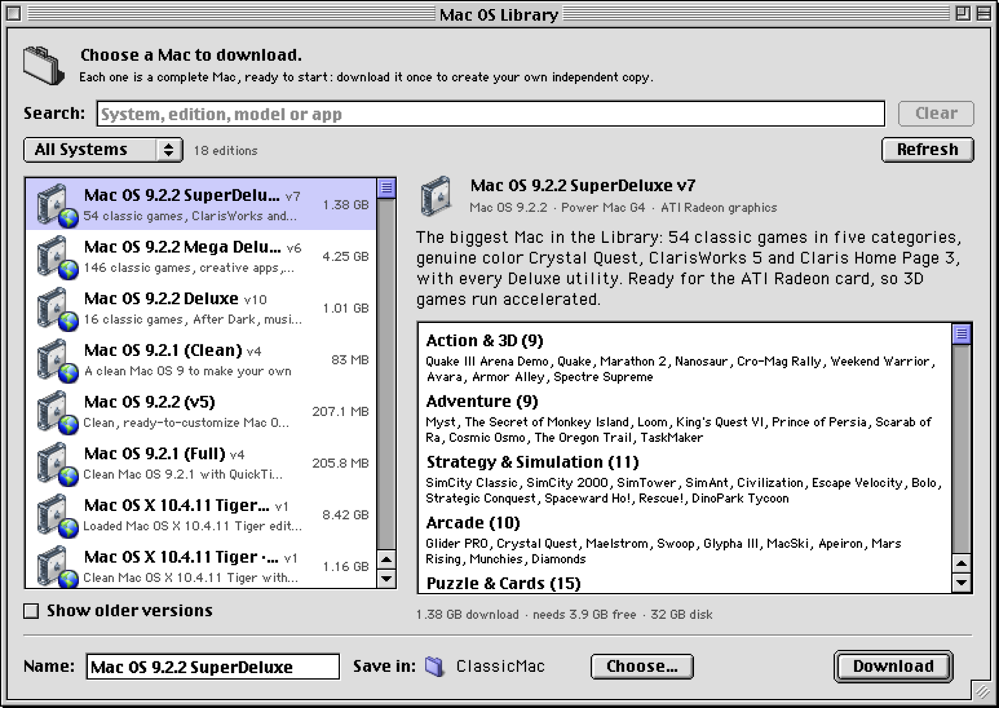
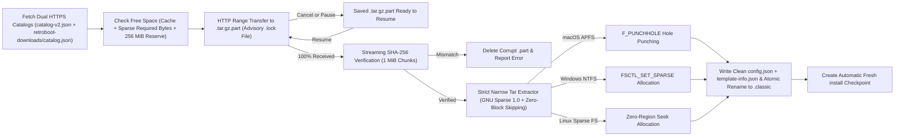
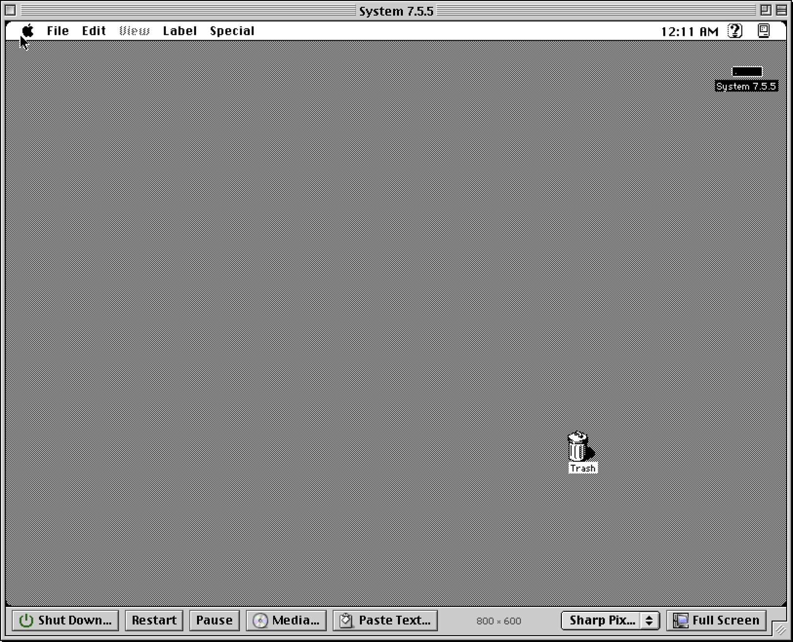
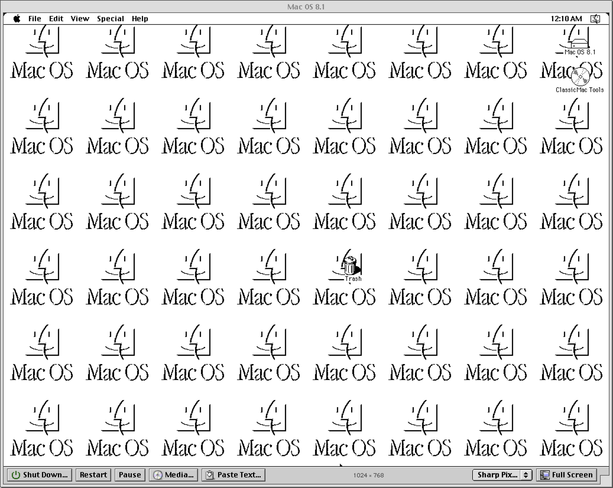
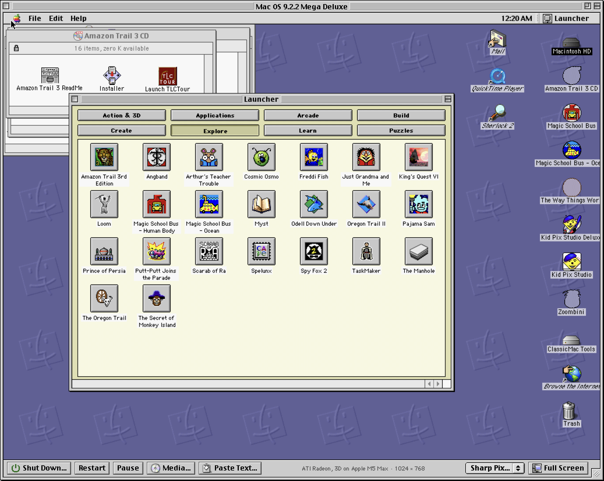
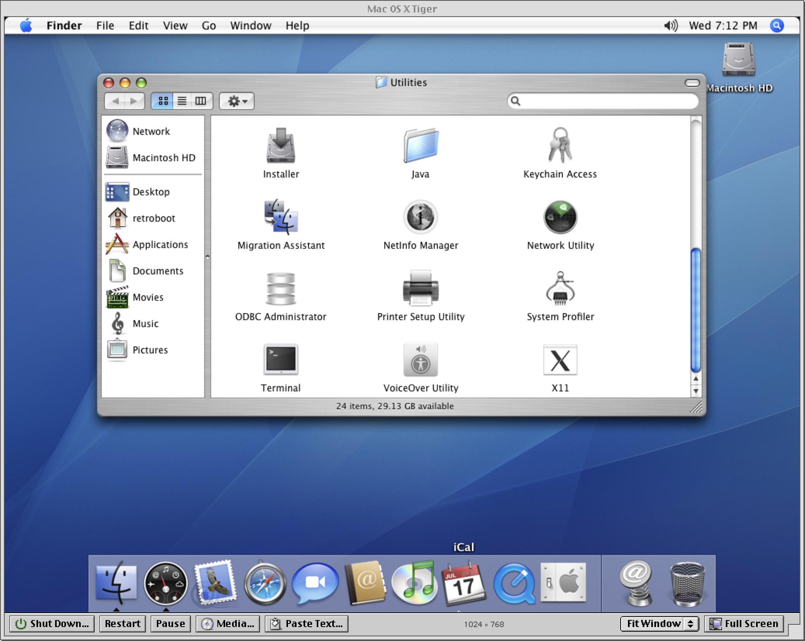
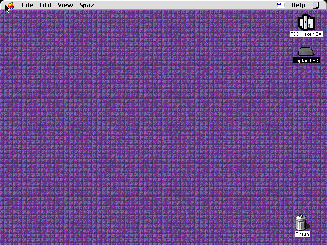
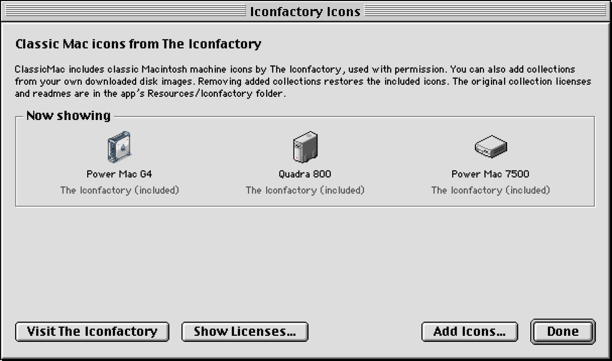

# Chapter 4: Mac OS Library & Downloadable Editions

The **Mac OS Library** gives you one-click access to pre-installed, ready-to-boot Macintosh systems—from mid-1990s 68k System 7.5.5 and Mac OS 8.1 machines up through 3D-accelerated Mac OS 9.2.2 collections, PowerPC Mac OS X, and the experimental Copland D11E4 developer preview. Every edition downloads over HTTPS, verifies its cryptographic checksum, extracts into a sparse `.classic` bundle, and automatically captures a `Fresh install` checkpoint so you can experiment freely.

  

---

## How the Mac OS Library Works

### Dual HTTPS Catalogs

When you open **Mac OS Library…** (`Command-Shift-L` on macOS, or **Library…** from the Home window), ClassicMac fetches two `schemaVersion: 1` JSON catalogs over HTTPS:

| Catalog | URL | Role |
| :--- | :--- | :--- |
| **ClassicMac Core Catalog** | `https://mcchord.net/classicmac/catalog-v2.json` | Core clean templates (`System 7.5.5`, `Mac OS 8.1`, `Mac OS 8.6 Base`, `Mac OS 9.2.1`), `Mac OS 9.2.2 Deluxe` / `SuperDeluxe`, and `Copland D11E4 Activities` |
| **RetroBoot Downloads Catalog** | `https://mcchord.net/retroboot-downloads/catalog.json` | RetroBoot-curated editions (`Deluxe v2` 68k builds, `Mac OS 9.2.1` / `9.2.2` Full, `Mega Deluxe`, and `Mac OS X` Jaguar / Panther / Tiger editions) |

ClassicMac enforces a strict `1 MiB` (`1,048,576` bytes) cap per catalog, deduplicates entries by `id`, and warns you with a banner if one catalog is temporarily unreachable while still displaying editions from the other. Whenever a catalog entry includes a `thinArchive` object (`format: "retroboot-thin-1"`), ClassicMac automatically selects the smaller sparse-friendly thin archive instead of the legacy full-disk archive.

### Searching, Filtering & Version Visibility

- **OS Category Filter:** Narrow the list using the category menu: **All Systems**, **System 7**, **Mac OS 8**, **Mac OS 9**, **Mac OS X**, or **Copland**.
- **Search Bar:** Filter live by OS version, edition title, machine model (`Quadra 800`, `Power Mac G4`), tagline/summary, tags, highlights, or bundled apps and games (for example, searching `"Quake"` or `"ClarisWorks"`).
- **Latest Revisions First:** Older `-vN` revisions of the same edition family are hidden by default so you see only the newest release of each Mac. On macOS, check **Show older versions** beneath the list if you specifically need an earlier revision.
- **Name & Destination:** Before clicking **Download**, you can edit the **Name:** field (up to 100 characters) and pick any **Save in:** folder (defaulting to `~/Documents/ClassicMac` on macOS/Linux or `%USERPROFILE%\Documents\ClassicMac` on Windows).

---

## Resumable Downloads, SHA-256 Verification & Sparse Extraction

Large editions such as **Mac OS 9.2.2 Mega Deluxe** (`~4.06 GiB`) or **Mac OS X 10.4.11 Tiger Deluxe** (`~8.03 GiB`) are protected by a multi-stage transfer and extraction pipeline designed for reliability and minimal disk usage.

### Partial Resume (`.tar.gz.part`) & Concurrency Lock

1. **Download Cache:** Archives stream into `<sha256>.tar.gz.part` inside ClassicMac's Downloads cache (`~/Library/Application Support/ClassicMac/Downloads/` on macOS, or the platform Qt cache directory on Windows/Linux). An advisory lock file (`<sha256>.lock` via `flock` / `LockFileEx`) prevents two windows from writing the same partial file simultaneously.
2. **Pause & Resume:** Clicking **Stop** / **Pause Download** keeps the `.tar.gz.part` file intact and switches the edition's button to **Resume** (or **Create Mac** once 100% downloaded). On resume, ClassicMac sends `Accept-Encoding: identity` and `Range: bytes=<offset>-`, verifying an `HTTP 206` status and an exact `Content-Range` header before appending. If a server ignores `Range` and replies with `HTTP 200`, ClassicMac restarts cleanly from byte `0`.
3. **Discard:** If you want to reclaim cache space before finishing a paused download, select the edition and click **Discard** (or **Discard Download**).

### Cryptographic Verification & Narrow Tar Security

Once the archive reaches `archiveBytes`, ClassicMac hashes the entire `.tar.gz.part` file in `1 MiB` chunks and compares the digest against the catalog's `sha256`. If verification fails, the corrupt cache file is deleted automatically so the next attempt downloads cleanly.

ClassicMac's archive extractor does not invoke shell `tar` and refuses path traversal, symlinks, device nodes, and unrecognized files:
- Only flat regular files are permitted: `config.json`, `disk.img`, `preview.png`, plus family-specific firmware (`Quadra800.rom` and `pram.img` for Quadra 800; `nvram.img` for Mac OS X; `bootrom.bin` and `nvram.bin` for Copland).
- Extracted `Quadra800.rom` and Copland `bootrom.bin`/`nvram.bin` files undergo additional SHA-256 and header validation.
- Template `config.json` files are rebuilt from supported hardware fields and `recommendedSettings` (for example, clamping `osx_ram_mb` to half or less of host physical memory where required), then atomically published as `<Name>.classic`.

### How a 32 GB Virtual Disk Uses Only Actual Used Blocks

Every catalog entry declares both its logical `diskCapacityBytes` (for example, `2 GB` for 68k systems or `32 GB` for Power Mac G4 / Tiger) and its `requiredStorageBytes` on sparse-capable filesystems. ClassicMac supports **GNU sparse 1.0 PAX** extents (`cm_sparse_read_map` in `sparse_tar.c`) as well as scanning `1 MiB` chunks for all-zero blocks:

| Host Filesystem | Sparse Mechanism | Free-Space Budget Checked |
| :--- | :--- | :--- |
| **macOS (APFS)** | `fcntl(fd, F_PUNCHHOLE, ...)` releases zero extents and inter-extent preallocations | `requiredStorageBytes` + `256 MiB` reserve (+ remaining download if same volume) |
| **Windows (NTFS / ReFS)** | `DeviceIoControl(..., FSCTL_SET_SPARSE, ...)` + seeking past zero blocks | `requiredStorageBytes` + `256 MiB` reserve |
| **Linux (ext4, Btrfs, XFS, etc.)** | File seek past zero extents (disabled on `msdos`/`vfat` and `exfat`) | `requiredStorageBytes` + `256 MiB` reserve |
| **Non-sparse volumes (e.g., exFAT / FAT32 / HFS+)** | Full logical write | Full `installedBytes` + `256 MiB` reserve |

As a result, a clean **Mac OS 9.2.1** download with a `32 GB` logical startup disk occupies roughly `120 MiB` on APFS, growing only as you install software inside the guest Mac. Immediately upon installation, ClassicMac removes the cached `.tar.gz.part` and creates a **Fresh install** checkpoint (using instant copy-on-write cloning where supported; see [Chapter 11](11-checkpoints-updates-and-troubleshooting.md)).

---

## Complete Guide to Available Editions

The sections below list the downloadable editions served by ClassicMac 4.10.0's dual catalogs, grouped by OS category. Download sizes reflect the active `thinArchive` when provided.

### System 7 (Quadra 800 · Motorola 68040)

System 7 editions emulate a **Macintosh Quadra 800** (`68040` CPU, `2 GB` HFS disk, Ethernet networking with DHCP, and `128 MB` RAM).

  

| Edition | Catalog ID | Download | Free Space Needed (Sparse) | What's Inside |
| :--- | :--- | :--- | :--- | :--- |
| **System 7.5.5 (Clean)** | `system-7.5.5-base-v1` | ~19.6 MiB | ~64 MiB + reserve | Clean System 7.5.5 with StuffIt Expander 5.5, Transmit 1.2, and Netscape Navigator 3.04 on a 2 GB disk. |
| **System 7.5.5 (RetroBoot)** | `mac-os-7.5.5-v1` | ~16.6 MiB | ~47 MiB + reserve | Fast-booting clean System 7.5.5 on a 2 GB disk with Ethernet & DHCP preconfigured. |
| **Mac OS 7.5.5 Deluxe v2** | `mac-os-7-5-5-deluxe-v2` | ~156.0 MiB | ~349 MiB + reserve | 23 classic 1990s 68k games, ClarisWorks 5, After Dark screensavers, retro web browsers, and utilities. |

### Mac OS 8 (Quadra 800 & Power Mac G4)

Mac OS 8.1 runs on the 68040 **Quadra 800** (introducing HFS+ support and the classic Platinum desktop look), while Mac OS 8.6 runs on the PowerPC **Power Mac G4** (`mac99`) with G3 CPU compatibility.

  

| Edition | Model | Catalog ID | Download | Free Space Needed (Sparse) | What's Inside |
| :--- | :--- | :--- | :--- | :--- | :--- |
| **Mac OS 8.1 (Clean)** | Quadra 800 | `mac-os-8.1-base-v1` | ~34.7 MiB | ~125 MiB + reserve | Clean Mac OS 8.1 with StuffIt Expander 5.5, Transmit 1.2, and Netscape Navigator 3.04 on a 2 GB disk. |
| **Mac OS 8.1 (Full)** | Quadra 800 | `mac-os-8.1-v1` | ~58.0 MiB | ~195 MiB + reserve | Clean Mac OS 8.1 with Platinum desktop, Ethernet & DHCP, Java, OpenDoc, and MacLink Plus on a 2 GB HFS disk. |
| **Mac OS 8.1 Deluxe v2** | Quadra 800 | `mac-os-8-1-deluxe-v2` | ~209.6 MiB | ~657 MiB + reserve | 23 classic Mac games (with automatic color mode switching from Thousands of colors), ClarisWorks 5, After Dark, and retro browsers. |
| **Mac OS 8.6 Base** | Power Mac G4 (G3 mode) | `mac-os-8.6-base-v1` | ~54.1 MiB | ~183 MiB + reserve | Clean Mac OS 8.6 with StuffIt Expander 5.5, Transmit 1.2, and Netscape Communicator 4.5 on a 2 GB disk. |

### Mac OS 9 (Power Mac G4 · PowerPC)

All Mac OS 9 editions use a `32 GB` sparse virtual disk on the **Power Mac G4** (`mac99`). Editions marked **ATI Radeon** arrive preconfigured with Apple's ATI Radeon 3D drivers (for accelerated QuickDraw 3D RAVE and OpenGL games) and **RetroBoot Display** for live window resizing up to `1920 × 1440`.

  

| Edition | Graphics | Catalog ID | Download | Free Space Needed (Sparse) | Highlights & Bundled Software |
| :--- | :--- | :--- | :--- | :--- | :--- |
| **Mac OS 9.2.1 (Clean)** | ATI Radeon | `mac-os-9.2.1-ati-32gb-v4` | ~79.1 MiB | ~120 MiB + reserve | Fresh Mac OS 9.2.1 with Apple's ATI drivers on a 32 GB sparse disk—ideal as a blank slate for your own software. |
| **Mac OS 9.2.1 (Full)** | Standard | `os921-full-v4` | ~196.3 MiB | ~498 MiB + reserve | Clean Mac OS 9.2.1 with QuickTime 5, AirPort 2.0.4 wireless & USB support, StuffIt, and classic internet browsers. |
| **Mac OS 9.2.2** | ATI Radeon | `os922-full-v5` | ~197.5 MiB | ~509 MiB + reserve | Clean Mac OS 9.2.2 with QuickTime 6, AirPort, Classilla & iCab browsers, Acrobat 5, ATI 3D acceleration, and RetroBoot Display. |
| **Mac OS 9.2.2 Deluxe** | ATI Radeon | `os922-deluxe-v10` | ~967.4 MiB | ~1.58 GiB + reserve | 16 classic games (including *Quake*, *Quake III Arena Demo*, *Marathon 2*, *Myst*, *SimCity 2000*, *Escape Velocity*, *Glider PRO*, *Crystal Quest*), **ACTION GoMac** (2s bar delay), **After Dark 4.94** (*Flying Toasters*), **Audion 3** (with faces, visualizers & Groove Salad preset), **SoundJam MP**, **Transmit**, **Speedometer 4.02**, **MacBench 5.0**, **Gauge PRO**, **USB Overdrive**, **IE 5.1.7**, sample QuickTime movies, and on-demand *Myst* disc mounting. |
| **Mac OS 9.2.2 SuperDeluxe** | ATI Radeon | `os922-superdeluxe-v7` | ~1.32 GiB | ~2.15 GiB + reserve | 59 classic games (including *Harry the Handsome Executive*, *Mighty Mike*, *Bub & Bob*, *Wolfenstein 3D*, *Angband*, *Nanosaur*, *Cro-Mag Rally*, *King's Quest VI*, *Civilization*, *SimTower*), **ClarisWorks 5.0**, **Claris Home Page 3**, **SoundEdit 16 2.0.7**, complete **After Dark** collection, **Audion 3**, **ACTION GoMac**, and classic utilities. |
| **Mac OS 9.2.2 Mega Deluxe** | ATI Radeon | `os922-mega-deluxe-v6` | ~4.06 GiB | ~6.53 GiB + reserve | 146 classic games, creative apps, and utilities organized across 8 tabs in a 4-row **Launcher**, **ACTION Menus**, and **ACTION GoMac**—highlighted by *Kid Pix Studio Deluxe*, *Logical Journey of the Zoombinis*, *The Oregon Trail*, *SimCity*, and *ClarisWorks*, with on-demand Virtual CDs so the Desktop boots clean. |

> [!TIP]
> In **Deluxe**, **SuperDeluxe**, and **Mega Deluxe**, a few older 2D games require 256 colors. Deluxe/SuperDeluxe game launchers switch color depth automatically when needed; in Deluxe, switch **Monitors** to 256 colors before launching *Prince of Persia*. Original shareware and demo limits in included classic titles remain intact.

### Mac OS X (Power Mac G4 · QEMU 10 Engine)

PowerPC Mac OS X editions run on ClassicMac's dedicated **QEMU 10.0.13** `mac99,via=pmu` profile with OpenBIOS, persistent `16 KiB` Core99 flash (`nvram.img`), Screamer audio, Sungem Ethernet, and `-vga std` widescreen display support.

  

| Edition | Catalog ID | Download | Disk | Recommended RAM | What's Inside |
| :--- | :--- | :--- | :--- | :--- | :--- |
| **Mac OS X 10.2.8 Jaguar · Period Edition** | `mac-os-x-10-2-8-jaguar-period-v1` | ~535.6 MiB | 16 GB | 1024 MB (default) | Early Aqua 10.2.8 with Camino 0.7, VLC 0.6.2, BBEdit Lite 6.1.2, GLtron 0.70, and OnyX 1.3.1. |
| **Mac OS X 10.3.9 Panther · Period Edition** | `mac-os-x-10-3-9-panther-period-v1` | ~1.22 GiB | 16 GB | 1024 MB | Brushed-metal 10.3.9 Panther with Exposé, Camino 0.8.4, Smultron 1.1, VLC 0.7.2, Fugu 1.1.3, Maelstrom 3.0.6, and GLtron 0.70. |
| **Mac OS X 10.4.11 Tiger · Period Edition** | `mac-os-x-10-4-11-tiger-period-v1` | ~1.10 GiB | 32 GB | 1024 MB | Clean 10.4.11 Tiger with Spotlight, Dashboard, Camino 1.0, Audacity 1.2.6a, Smultron 1.2.5, VLC 0.8.4a, and GLtron 0.70. |
| **Mac OS X 10.4.11 Tiger Deluxe** | `mac-os-x-10-4-11-tiger-deluxe-v1` | ~8.03 GiB | 32 GB | 2048 MB (auto-capped to host RAM) | Loaded 10.4.11 Tiger with **iLife ’06**, **Quake III Arena**, period PowerPC games, creative tools, and screensavers. |

> [!IMPORTANT]
> Always shut down Mac OS X cleanly from the **Apple menu → Shut Down** inside the guest OS so its Mac OS Extended (Journaled) filesystem stays healthy.

### Copland D11E4 (macOS Only · Power Mac 7500)

**Copland D11E4** (`copland-d11e4-activities-v3`, ~35.5 MiB download, `512 MB` / `0.5 GiB` disk) boots Apple's unfinished 1996 Mac OS 8 rewrite on ClassicMac's dedicated DingusPPC **Power Mac 7500** (`PowerPC 601`, `32 MB` RAM, `640 × 480` at 256 colors) helper.

  

- **Included software:** Anarcho text editing, MineSweeper, Solitaire, GXSlidemaster, QuickDraw GX graphics demos, experiment guides, and a notebook (alongside System 7.5.3 on disk for Copland virtual memory).
- **Platform & feature notes:** Available on **ClassicMac for macOS** only (marked **macOS only** on Windows/Linux). Sound, networking, shared folders, removable media, ATI acceleration, Paste Text, and Browser Display are unavailable. If a Finder action hits an Apple developer assertion, ClassicMac displays **Continue Copland** in the Home window; use **Spaz → Shut Down** inside Copland for a graceful shutdown.

---

## Personalizing Mac Icons with The Iconfactory Packs

On macOS, ClassicMac includes classic Macintosh hardware artwork by **The Iconfactory**, used with permission, to draw the **Quadra 800**, **Power Mac G4**, and **Power Mac 7500** icons across the Home window, Library, and dialogs.

  

Open **ClassicMac → Iconfactory Icons…** from the menu bar to inspect or customize icons:
- **Included artwork:** ClassicMac ships `.icns` assets extracted from Iconfactory collections (`G4 Side List View`, `800/8000 series`, and `7200+series/G3 Desktop`) inside the app's `Resources/Iconfactory` folder. Click **Show Licenses…** to open that folder in Finder and read the original collection readmes and licenses.
- **Add custom collections:** Click **Visit The Iconfactory** to download classic icon sets, then click **Add Icons…** and select the downloaded `.dmg` disk images or folders. ClassicMac mounts `.dmg` images read-only, preserves classic Macintosh resource forks using `ditto --rsrc --extattr` into `~/Library/Application Support/ClassicMac/Icons/`, decodes the `icns` resources (`il32`/`l8mk`, `is32`/`s8mk`, `icl8`/`icl4`/`ICN#`) from each folder's `Icon\r` file, and updates the icons live.
- **Restore defaults:** Click **Remove Added** to delete imported collections from Application Support and revert immediately to the bundled Iconfactory icons.

---

**Next:** [Chapter 5: Creating Custom Macs & Manual OS Installation](05-installing-your-own-mac-os.md) · **Previous:** [Chapter 3: Installation & First Run](03-installation-and-first-run.md) · **Contents:** [Manual Home](README.md)
