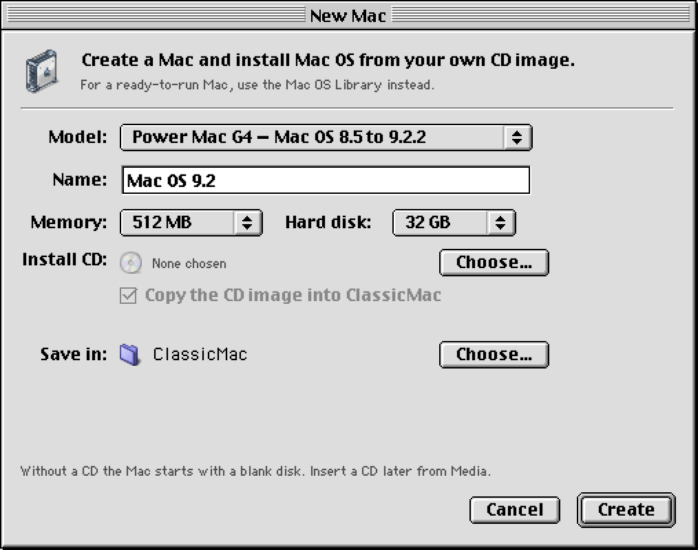
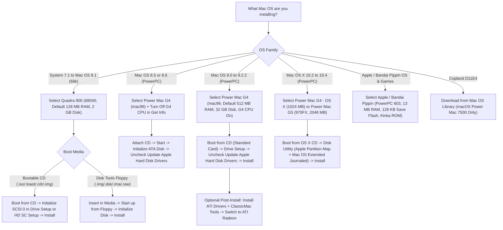
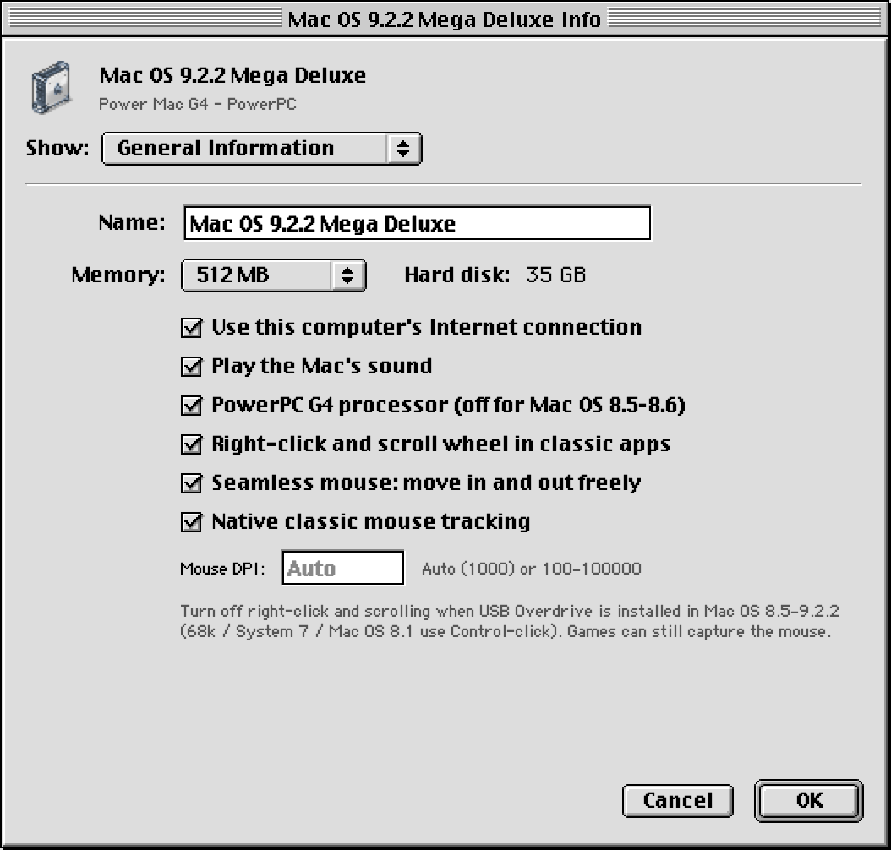
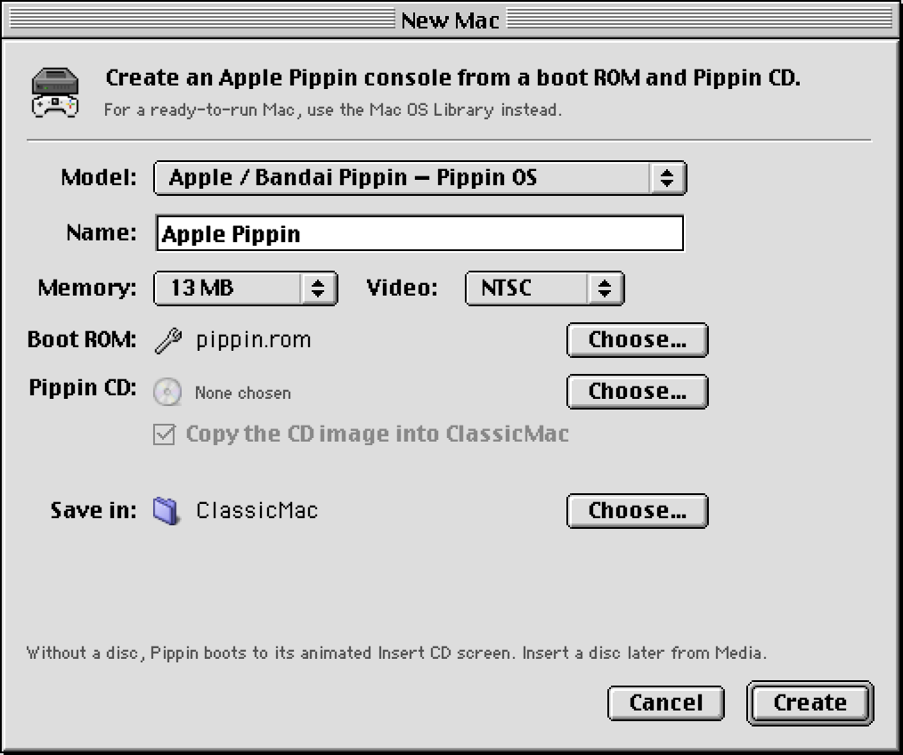
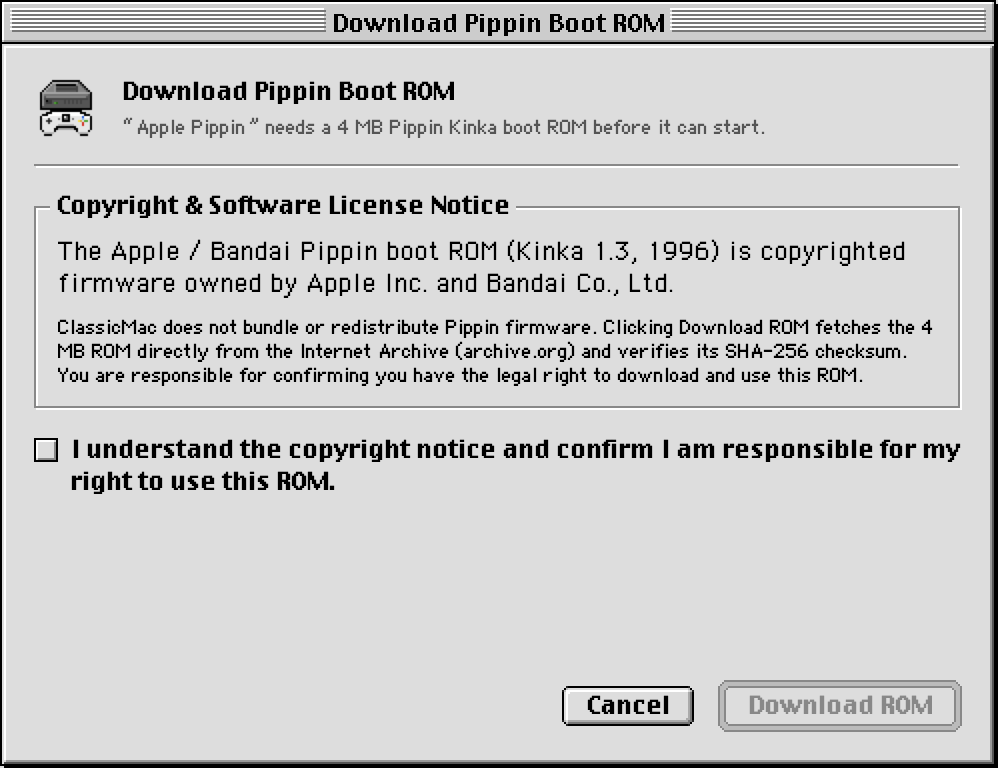
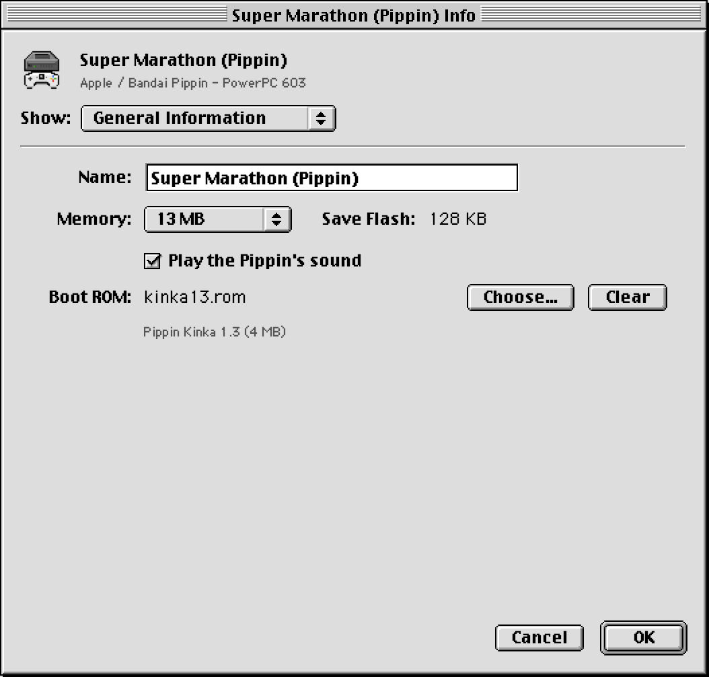
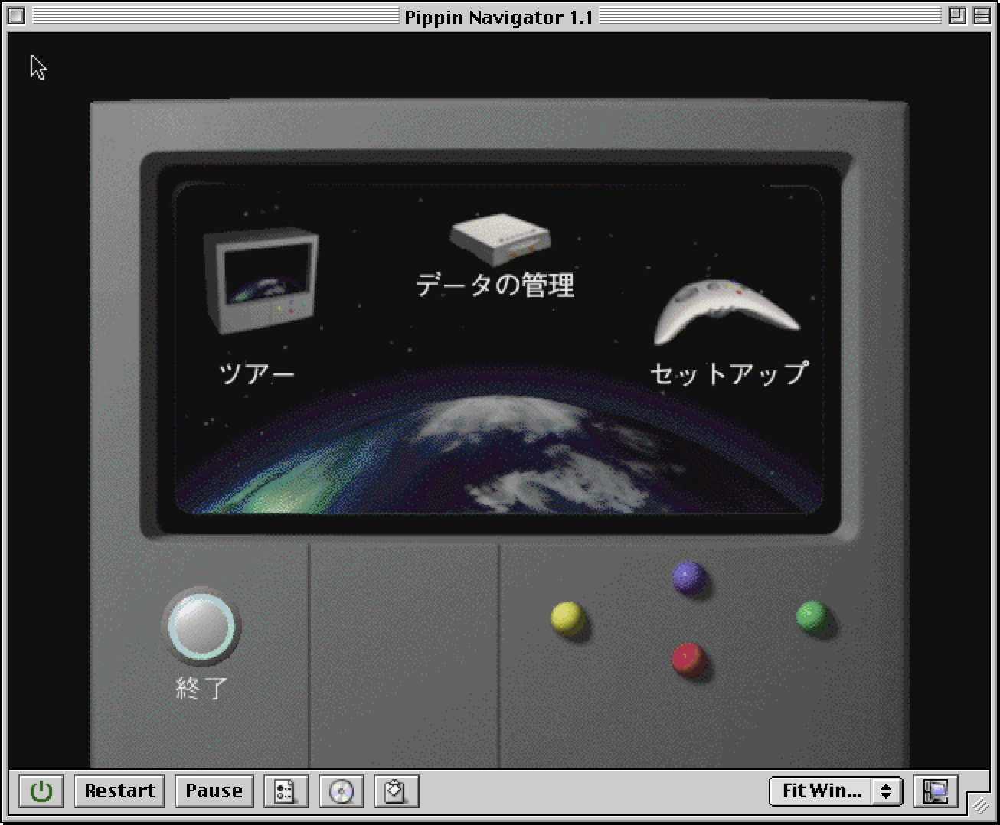
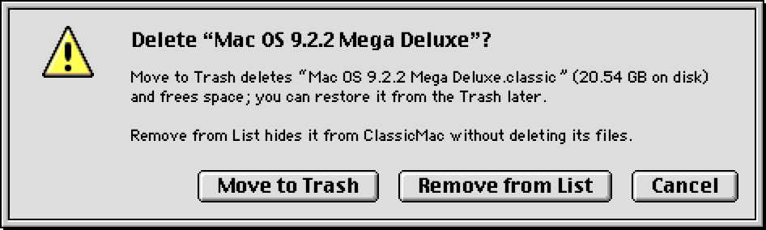

# Chapter 5: Creating Custom Macs & Manual OS Installation

If you have your own retail Macintosh installation CDs, restore discs, or bootable floppy images, you can build a custom Mac from scratch using **New Mac…** (`Command-N` on macOS, `Ctrl+N` on Windows/Linux). ClassicMac creates a blank, sparse raw hard disk inside a self-contained `.classic` bundle, attaches your installation media, and automatically switches the startup drive back to your hard disk as soon as the installer blesses a System Folder.

<p align="center">
  
</p>

---

## Choosing a Machine Model, Boot Media & Settings

Before creating a custom Mac, match your installation media to the right emulated machine family:



---

## Creating a Custom Mac (`New Mac…`)

Open **File → New Mac…** (`Command-N` / `Ctrl+N`) or click **New Mac…** in the Home window:

1. **Model:** Choose one of five hardware profiles:
   - **Power Mac G4 — Mac OS 8.5 to 9.2.2** (`powerMacG4`): OpenBIOS `mac99` PowerPC machine. No Apple ROM file is required.
   - **Power Mac G4 — Mac OS X** (`powerMacOSX`): Dedicated QEMU 10.0.13 `mac99,via=pmu` machine (`10.2–10.4.11`) with Core99 `16 KiB` flash NVRAM (`nvram.img`).
   - **Power Mac G5 — Mac OS X 10.3 to 10.4** (`powerMacG5`): 64-bit `PowerMac7,3` (`qemu-system-ppc64`, PowerPC `970fx` with `1–16` CPUs, `512 MB–16 GB` RAM, K2 SATA/ATA-100, and optional ATI Radeon 9800/7000 with a user-supplied Mac ROM).
   - **Quadra 800 — System 7.1 to Mac OS 8.1** (`quadra800`): Motorola `68040` machine using ClassicMac's bundled Quadra 800 ROM and a per-machine `pram.img`.
   - **Apple / Bandai Pippin — Pippin OS** (`pippin`): `qemu-system-ppc -M pippin` PowerPC `603` console (`5–16 MB` RAM, default `13 MB`; `128 KB` Save Flash `flash.img`, `8 KB` `nvram.img`, and `256 B` `pram.img`; requires a user-supplied 4 MB Kinka boot ROM such as Kinka 1.3). Accepts `.iso`, `.toast`, `.cdr`, `.img`, and raw 2352-byte `.bin`/`.cue` Pippin discs (auto-converted to `.iso`).
2. **Name:** Enter up to 100 characters. ClassicMac creates `<Name>.classic` (appending a number if a bundle with that name already exists).
3. **Memory & Hard disk:**
   - **Quadra 800:** RAM presets `64`, `128` (default), `256`, `512`, `1000 MB`; disk presets `1`, `2` (default), `4`, `8`, `16`, `32`, `64`, `120 GB`.
   - **Power Mac G4:** RAM presets `128`, `256`, `512` (default), `768`, `896 MB`; disk presets `2`, `4`, `8`, `16`, `32` (default), `64`, `120 GB`. *(Mac OS 9 tops out at `896 MB` because Mac OS 9 sound and stability break under emulation with `1 GB` or more.)*
   - **Power Mac G4 — Mac OS X:** RAM presets `256`, `512`, `768`, `1024` (default), `1536`, `2048 MB`; disk presets `2`–`120 GB` (`32 GB` default).
   - **Power Mac G5:** RAM presets `512`, `1024`, `2048` (default), `4096`, `8192`, `16384 MB`; CPU count `1–16` (`2` default; cap at `2` CPUs for 10.3 Panther); disk presets `2`–`120 GB` (`32 GB` default).
   - *(On Windows/Linux, **New Mac** lets you pick Model, Name, Hard disk capacity, and Install CD; adjust Memory afterward in **Get Info…**.)*
4. **Install CD (optional):** Click **Choose…** to attach an uncompressed `.iso`, `.toast`, `.cdr`, or `.img` installer disc image.
   - On macOS, **Copy the CD image into ClassicMac** (checked by default) copies the image into `~/Library/Application Support/ClassicMac/Media/` so moving or deleting your original download won't break the VM. Uncheck it if you prefer to reference the image in place.
   - If you leave **Install CD** blank, ClassicMac creates a blank disk and you can attach an installer CD or floppy later from **Media…**.
5. **Save in:** Choose where to store the `.classic` bundle (defaults to `~/Documents/ClassicMac` or `%USERPROFILE%\Documents\ClassicMac`).
6. Click **Create**. ClassicMac runs `qemu-img create -f raw -o preallocation=off` (or sparse resize on Windows/Linux) to create a blank sparse `disk.img` that consumes zero guest blocks until formatted and written.

### Using Existing `.img`, `.dsk`, or `.qcow2` Disk Images

ClassicMac stores virtual hard disks as raw `disk.img` files (`format=raw`) inside each `.classic` package for maximum compatibility with classic Macintosh SCSI/IDE drivers and APFS sparse/clone storage:

- **Existing `.classic` bundle:** Choose **File → Open Mac…** (`Command-O` / `Ctrl+O`) or double-click the `.classic` package in Finder. If you duplicated a `.classic` bundle in Finder, ClassicMac automatically assigns a fresh UUID so both machines stay independent.
- **Existing raw hard disk (`.img` or `.dsk`):** Create a new blank Mac of the matching model and disk size, shut down, click **Show in Finder** (or **Manage… → Show Files**), and replace `disk.img` inside the `.classic` bundle with your raw image named `disk.img`.
- **Existing `.qcow2` disk image:** Convert it to raw format before placing it in the `.classic` bundle:
  ```bash
  qemu-img convert -f qcow2 -O raw source-disk.qcow2 disk.img
  ```
- **Bootable floppy images (`.img`, `.dsk`, `.ima`, `.raw`):** Attach them directly in **Media… → Floppy Disk** on a **Quadra 800**—no conversion needed.

---

## Adjusting Hardware & Boot Settings Before Install

Before starting an install—or after shutting down—click **Get Info…** (`Command-I` / `Ctrl+I`) or **Media…** (`Command-Shift-E`) to inspect hardware options.

<p align="center">
  
</p>

### How ClassicMac Automatically Switches from CD to Hard Disk

When you create a Mac with an installer CD, `bootFromCD` starts enabled (`Start up from: CD` in **Media…**). After an OS installer finishes, it blesses the destination System Folder on `disk.img` and asks the Mac to restart or shut down. At that clean exit boundary, ClassicMac inspects `disk.img` read-only (`MacDiskImage.hasBlessedSystemFolder`) for a valid Apple Partition Map and a blessed `Apple_HFS` / `Apple_HFSX` System Folder (including HFS wrappers around HFS+ volumes). Once detected, ClassicMac automatically sets `bootFromCD = false` so the next startup boots from the hard disk while leaving the installer CD mounted on the desktop if you still need extras from it.

---

## OS Installation Recipes

### 1. System 7.x or Mac OS 8.1 on Quadra 800 (68040)

1. **Create & Attach Media:** Create a **Quadra 800** Mac (`128 MB` RAM, `2 GB` disk).
   - If installing from a **bootable CD** (`.iso`, `.toast`, `.cdr`, `.img`), select it in **New Mac** or **Media… → CD** and set **Start up from: CD**.
   - If installing from **Disk Tools / Install floppy images** (`.img`, `.dsk`, `.ima`, `.raw`), open **Media… → Floppy Disk**, choose your writable raw Disk Tools image, and select **Start up from: Floppy**. *(ClassicMac updates `DefStartRec` at offset `0x78` in `pram.img` to boot from SCSI CD ID 3, NuBus Virtio floppy, or SCSI hard disk ID 0.)*
2. **Initialize the Blank Hard Disk:**
   - **System 7.1–7.5.x:** Open **Apple HD SC Setup** (or **Drive Setup** on 7.5.3+/8.x) from the CD or Disk Tools floppy, select the SCSI ID 0 disk, and click **Initialize**. Use **Mac OS Standard (HFS)** for System 7.1–8.0.
   - **Mac OS 8.1:** Open **Drive Setup**, select the SCSI ID 0 disk, and initialize. Mac OS 8.1 supports both **Mac OS Standard (HFS)** and **Mac OS Extended (HFS+)**; HFS+ saves space on larger disks, while Standard HFS remains compatible with older 68k utilities.
3. **Run the Installer:** Launch **Installer** from the CD (or swap floppies live in **Media… → Floppy Disk** on Quadra 800—remember to click **Eject** before inserting the next floppy).
4. **Finish & Tools:** Restart or shut down when installation completes. ClassicMac boots from `disk.img`. Ensure **ClassicMac Tools** is inserted in **Media…** to access StuffIt Expander and Disk Copy on the desktop.

### 2. Mac OS 8.5–9.2.2 on Power Mac G4 (`mac99`)

1. **Configure CPU for Your OS Version:**
   - **Mac OS 9.0–9.2.2:** Create a **Power Mac G4** (`512 MB` RAM, `32 GB` disk) with your install CD. Keep **PowerPC G4 processor** checked in **Get Info…** (`useG4CPU = true`).
   - **Mac OS 8.5 or 8.6:** Create the **Power Mac G4**, open **Get Info… → General Information**, and **uncheck `PowerPC G4 processor (off for Mac OS 8.5–8.6)`**. If your 8.5/8.6 retail CD requires Virtio startup disk routing, also set `"useVirtioDisk": true` in `config.json` (see [Chapter 12](12-configuration-and-cli-reference.md)). ClassicMac automatically routes the CD and Tools over Virtio in G3 compatibility mode because retail 8.5/8.6 ROMs predate G4/KeyLargo IDE.
2. **Keep Graphics on Standard During Install:** Even if you plan to use **ATI Radeon** later, ClassicMac automatically uses the **Standard** VGA card whenever `bootFromCD` is enabled so the installer environment boots reliably.
3. **Initialize & Install (Follow the Home Panel Checklist):**
   - Start up from the CD.
   - Open **Utilities → Drive Setup** on the CD, select the blank ATA hard disk, and choose **Initialize** (**Mac OS Extended / HFS+** is recommended).
   - Open **Mac OS Install**, click **Options…**, and **turn off "Update Apple Hard Disk Drivers"**, then run the installation.
4. **First Hard-Disk Boot & Tools:** Click **Restart** when finished. ClassicMac detects the blessed System Folder, switches startup to the hard disk, and mounts **ClassicMac Tools** at startup via a read-only Virtio disk.
5. **Optional: Enable ATI Radeon 3D Acceleration:**
   - Install Apple's **ATI drivers** (ATI Driver Update 1.9.5 / ATI Radeon software) and **ClassicMac Display** (from the Tools volume) inside Mac OS 9 so the desktop switches out of `640 × 480`.
   - Shut down the Mac, open **Get Info… → Display**, select **ATI Radeon (3D acceleration)**, and click **OK**.

### 3. Mac OS X 10.2–10.4 Tiger on Power Mac G4 or Power Mac G5

ClassicMac runs PowerPC Mac OS X either on **Power Mac G4 — Mac OS X** (`10.2` Jaguar, `10.3` Panther, `10.4` Tiger on **QEMU 10.0.13** `mac99,via=pmu` with `7400` G4 CPU) or on **Power Mac G5** (`10.3` Panther and `10.4` Tiger on **QEMU 11.1.50** `qemu-system-ppc64` with `970fx` SMP, K2 SATA/ATA-100, and optional ATI Radeon 9800/7000). Both use persistent `16 KiB` flash `nvram.img`, `-vga std` (`64 MB` VRAM by default), and `sungem` Ethernet.

1. **Create the Machine:** Choose **Power Mac G4 — Mac OS X** (`1024 MB` default) or **Power Mac G5** (`2048 MB` default, `2` CPUs default; keep `<= 2` CPUs for 10.3 Panther) in **New Mac…**, set **Hard disk** to `32 GB`, and attach your PowerPC Mac OS X installation disc image (`.iso`, `.cdr`, or `.toast`).
2. **Partition & Format in Disk Utility:**
   - Start up into the Mac OS X Installer.
   - From the **Utilities** menu (or **Installer** menu on 10.2/10.3), open **Disk Utility**.
   - Select the blank virtual hard disk, choose **Erase** (or **Partition** with **Apple Partition Map**), and format as **Mac OS Extended (Journaled)** (or **Mac OS Extended** on Jaguar).
3. **Install & Handle Multi-Disc / First Reboot:**
   - Run the installer onto your formatted volume.
   - If the installer restarts back into the installation CD (or asks for Disc 2), shut down, open **Media…**, switch **Start up from:** to **Hard disk** (or eject/swap the disc), and start up again.
4. **Clean Shutdown:** Inside Mac OS X, always choose **Apple menu → Shut Down** (or confirm **Shut Down** in ClassicMac's dialog, which triggers Mac OS X shutdown cleanly; **Force Stop** is available only as an emergency fallback if the guest freezes).

> [!NOTE]
> On `powerMacOSX` and `powerMacG5`, ClassicMac uses the standard widescreen VGA framebuffer (`-vga std`) at 32-bit color by default, and **Floppy Disk**, **ClassicMac Tools CD**, and **Classic input helpers** are disabled because Mac OS X has native USB mouse, two-button/scroll support, and UNIX networking. Host **Shared Folders** are disabled on `powerMacOSX`; on `powerMacG5`, setting a Shared Folder attaches a PCI-X `virtio-9p-pci` (`macos_compat=on`) device for the `osx9p` guest extension.

### 4. Copland D11E4 Developer Preview (`powerMac7500`)

Copland D11E4 cannot be installed from a blank disk in **New Mac…**—it must be downloaded from the **Mac OS Library** (macOS only), because Apple's unfinished 1996 preview requires ClassicMac's specialized DingusPPC **Power Mac 7500** (`PowerPC 601`) engine and a matched set of files inside its `.classic` bundle:

- `bootrom.bin` (`4,194,304` bytes, SHA-256 verified) and `nvram.bin` (`8,209` bytes)
- `disk.img` (contains both System 7.5.3 and Copland virtual memory space)
- `copland-rtc.bin` (persistent RTC checkpoint created beside `disk.img` so restarts never rewind file dates—Copland refuses to boot if directory creation dates appear newer than modification dates)

During startup, the engine holds `Caps Lock` for `500 ms` (until your first real keypress) so the ROM selects Copland instead of System 7.5.3. Sound, networking, shared folders, removable media, ATI acceleration, Paste Text, and Browser Display are unavailable, and developer assertions pause the preview with a **Continue Copland** button in the Home window. Always use **Spaz → Shut Down** inside Copland for a clean exit.

### 5. Apple / Bandai Pippin Console (Pippin OS & Games)

ClassicMac 5.1.0 emulates the PowerPC 603 **Apple / Bandai Pippin** (`qemu-system-ppc -M pippin`) directly inside QEMU with Apple Taos 16-bit graphics (`ntsc`, `pal`, `vga`), AppleJack trackball/gamepad ADB input, Save Flash storage (`128 KB` `flash.img`), `8 KB` NVRAM (`nvram.img`), `256 B` PRAM (`pram.img`), and genuine Sony/Apple SCSI CD-ROM timing.

<p align="center">
  
</p>

1. **Supply or Download a Pippin Boot ROM:** Select **Apple / Bandai Pippin — Pippin OS** in **New Mac…** and either click **Choose…** next to **Boot ROM** to pick an existing 4 MB Pippin ROM (or place it at `~/Library/Application Support/ClassicMac/ROMs/pippin.rom` / `AppData\Roaming\ClassicMac\ROMs\pippin.rom`), or click **Download…** (or simply click **Start Up** when no ROM is configured) to review the **Copyright & Software License Notice** and automatically download & SHA-256 verify **Pippin Kinka 1.3** (`4 MB`) from the Internet Archive (`archive.org`).

<p align="center">
  
</p>
2. **Choose Video Output & Media:** Select **NTSC** (`640 × 480`), **PAL** (`640 × 512`), or **VGA** (`640 × 480`), optionally adjust **Memory** (`5–16 MB`, `13 MB` default) and **Save Flash** (`128 KB`) in **Get Info… → General Information**, and attach a Pippin disc image (`.iso`, `.toast`, `.cdr`, `.img`, or raw 2352-byte `.bin`/`.cue`).

<p align="center">
  
</p>

3. **Start & Swap Discs:** Pippin discs self-boot directly from the CD-ROM; without a disc inserted, the console displays its animated *Insert CD* prompt. You can eject or swap Pippin discs live in **Media…**.

<p align="center">
  
</p>

---

## Deleting vs. Archiving a `.classic` Bundle

Each Mac lives as a self-contained `.classic` folder (`config.json`, `disk.img`, `preview.png`, `Checkpoints/`, and `pram.img` / `nvram.img`).

<p align="center">
  
</p>

When you select a Mac and click **Delete…** (or **Mac → Delete Mac…**, `Command-Delete` / `Delete` key):

- **If the Mac is shut down:**
  - **Remove from List** *(Archive / Keep Files)*: Removes the machine from ClassicMac's library index without touching its `.classic` folder on disk. You can move or back up the `.classic` bundle to an external drive and re-add it anytime with **File → Open Mac…**.
  - **Move to Trash** *(or **Recycle Bin** on Windows)*: Moves the entire `.classic` bundle (including `disk.img` and its `Checkpoints/` folder) to Trash/Recycle Bin and cleans up any unreferenced copied CD images inside `Application Support/ClassicMac/Media/`. External CDs or shared folders outside the bundle are untouched.
- **If the Mac is running:** ClassicMac warns you and requires you to **Shut Down & Move to Trash** (clean shutdown up to 16 seconds before escalating) or **Force Stop & Move to Trash** before trashing the package.

---

**Next:** [Chapter 6: Everyday Use, Controls & Input](06-everyday-use-and-input.md) · **Previous:** [Chapter 4: Mac OS Library & Downloadable Editions](04-mac-os-library-and-editions.md) · **Contents:** [Manual Home](README.md)
