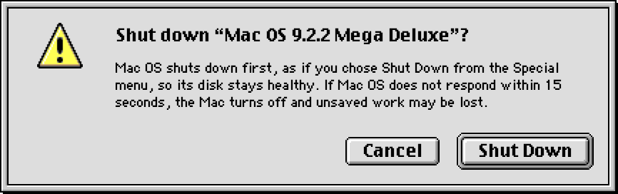
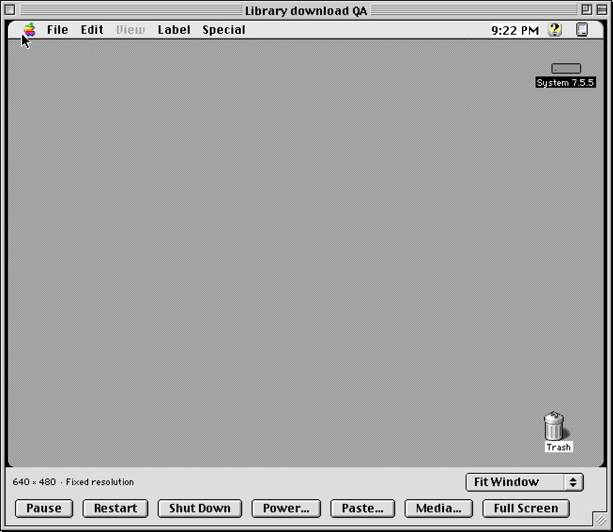
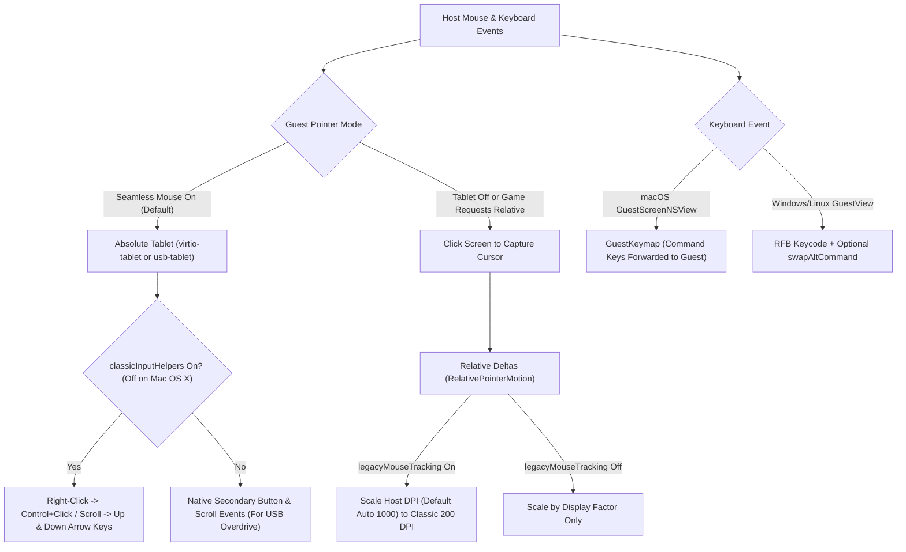
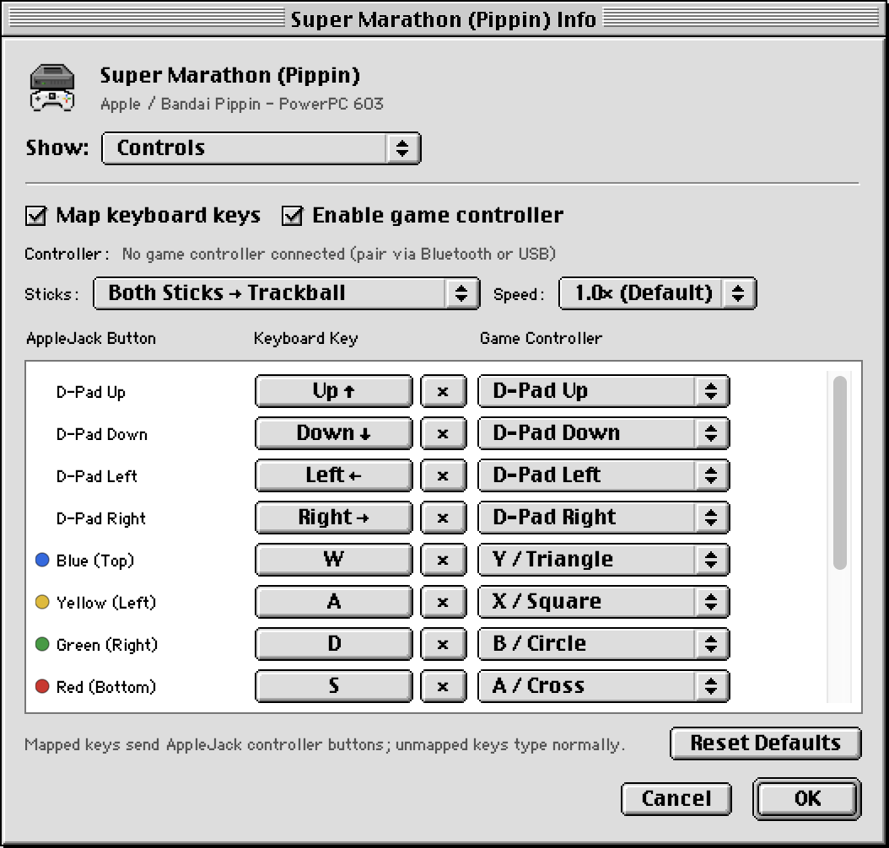
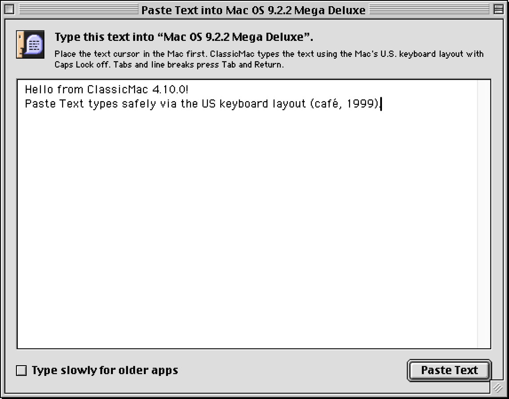

# Chapter 6: Everyday Use, Controls & Input

Once your classic Mac is set up, ClassicMac surrounds it with native Apple Platinum windows, live screen previews, flexible pointer tracking for both desktop apps and 3D games, keyboard passthrough, and a safe one-way **Paste Text** bridge for moving text from your modern computer into classic Mac OS.

---

## Starting, Pausing, Restarting & Shutting Down

### Power States & Clean Shutdown

Every Mac in your sidebar displays a status light on its icon and a status line in the Home window: **Shut down**, **Running now** (green LED), **Paused** (amber LED), or **Stopped at an assertion** (amber LED for Copland).

| Action | Shortcut / Location | What ClassicMac Does |
| :--- | :--- | :--- |
| **Start Up / Show Mac** | `Command-R` / double-click row / **Start Up** | Launches QEMU (or brings the running window forward and resumes if paused). |
| **Pause / Resume** | **Mac → Pause** / Home or Guest toolbar **Pause** | Freezes or resumes CPU execution via QEMU's monitor (`stop` / `cont`) or Copland's control pipe (`pause` / `resume`). Releases any captured mouse and held keys and overlays a **Paused** badge. |
| **Restart** | `Command-Shift-R` / **Restart** | Triggers `system_reset` (or clean OS X / Copland restart). Because QEMU runs with `-action reboot=shutdown`, ClassicMac cleanly relaunches the process so updated settings, media, and boot order apply reliably. |
| **Shut Down…** | Guest window close box / **Mac → Shut Down…** | Sends a safe shutdown signal and lets you confirm before powering off. |
| **Force Quit Frontmost App…** | **Mac → Force Quit Frontmost App…** | Sends `Command-Option-Escape` (`meta_l-alt-esc`) to the active classic Mac (disabled while paused or on Copland). |

  

ClassicMac handles **Shut Down…** differently per OS family so your virtual hard disk stays clean:
- **System 7, Mac OS 8 & Mac OS 9:** Sends the ADB `power` key followed by `Return` `750 ms` later, triggering classic Mac OS's native Shut Down dialog and flushing HFS/HFS+ caches. If the Mac freezes and does not exit within `15 seconds`, ClassicMac forces the emulator off.
- **Mac OS X (PowerPC):** Offers **Shut Down**, **Force Stop**, and **Cancel** (use **Apple menu → Shut Down** inside Mac OS X whenever possible so the journaled filesystem stays healthy; **Force Stop** powers off immediately if OS X hangs).
- **Copland D11E4:** Choose **Spaz → Shut Down** inside Copland for a graceful exit. ClassicMac's confirmed **Shut Down** command powers off the Copland helper immediately.

When you quit ClassicMac while one or more Macs are running, ClassicMac asks to shut them all down safely first (with a `15-second` timeout per machine on macOS, or **Shut Down All** / **Force Stop All…** on Windows/Linux).

---

## Windows, ScreenPreview, WindowShade & Scaling

### Platinum Home, ScreenPreview & WindowShade

  

- **ScreenPreview:** The Home window displays a live view of the selected running Mac (or its saved `preview.png` from the last session when shut down). Clicking a running Mac's preview brings its guest window to the front.
- **WindowShade Collapse:** Click the collapse box on the right edge of any Platinum window title bar—or press `Command-Option-M` (**Window → Collapse**) on macOS—to roll the window up into a single title bar, just like Mac OS 8/9. Clicking the collapse box again (or zooming/activating the window) expands it back down.

### Guest Window Toolbar, Scaling & Full Screen

  

Along the bottom of each running guest window, the Platinum toolbar gives quick access to **Shut Down…**, **Restart**, **Pause / Resume**, **Media…**, **Paste Text…**, a live status readout (current resolution, active ATI renderer, or mouse capture hint), **Screen Scale**, and **Full Screen**:

| Scale Mode | Behavior |
| :--- | :--- |
| **Sharp Pixels** | Default on resizable Macs (`Power Mac G4` and `Enhanced Quadra`). Uses whole-number scaling (`1×`, `2×`, etc.) and asks the guest OS to resize its desktop to match the window. |
| **1×** / **2×** | Locks pixel scaling to `1×` or `2×` with nearest-neighbor crisp pixels, adding scrollbars if the window is smaller than the scaled screen. |
| **Fit Window** | Default on fixed-resolution Macs (`Mac OS X`, non-enhanced `Quadra 800`, and `Copland`). Scales the guest framebuffer smoothly to fill the window without changing the guest's resolution. |

- **Zoom Box:** Clicking the title bar's zoom box expands a `Sharp Pixels` resizable screen to fill your display, or snaps a fixed-resolution screen to the largest whole-number scale that fits.
- **Full Screen:** Click **Full Screen** or press `Control-Command-F` on macOS (`Ctrl+Alt+F` or `Alt+Return` on Windows/Linux; `Control-F` on Copland). In **Sharp Pixels** mode, resizable Macs automatically adjust the guest resolution to fill the display; **Fit Window**, **1×**, and **2×** keep the configured guest resolution and scale to fit without forcing a desktop resize. Background windowed display updates pause automatically while Full Screen is active, and a brief status pill at the top reminds you how to exit full screen and how to release a captured mouse.

---

## Mouse, Tablet & Keyboard Input

### Seamless Pointer vs. Relative Mouse Capture

By default, **Seamless mouse: move in and out freely** (`tabletInput`) is enabled in **Get Info… → General Information**:
- ClassicMac attaches a virtual absolute pointing device (`virtio-tablet-device` on Quadra 800, `virtio-tablet-pci` on Power Mac G4, `usb-tablet` on Mac OS X), letting your cursor glide seamlessly between your host desktop and the classic Mac without clicking to capture.
- **Apple / Bandai Pippin (`adb-applejack`):** Uses the ADB AppleJack relative pointer/controller profile; clicking inside the window captures relative motion (`Control-Option` releases the cursor).
- When you launch a 3D game that switches the guest into relative pointer mode (`pointerRelative`), or if you uncheck **Seamless mouse** (for example, to use **USB Overdrive** or a relative USB mouse on Mac OS X), clicking the guest screen captures and hides the host cursor.
- **Release Captured Mouse:**
  - **macOS:** Press **Control-Option** (`⌃⌥`).
  - **Windows / Linux:** Press **Escape** or **Ctrl+Alt**.
  - **Copland D11E4:** Press **Control-G** (`⌃G`) to capture or release the mouse.
- **Native Classic Mouse Tracking & Mouse DPI:** When **Native classic mouse tracking** (`legacyMouseTracking`, on by default) is active in relative mode, ClassicMac scales raw host mouse deltas from your configured **Mouse DPI** (`Auto` = `1000` DPI, or any value from `100` to `100,000`) down to a classic Macintosh `200 DPI` baseline (`ratio = dpi / 200`), preventing hypersensitive camera spin in classic 3D games.

### Right-Click, Scrolling & USB Overdrive (`classicInputHelpers`)

When **Right-click and scroll wheel in classic apps** (`classicInputHelpers`, on by default for System 7, Mac OS 8, and Mac OS 9; always off for Mac OS X) is enabled in desktop mode:
- **Secondary / Right-Click** is delivered as **Control+Click**, opening classic Mac OS contextual menus.
- **Scroll Wheel** movements tap the **Up** and **Down** arrow keys so older classic apps without wheel support scroll naturally.

> [!TIP]
> If you install **USB Overdrive** inside Mac OS 8.5–9.2.2 (such as in the Deluxe editions, or with your own driver), turn **off** **Right-click and scroll wheel in classic apps** in **Get Info… → General Information** (and optionally turn off **Seamless mouse** if using relative HID motion) so ClassicMac does not double up mouse or scroll events.

### Keyboard Mapping & `swapAltCommand`

- **On macOS:** While a guest screen has focus, `GuestScreenNSView` forwards every key—including `Command` (`⌘`) shortcuts such as `Command-Q`, `Command-W`, `Command-C`, and `Command-V`—directly to the guest Mac instead of ClassicMac's own menus (the one reserved host shortcut is `Control-Command-F` for full screen). `Caps Lock` tracks the guest keyboard's locking state.
- **On Windows & Linux:** In **Get Info…**, toggle **Swap Alt and Command keys** (`swapAltCommand`, off by default) if you prefer pressing your PC keyboard's `Alt` key as the Macintosh `Command` (`⌘`) key instead of the `Windows` / `Super` key.

### Pippin Key Mapping & Game Controllers (`Get Info → Controls`)

For **Apple / Bandai Pippin** (`machineFamily == "pippin"`) on macOS, ClassicMac supports both custom **keyboard-to-AppleJack** bindings and physical **game controllers** (Xbox, PlayStation DualSense / DualShock, Nintendo Switch Pro, and MFi controllers via Apple `GameController`):

- Open **Get Info… → Controls** (or click **Controls…** right in the running Pippin window toolbar—this pane can be edited live without shutting down).
- **Keyboard Mapping (`keyboardMappingEnabled`):** Maps keys (defaults: `Arrows` = D-Pad, `W/A/S/D` = Blue/Yellow/Red/Green diamond buttons, `Z/X/C` = Square/Circle/Triangle, `Q/E` = Left/Right Triggers) to AppleJack controller buttons. Any unmapped key continues typing normally through `adb-keyboard`.
- **Game Controllers (`gamepadEnabled`):** Automatically detects connected controllers and merges controller inputs with keyboard bindings over `-display classicmac` (`CMD_MSG_GAMEPAD = 23` -> `/machine/applejack`). Click **Set** next to any button to capture a physical controller input directly.
- **Analog Sticks (`stickMode`, `stickSensitivity`, `stickDeadzone`):** Drives the AppleJack relative trackball (`POINTER_REL`) from either or both thumbsticks (or maps Left Stick to D-Pad and Right Stick to Trackball) with configurable speed (`0.5×–2.5×`).

  

---

## Pasting Text into a Classic Mac (`Paste Text`)

Classic Mac OS guests do not run a host clipboard daemon, so ClassicMac provides an explicit, one-way **Paste Text** tool that converts plain text into paced ADB/USB keyboard events.

  

1. Click inside the target text field, **SimpleText**, **BBEdit**, or **Terminal** inside your running Mac so the insertion cursor is active. *(Ensure the guest Mac uses its **U.S. keyboard layout** with **Caps Lock off**.)*
2. Open **Paste Text…** from the guest window toolbar, **Mac → Paste Text into Mac…** (`Command-Shift-V` on macOS), or the native window's **Mac** menu.
3. ClassicMac reads plain text from your host clipboard once into an editable review window—clipboard data is never sent automatically or written to disk.
4. Review or edit the text (up to **8,192 characters**), then click **Paste Text**:
   - **Line endings & whitespace:** `CRLF`, `CR`, and `LF` normalize to one `Return` (`ret`) per line break; tabs press `Tab` (`tab`).
   - **Accents & MacRoman symbols:** Supports all printable US ASCII plus common MacRoman characters (`á é í ó ú`, `ä ë ï ö ü ÿ`, `â ê î ô û`, `à è ì ò ù`, `ã ñ õ`, `ç`, `å`, `ø`, `ß`, curly quotes `“ ” ‘ ’`, em/en dashes `— –`, ellipsis `…`, bullet `•`, `© ™ ® ° ± £ ¥ ¢`, and non-breaking space) via Option (`alt-`) dead-key chords.
   - **Strict upfront validation:** If any unsupported Unicode character (such as emoji or non-MacRoman scripts) is present, ClassicMac flags its `U+XXXX` code point(s) and refuses to send anything until you edit it out.
   - **Typing speed:** Sends one acknowledged `sendkey` chord at a time—about **20 chords/sec** (`50 ms` interval) normally, or **8 chords/sec** (`125 ms` interval) when **Type slowly for older apps** (**Slow typing** on Windows/Linux) is checked.
   - **Safe cancellation:** Clicking **Stop** / **Cancel**, closing the review window, switching apps, pausing, or shutting down stops entry after completing any in-flight accent pair so a dead key is never left active. Text already typed stays in the guest.

*(Paste Text is unavailable on Copland D11E4.)*

---

## Managing Multiple Macs Side by Side

You can run multiple `.classic` machines concurrently—for example, running **System 7.5.5** alongside **Mac OS 9.2.2** and **Mac OS X 10.4.11 Tiger**:

- **Independent Windows & Persistence:** Each running Mac gets its own Platinum guest window (`ClassicMac Screen <UUID>` autosaved position and scale mode), its own private Unix monitor/QMP/display sockets, and its own virtual printer and Browser Display endpoints.
- **Switching Quickly:** Use the sidebar in the **ClassicMac** Home window (`Command-1`), click any Mac's **ScreenPreview**, or switch directly from macOS's **Window** menu.
- **Resource Budgeting:** Each running Power Mac or Tiger VM reserves its configured **Memory** (`ramMB`) plus up to `512 MB` for QEMU's TCG code-translation cache (`tb-size=512`) and an active CPU emulation thread. Use **Pause** on idle background Macs or shut down Macs you aren't actively using to free CPU and memory.
- **Organizing Your Fleet:** Give each machine a descriptive name in **Get Info…** and customize model icons with **Iconfactory Icons…** (see [Chapter 4](04-mac-os-library-and-editions.md)) so each system stands out at a glance.

---

**Next:** [Chapter 7: Display, 3D Graphics, Browser Display & Sound](07-display-3d-graphics-and-sound.md) · **Previous:** [Chapter 5: Creating Custom Macs & Manual OS Installation](05-installing-your-own-mac-os.md) · **Contents:** [Manual Home](README.md)
