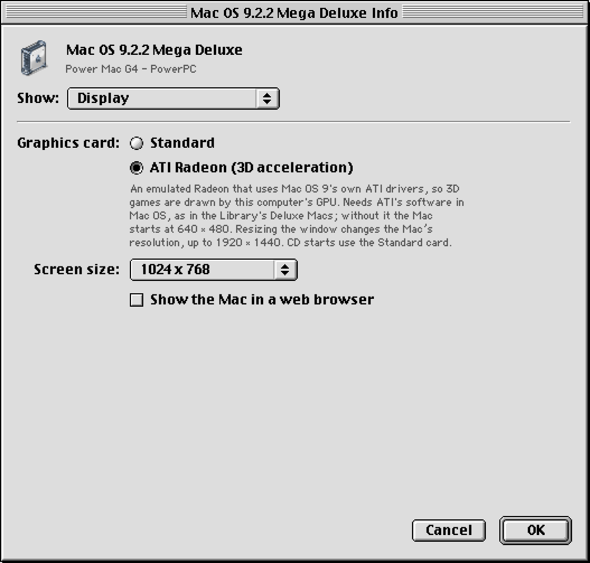
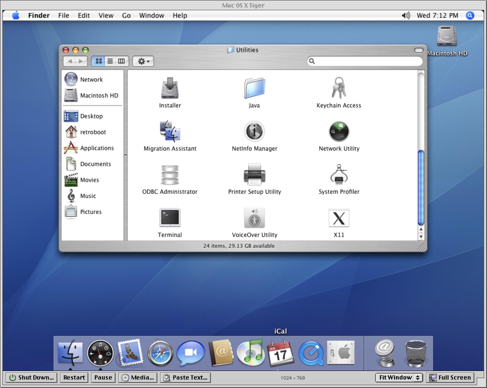
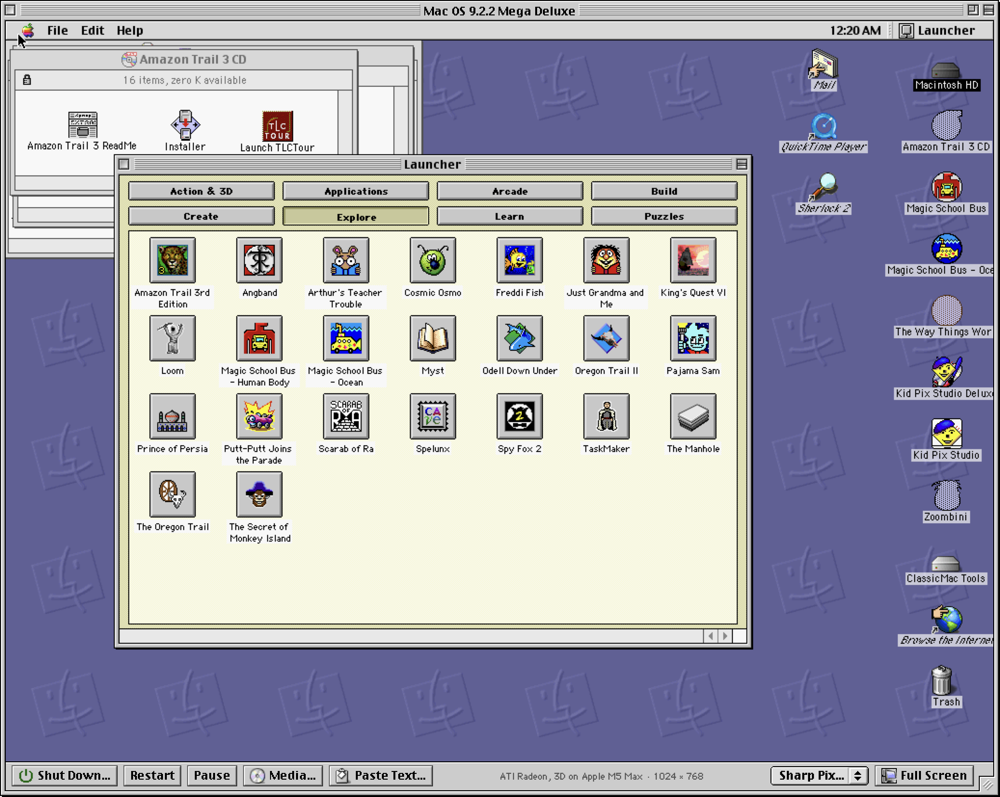
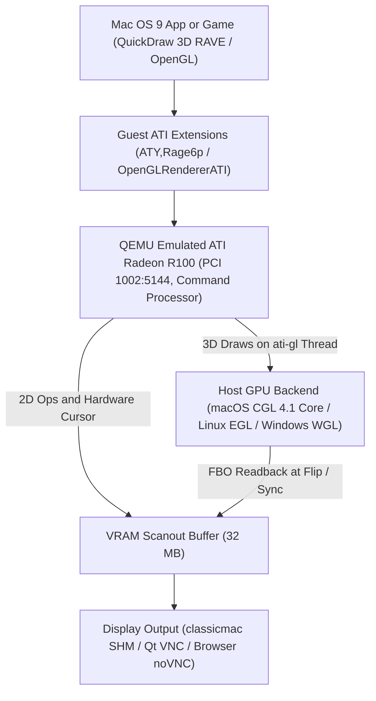
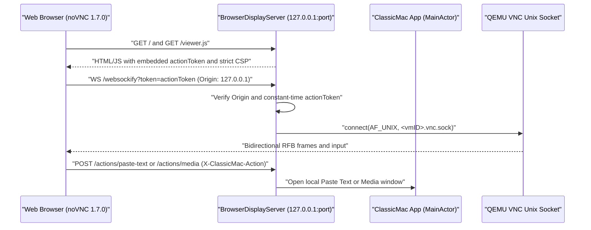

# 7. Display, 3D Graphics, Browser Display & Sound

ClassicMac gives every emulated Macintosh a clean desktop window with crisp pixel scaling, flexible screen resolutions, optional **ATI Radeon** 3D hardware acceleration for Power Mac G4 guests, an optional **Browser Display** powered by a token-authenticated local WebSocket server, and native host audio output.

This chapter covers all display settings in **Get Info → Display**, how standard and 3D graphics work under the hood, how to run a Mac in your web browser, and how ClassicMac emulates classic Macintosh audio hardware.

  

---

## Standard Display Settings

Open a shut-down Mac's **Get Info…** window and choose **Display** from the **Show:** menu to configure its video hardware, resolution, and color depth.

### Resolution Presets and Custom Sizes

ClassicMac includes six standard `ResolutionPreset` sizes, with **1024 × 768** as the recommended default:

- `640 × 480`
- `800 × 600`
- `1024 × 768` *(recommended default)*
- `1152 × 870`
- `1280 × 1024`
- `1440 × 900`

On machines that support arbitrary resolutions (Power Mac G4 with **Standard** graphics, Power Mac G4 for **Mac OS X**, and Quadra 800 with **Enhanced Quadra video** enabled), choosing **Custom…** in the **Screen size:** menu lets you enter any dimensions between **512 × 384** (`minWidth` × `minHeight`) and **3840 × 2160** (`maxWidth` × `maxHeight`). On macOS, clicking **Match This Display** automatically fills in your main Mac screen's dimensions.

> [!NOTE]
> On Power Mac G4 and Mac OS X, screen widths are aligned down to an 8-pixel multiple (`width / 8 * 8`) to satisfy the framebuffer hardware.

### Color Depth

The **Colors:** pop-up configures the guest's color depth (`ColorDepth`):

| UI Label | `config.json` Value (`depth`) | Notes |
| :--- | :--- | :--- |
| **256 Colors** | `8` | Available on Quadra 800 (required at `1152 × 870` when Enhanced Quadra video is off) and Copland (`640 × 480`). |
| **Thousands** | `16` | Default for classic Power Mac and Quadra setups; passed as 15-bit direct color (`x15`) to OpenBIOS on Power Mac. |
| **Millions** | `24` (macOS) / `32` (Win/Linux) | 24/32-bit true color. ClassicMac automatically normalizes `32` ↔ `24` when opening `.classic` bundles across platforms. |

On Power Mac G4 with the **Standard** card, QEMU also passes `-global VGA.packed-lowbpp=on`, which allows ClassicMac's bundled `qemu_vga.ndrv` driver to offer **Black & White** (1-bit), **4 Colors** (2-bit), and **16 Colors** (4-bit) inside the guest's **Monitors** control panel for older software that requires indexed low-color modes.

### Machine-Specific Video Capabilities

Video hardware and resizing rules differ by machine family:

| Machine Family | Emulated Display Hardware | Allowed Color Depths | Resolution Range & Live Resize |
| :--- | :--- | :--- | :--- |
| **Quadra 800** (`useEnhancedFramebuffer: true`) | `nubus-qfb` (`mac_qfb.rom`) NuBus framebuffer | 256 Colors, Thousands, Millions | `512 × 384` to `3840 × 2160`; resizes live with the host window in **Sharp Pixels** mode |
| **Quadra 800** (`useEnhancedFramebuffer: false`) | Built-in `macfb` | 256 Colors, Thousands, Millions (`1152 × 870` capped at 256 Colors) | Fixed presets only: `640 × 480`, `800 × 600`, `1152 × 870`; no live window resize |
| **Power Mac G4 (`Standard`)** | QEMU `-vga std` + `qemu_vga.ndrv` (64 MB VRAM) | Thousands, Millions (plus 1/2/4/8-bit inside guest **Monitors**) | `512 × 384` to `3840 × 2160`; resizes live via `VGA.host-resize=on` |
| **Power Mac G4 (`ATI Radeon`)** | Emulated ATI Radeon R100 (`ati-vga,model=r100`, 32 MB VRAM) | 256 Colors, Thousands, Millions (inside guest **Monitors**) | `640 × 480` to `1920 × 1440` (within 162 MHz EDID clock); resizes live via `classicmac-display-control` |
| **Power Mac G4 (Mac OS X)** | QEMU `-vga std` (64 MB VRAM, `VGA.romfile=`) | Millions (`32`-bit fixed) | `512 × 384` to `3840 × 2160` at startup; fixed desktop size (does not live-resize) |
| **Power Mac 7500 (Copland)** | DingusPPC built-in video | 256 Colors (`8`-bit fixed) | Fixed `640 × 480`; use `Control-+` and `Control-−` to scale window |

  

### Native Display Transport & Pixel Scaling

On **macOS**, ClassicMac draws the guest screen inside its own Platinum document window (`GuestWindow`) using a custom QEMU backend (`-display classicmac,socket=...`):

- QEMU allocates a POSIX shared-memory framebuffer (`shm_open` + `mmap`) and hands its file descriptor to the ClassicMac app over a Unix stream socket (`/tmp/ClassicMac/<UUID>.display.sock`) using `SCM_RIGHTS`.
- QEMU compares dirty regions in `64 × 16` tiles against the shared buffer (using a direct byte-swapped `bswap32` compare/copy fast path for 32-bit big-endian `PIXMAN_b8g8r8x8` guest surfaces) and emits coalesced `DAMAGE` events, engaging an `idle-refresh` backoff (`100 ms`) when the guest screen is static.
- ClassicMac copies only accumulated `DAMAGE` rectangles into double-buffered `IOSurface` layers, avoids redundant full-frame preview copies when the Home window is occluded, pauses background/occluded `CADisplayLink` callbacks, and caps Standard VGA/Quadra/OS X refresh polling at `16 ms` (`60 Hz`) while allowing ATI Radeon to match up to `120 Hz` (`8 ms`) ProMotion displays.
- When **Standard** VGA uses `-global VGA.untracked-vram=on`, QEMU avoids expensive page-fault write tracking during QuickDraw `BitBlt` operations.
- The guest window toolbar includes a scale pop-up (`GuestDisplayScale`): **Sharp Pixels** (default on resizable Macs; auto-fits at integer scaling and resizes the guest desktop to match the window), **1×**, **2×**, and **Fit Window**.

On **Windows and Linux**, QEMU runs a password-protected localhost VNC server (`127.0.0.1`, port `5900+`) that the native Qt6 Platinum window renders directly (`native/src/engine.cpp`, `vnc.cpp`).

---

## ATI Radeon 3D Acceleration

Power Mac G4 machines can switch their **Graphics card:** setting from **Standard** to **ATI Radeon (3D acceleration)** (`"graphicsCard": "atiRadeon"`).

  

### How the Emulated ATI Radeon R100 Works

Instead of requiring a custom guest 3D driver, ClassicMac emulates a PCI **ATI Radeon R100** (`ati-vga,id=ati0,model=r100,vgamem_mb=32,romfile=,guest_hwcursor=on`, PCI ID `1002:5144`):

1. **OpenBIOS initialization (`openbios-ati-radeon.patch`):** Because `romfile=` is intentionally left empty (no x86 VGA BIOS is used), ClassicMac's bundled OpenBIOS names the PCI device tree node `ATY,Rage6p`, enables PCI bus mastering, programs the `640 × 480` startup CRTC mode, and removes the generic QEMU VGA driver property.
2. **Mac OS 9 native ATI drivers:** Inside Mac OS 9, Apple's own retail extensions—**ATI Driver Update**, **ATI Radeon 3D Accelerator**, **ATI Resource Manager**, and **OpenGLRendererATI**—drive the virtual card directly.
3. **Host GPU OpenGL passthrough:** QEMU's R100 command processor parses ring/PIO/indirect 3D command buffers and queues draws onto a dedicated `ati-gl` thread:
   - **macOS:** Loads `/System/Library/Frameworks/OpenGL.framework/OpenGL` via `dlopen()` and creates an accelerated **OpenGL 4.1 Core** CGL context (`#version 410 core` shaders rendering into FBOs, read back to VRAM at sync/flip points).
   - **Linux & Windows:** Uses **EGL** (`libEGL.so.1` / `libGLESv2.so.2`) or **WGL** respectively.
4. **Live status reporting:** ClassicMac queries QOM `/machine/peripheral/ati0` (`x-gl-renderer` and `x-accel-stats`) and displays the active host GPU in **About This Mac** and the guest window status bar (for example, `ATI Radeon, 3D on Apple M5 Max · 1024 × 768`).

### ATI Resolutions, EDID, and `ClassicMac Display`

ATI's Mac OS 9 driver always initializes at **`640 × 480`** on boot because emulated ATI NVRAM is not persisted across sessions. ClassicMac handles your chosen resolution in two ways:

- **EDID Timing Calculation:** QEMU generates a virtual monitor EDID matching your configured `xres` and `yres` at the highest refresh rate among `75`, `60`, or `50 Hz` whose pixel clock stays at or below **162 MHz** (`ATIDisplay.maxPixelClockKHz = 162_000`), because ATI's Mac OS driver rejects EDIDs above ~165 MHz. Supported fixed presets span `640 × 480` up to `1920 × 1200`, and custom/live modes span `640 × 480` up to `1920 × 1440`.
- **Automatic Startup Mode Switch:** ClassicMac passes `-prom-env classicmac-display=W×H` (and `retroboot-display=W×H`) into Open Firmware. Pre-built Deluxe/SuperDeluxe templates include **RetroBoot Display**, and user-installed systems can install **ClassicMac Display** (` ClassicMac Display Startup` + `ClassicMac Display`) from `ClassicMacTools.iso` (see [Chapter 8](08-media-tools-and-sharing.md)) so the Finder switches to your chosen size automatically during startup.
- **Live Window Resizing:** With `classicmac-display-control` attached on Power Mac G4, dragging the host window in **Sharp Pixels** mode dynamically updates the Radeon's display mode in 8-pixel width steps.

### Guest Requirements & Supported 3D Games

- **Ready-to-run Library Macs:** Editions such as **Mac OS 9.2.2 Mega Deluxe** already include ATI's Mac OS 9 driver suite and work out of the box.
- **Tested 3D workloads:** ClassicMac's ATI Radeon R100 pipeline accelerates QuickDraw 3D RAVE and OpenGL titles including *Quake III Arena*, *Unreal Tournament*, *Bugdom*, *Cro-Mag Rally*, *Myth II*, *Oni*, *Weekend Warrior*, *Dark Vengeance*, *Future Cop*, *Combat Mission*, and *HAVOC*.
- **Clean installs without ATI drivers:** If you install Mac OS 9 from a stock retail CD that lacks Radeon drivers, Mac OS falls back to its generic `VGA Display` driver (`640 × 480`, Millions of colors, 2D only) until you install Apple's *ATI Driver Update* / Radeon software.

### When to Fall Back to `Standard`

Switch **Graphics card:** back to **Standard** in **Get Info → Display** if:

1. You are booting from an **installation CD** (`bootFromCD: true`)—ClassicMac automatically forces `Standard` on CD boots (`effectiveGraphicsCard`).
2. You need **Black & White / 4 / 16 colors** (`VGA.packed-lowbpp=on`) or resolutions above `1920 × 1440` (up to `3840 × 2160`).
3. You are running **Mac OS 8.5 or 8.6** without Radeon drivers.
4. Your host lacks a working OpenGL 4.1 / EGL / WGL context (in which case QEMU logs `ati: no host GL ...; 3D drawing is discarded` and 3D scenes draw blank). For diagnostics, setting `CLASSICMAC_ATI_3D=off` forces QEMU's 3D engine off while keeping 2D active.

---

## Browser Display (`useBrowserDisplay`)

On macOS, checking **Show the Mac in a web browser** in **Get Info → Display** (`"useBrowserDisplay": true`) replaces the native Platinum guest window with a private, local web viewer served directly by ClassicMac (`BrowserDisplayServer.swift`, `browser/README.md`).

When a Browser Display Mac starts up:

1. QEMU runs with `-display vnc=unix:<runtimeSocketDir>/<vmID>.vnc.sock,share=force-shared`.
2. `BrowserDisplayServer` binds an HTTP + WebSocket listener exclusively on loopback **`127.0.0.1`** with an OS-assigned ephemeral port and generates a random per-session `actionToken` (`UUID().uuidString`).
3. ClassicMac opens `http://127.0.0.1:<port>/` in your default web browser (and also displays the URL with **Open in Browser** and **Copy Address** buttons in the Home window).

### Browser Security Model

Because the browser runs alongside ordinary websites, `BrowserDisplayServer` enforces defense-in-depth protections:

- **Loopback-only binding:** Both the HTTP/WebSocket listener (`127.0.0.1`) and QEMU's VNC Unix socket (`0700` directory in `/tmp/ClassicMac-<uid>`) are unreachable from other machines on your network.
- **Exact Origin & Token Validation:** WebSocket upgrades (`/websockify?token=...`) and action endpoints (`/actions/paste-text`, `/actions/paste-text-state`, `/actions/media`) require both an exact `Origin: http://127.0.0.1:<port>` header and a constant-time match against the per-run `actionToken`.
- **Strict Response Headers:** Every HTTP response sets `Content-Security-Policy` (`default-src 'self'; script-src 'self'; connect-src 'self' ws://127.0.0.1:<port>; object-src 'none'; base-uri 'none'; frame-ancestors 'none'`), `Referrer-Policy: no-referrer`, `X-Content-Type-Options: nosniff`, `Cross-Origin-Resource-Policy: same-origin`, and `Cache-Control: no-store`.

### Browser Toolbar Controls

The bundled **noVNC 1.7.0** viewer (`browser/viewer.js`) includes a dark top toolbar with classic Mac helpers:

- **Capture game mouse:** Appears automatically when a game switches to relative mouse mode, engaging the browser's Pointer Lock API (`Esc` or clicking again exits).
- **Command / Option / Control & Esc:** Sticky modifier buttons for sending classic Mac shortcuts that your host browser might otherwise intercept (such as `Command-Q` or `Command-W`).
- **Media…:** Calls `POST /actions/media` to bring up ClassicMac's native **Media** window (never exposes host filenames or paths to the browser).
- **Paste Text…:** Calls `POST /actions/paste-text` to open ClassicMac's native **Paste Text** review dialog (the host clipboard is never sent to the browser).
- **Fit / Actual Size & Fullscreen:** Toggles nearest-neighbor sharp scaling (`pixel-scale.js`) vs. `1:1` pixels and full-screen mode.

---

## Sound Emulation

Audio hardware emulation is toggled per machine via **Play the Mac's sound** (`"sound": true` by default) in **Get Info → General Information**. Turning it off passes `-audiodev none,id=snd0` so QEMU never opens a host audio stream.

| Machine Family | Emulated Audio Device | Sample Rate & Notes | Host Backends (`-audiodev`) |
| :--- | :--- | :--- | :--- |
| **Power Mac G4** | **Screamer (AWACS)** (`mac99,audiodev=snd0`) | 44.1 kHz stereo PCM. Keep guest RAM at **896 MB or less**—1 GB+ breaks Mac OS 9 Screamer audio. | macOS: `coreaudio` (`out.buffer-length=50000`) / Win: `dsound` / Linux: `pa` (fallback `alsa`) |
| **Power Mac G4 (Mac OS X)** | **Screamer (AWACS)** (`screamer.osx-codec=on`, `screamer.dma-lead-us=0` on disk boots) | 44.1 kHz stereo PCM tuned for OS X Jaguar/Panther/Tiger audio drivers. | Same as Power Mac G4 |
| **Quadra 800** | **Apple Sound Chip (ASC)** (`q800,audiodev=snd0`) | 22 kHz audio. Patched (`asc-silence.patch`) to feed digital silence when idle, eliminating background hum/buzz, with a 50 ms output buffer to prevent underrun crackle. | Same as Power Mac G4 |
| **Power Mac 7500 (Copland)** | DingusPPC audio | Experimental Copland profile (`sound` toggle is hidden/disabled). | Managed by `dingusppc` |

> [!TIP]
> On **Windows** and **Linux**, if the host has no working audio output device when starting a Mac, ClassicMac automatically retries the session with `-audiodev none` so the machine still boots cleanly instead of failing at launch.

---

**Previous:** [6. Everyday Use, Controls & Input](06-everyday-use-and-input.md) · **Next:** [8. Media Drawer, ClassicMac Tools CD & Shared Folders](08-media-tools-and-sharing.md)
