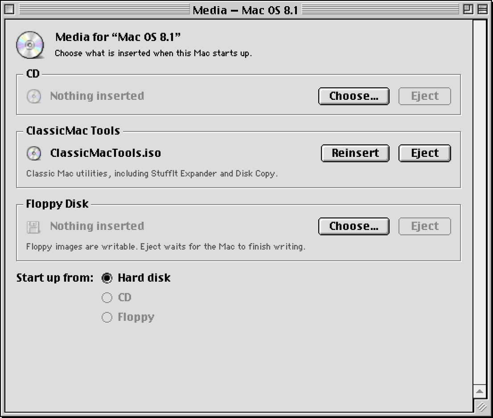
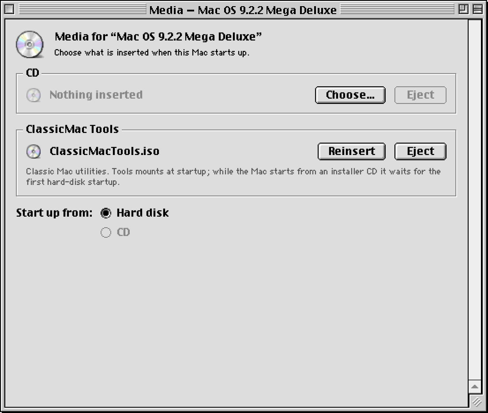
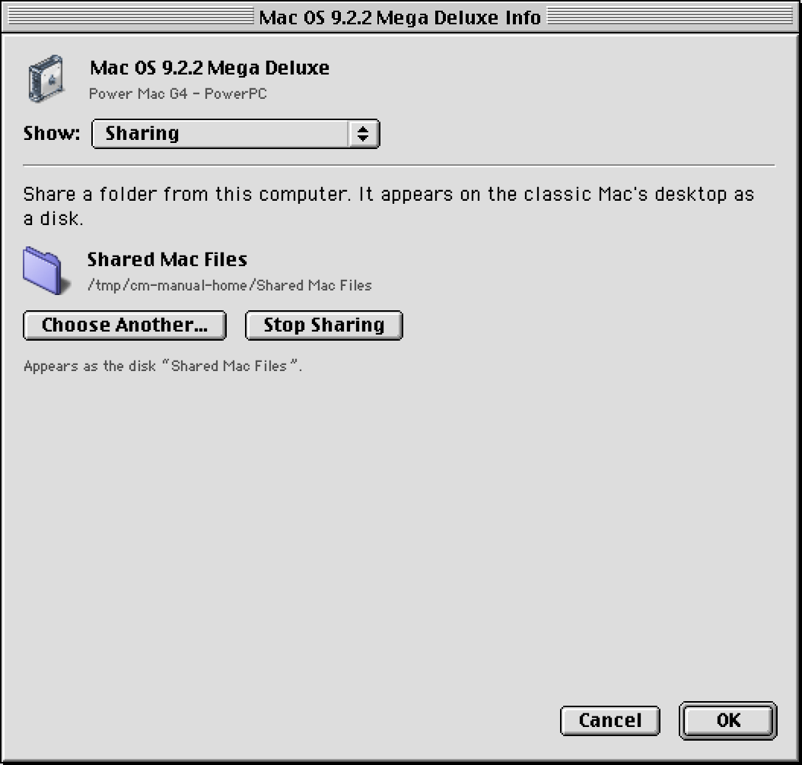
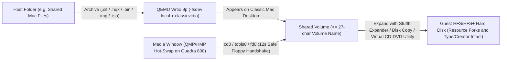

# 8. Media Drawer, ClassicMac Tools CD & Shared Folders

Moving software, games, and documents into and out of a classic Mac works through three complementary systems in ClassicMac: the **Media** window (for optical discs and floppy images), the bundled **ClassicMac Tools** disc (`ClassicMacTools.iso`), and **Shared Folders** (for live folder sharing between your host computer and the guest desktop).

---

## The Media Window & Drive Differences

You can open a machine's **Media** window from:
- The **Media…** button (or right-click context menu) in the Home window
- **Machine → Media…** in the ClassicMac menu bar (or **Mac → Media…** in the native guest menu)
- The **Media…** button on the guest window toolbar or in Browser Display

Accepted image formats are **uncompressed raw** images: `.iso`, `.toast`, `.cdr`, `.img`, and `.raw` for CDs, and writable `.img`, `.dsk`, `.ima`, or `.raw` files for floppies. ClassicMac keeps a list of up to **12 recent images** (`ClassicMac.RecentMedia.v1`), marking missing files with **Locate…**.

  
  

### Quadra 800 vs. Power Mac G4 vs. Mac OS X

Because real New World Power Macs dropped the floppy drive and Mac OS 9 handles IDE hot-plugging differently from 68k SCSI, the **Media** window adapts to each machine family:

| Feature | Quadra 800 | Power Mac G4 (Mac OS 8.5–9.2.2) | Power Mac G4 (Mac OS X) |
| :--- | :--- | :--- | :--- |
| **User CD-ROM (`cd0`)** | SCSI CD-ROM (`scsi-cd,scsi-id=3`) | IDE CD-ROM (`if=ide,index=3` on disk boot; `index=2` on CD boot; Virtio-mirrored on G3 legacy profile) | IDE CD-ROM (`if=ide,index=2`) |
| **ClassicMac Tools (`tools0`)** | Dedicated second SCSI CD-ROM (`scsi-id=4`) | Read-only Virtio block disk (`virtio-blk-pci`, node `classicmac-tools`) via `ndrvloader` (IDE `tools0` tray kept empty) | Not available |
| **Floppy Drive (`fd0`)** | Removable writable Virtio floppy (`nubus-virtio-mmio` + `virtio-blk-device,removable=on`) | Not available (New World Power Macs have no floppy controller) | Not available |
| **Startup Options** | **Hard disk**, **CD**, or **Floppy** (written to Quadra PRAM `DefStartRec` bytes `0x78..0x7B`) | **Hard disk** or **CD** | **Hard disk** or **CD** |
| **Changes While Running** | **Live hot-swap** via HMP `classicmac-media` | **Staged for next startup** (restart or shut down and start to apply) | **Staged for next startup** |

### Boot from CD / Floppy & Installer Auto-Switch

- Selecting **CD** (`bootFromCD: true`) or **Floppy** (`bootFromFloppy: true`) under **Start up from:** boots the Mac from that medium on the next startup. On Quadra 800, `applyQuadraBootPRAM` writes the selected device record (`0xffffffdc` for CD, `0x00000ca0` for Virtio floppy, `0xffffffdf` for SCSI hard disk) directly into `pram.img` before QEMU starts.
- Ejecting the currently selected startup disc automatically switches **Start up from:** back to **Hard disk** so the machine is never left pointing at an empty tray.
- After installing Mac OS onto a blank hard disk from a CD, ClassicMac inspects the hard disk on clean shutdown (`MacDiskImage.hasBlessedSystemFolder`) and automatically switches `bootFromCD` back to `false` once a blessed `System Folder` is present—leaving the CD inserted while booting from your new hard disk next time.

### Runtime Hot-Swap on Quadra 800

When a **Quadra 800** is running (and not paused), the **Media** window communicates live with QEMU over the HMP monitor socket (`classicmac-media status`, `insert`, `eject`):

- **CD & Tools Hot-Swap:** ClassicMac validates the image file, sends `classicmac-media insert cd0|tools0 "<path>"` (or `eject`), and confirms the host drive state. Because Mac OS 7/8's SCSI CD driver does not always auto-mount a disc inserted after startup, the window advises restarting if the disc does not appear on the desktop.
- **Safe Writable Floppy Eject:** You cannot replace a mounted floppy directly—**Choose… / Replace…** stays disabled until you click **Eject**. Clicking **Eject** sends `classicmac-media eject fd0` and polls `classicmac-media status` every `250 ms` for up to **12 seconds** while waiting for the `classicvirtio` guest driver to flush buffered writes and release the volume. ClassicMac **never** force-ejects a busy floppy; if Mac OS is still writing to it, eject the floppy icon from the guest Finder desktop (drag to Trash or `Command-Y`) first.
- **Paused Guard:** Live media changes are blocked while a Quadra 800 is paused so the guest can complete pending disk flushes safely.

---

## The `ClassicMac Tools` Volume (`ClassicMacTools.iso`)

ClassicMac bundles a custom **32 MiB Apple Partition Map + standard HFS** disc image (`ClassicMacTools.iso`), built reproducibly by `scripts/build-guest-cd.sh` from `guestcd/manifest.tsv`. Using an Apple Partition Map ensures both 68k Quadra ROMs and PowerPC Macs mount it natively. Every archive on the disc is **pre-expanded on the host** using `unar` and written with `hfsutils` (`hcopy -m`) so classic Mac resource forks and Type/Creator codes are already intact—meaning every utility is ready to run without needing an archiver first.

### Auto-Insertion & Behavior

- **Power Mac G4:** Enabled by default (`toolsCDInserted: true`, governed by one-time migration marker `toolsDeliveryVersion: 1`). On hard-disk boots, `ClassicMacTools.iso` mounts automatically as a read-only Virtio disk (`classicmac-tools`) alongside your desktop volumes. While booting from a **user CD or installer CD** (`bootFromCD: true`), ClassicMac automatically defers Tools until your next hard-disk boot so installers never confuse the Tools volume with an install disc.
- **Quadra 800:** Off by default on new VMs, or toggleable anytime in **Media → ClassicMac Tools** (`Insert` / `Reinsert` / `Eject`), mounting on dedicated SCSI ID 4 (`tools0`).

### Complete Tools Inventory

Every item included on `ClassicMacTools.iso` (`guestcd/manifest.tsv` and `scripts/build-guest-cd.sh`):

| Item on `ClassicMac Tools` | Target Guest OS / Arch | What It Does & How to Use It |
| :--- | :--- | :--- |
| **Read Me** | All (SimpleText `TEXT`/`ttxt`) | Quick-reference instructions for every tool on the disc. |
| **ClassicMac Display** | Power Mac G4 (Mac OS 9 + ATI Radeon) | Contains ` ClassicMac Display Startup` (`INIT`/`CMds`) and `ClassicMac Display` (`appe`/`CMds`). Drag both onto your closed `System Folder` so Mac OS 9 switches from ATI's `640 × 480` default to your chosen resolution at startup. |
| **Apple HD SC Setup (patched)** | 68k (System 7.0 – 7.6) | Apple's formatter patched to remove the Apple-OEM drive check so you can initialize blank QEMU SCSI hard disks on System 7.x. *(Use Drive Setup on Mac OS 8.1+ for HFS+.)* |
| **Lido 7.56** | 68k + PPC (System 6 – Mac OS 9) | Universal third-party SCSI/IDE disk formatter—reliable fallback if Apple's formatter refuses a disk. |
| **StuffIt Expander 5.5.sea** | 68k + PPC (System 7.1.1+) | Self-extracting installer for **StuffIt Expander 5.5**, essential for unpacking `.sit`, `.hqx`, and `.bin` software downloads. |
| **DropStuff 5.5 Installer** | 68k + PPC | Installs DropStuff and **Expander Enhancer**, adding `.zip` and extra archive support to StuffIt Expander. |
| **Disk Copy 6.3.3.smi** | 68k + PPC | Self-mounting image containing Apple's **Disk Copy 6.3.3** for mounting `.img`, `.dsk`, and `.smi` disk images inside Mac OS. |
| **Virtual CD-DVD Utility** | PPC / 68k | Mounts `.iso` and `.toast` CD images directly from inside Mac OS. Launch the app and use **File → Open** rather than double-clicking `.iso` files in Finder. Pairs cleanly with Shared Folders. |
| **USB Overdrive 1.4** | Power Mac (Mac OS 8.5 – 9.2.2) | Adds native USB scroll-wheel and multi-button mouse support. **Important:** After installing it, uncheck **Right-click and scroll wheel in classic apps** (`classicInputHelpers`) in **Get Info → General Information** to prevent doubled input. *(Skip on Quadra 800.)* |
| **Transmit 1.6 PPC** | Power Mac (PPC) | Panic's classic FTP client for PowerPC Macs. Drag the folder to your hard disk. |
| **Transmit 1.6 68k** | Quadra 800 (68k) | Panic's classic FTP client compiled for Motorola 68k Macs. |

---

## Host-Guest Shared Folders (`sharedFolderPath`)

To transfer files smoothly between your modern computer and your classic Mac without creating disk images every time, enable a **Shared Folder** in **Get Info → Sharing** (while the Mac is shut down).

  

### Setting Up & Platform Support

- **Where it works:** Supported on **Quadra 800** and **Power Mac G4** on **macOS** and **Linux** hosts. Unavailable for **Mac OS X** (use HTTP/FTP/SMB or CD images instead), **Apple / Bandai Pippin** (boots optical discs with 128 KB Save Flash), **Copland D11E4**, and **Windows** hosts (where Virtio 9p host sharing is disabled in `native/src/machine.cpp`).
- **Default state:** Off by default (`sharedFolderPath: nil`) until you click **Choose Folder…** and select a folder (such as `~/Documents/ClassicMac/Shared Mac Files` or any folder you create). Click **Stop Sharing** to detach it.
- **How it works:** ClassicMac passes `-fsdev local,id=share0,security_model=none,path=...` through **Virtio 9p** (`virtio-9p-pci` + `ndrvloader` on Power Mac; `virtio-9p-device` + `nubus-virtio-mmio` + `declrom` on Quadra 800). On boot, the folder appears directly on your classic Mac's desktop as a shared volume.
- **Volume naming rules (`sharedVolumeName`):** Classic Mac HFS volume names cannot contain colons (`:`) or exceed **27 characters**. ClassicMac automatically replaces `:` (and `,` on macOS) with `-` and truncates the folder name to 27 characters (falling back to `Shared` / `Shared Files`).
- **Booting from CD:** Shared folders are automatically hidden whenever **Start up from: CD** is active so OS installers never treat the shared folder as an install target.
- **Virtual Printing Integration:** When **Printing** is set to **Save as PDF** and a Shared Folder is configured, ClassicMac saves printed PDFs straight into **`<Shared Folder>/Printed PDFs/`** so both your host Mac and your classic Mac can access them immediately (see [Chapter 9](09-networking-and-virtual-printing.md)).

### Preserving Classic Mac Resource Forks & Filenames

Classic Mac applications and fonts store essential code, icons, and metadata in a **resource fork** alongside the **data fork**, plus 4-byte Finder **Type** and **Creator** codes. Even though ClassicMac's `classicvirtio` 9p driver preserves directory timestamps, Finder flags, and basic files cleanly on macOS and Linux, transferring loose unzipped Mac applications across modern host tools, browsers, or Windows/FAT USB sticks will often strip resource forks and Type/Creator codes—turning an application into an unlaunchable blank document icon.

Follow this workflow for reliable file exchange:

1. **Always transfer archives or disk images, not loose apps:** Download or place `.sit` (StuffIt), `.hqx` (BinHex), `.bin` (MacBinary), `.img`/`.smi` (Disk Copy), or `.iso`/`.toast` files into your Shared Folder on the host.
2. **Unpack inside the classic Mac:** Open the shared volume on the classic Mac desktop and expand `.sit`/`.hqx`/`.bin` archives using **StuffIt Expander 5.5**, or mount `.img`/`.iso` images with **Disk Copy 6.3.3** / **Virtual CD-DVD Utility** (all included on `ClassicMac Tools`).
3. **Copy to your HFS/HFS+ hard disk:** Drag the unpacked application or files onto your Mac's virtual hard disk so all forks and Finder metadata live natively on HFS/HFS+.
4. **Watch filename limits:** Keep filenames at **31 characters or fewer** and avoid `:` (which Classic Mac uses as the path separator) and `/`.

---

**Previous:** [7. Display, 3D Graphics, Browser Display & Sound](07-display-3d-graphics-and-sound.md) · **Next:** [9. Networking & Virtual Printing](09-networking-and-virtual-printing.md)
