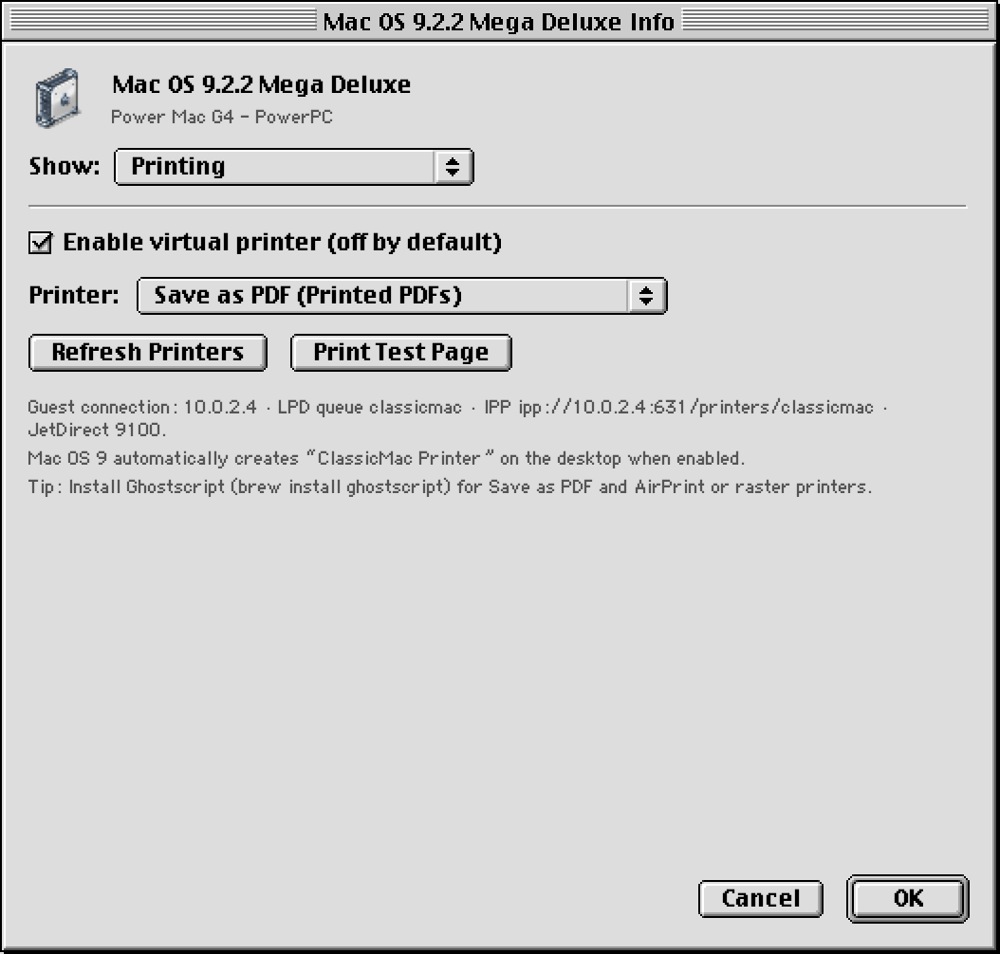
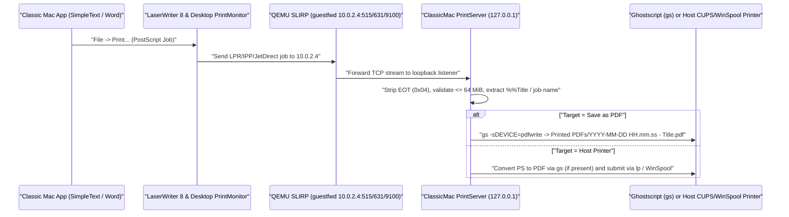
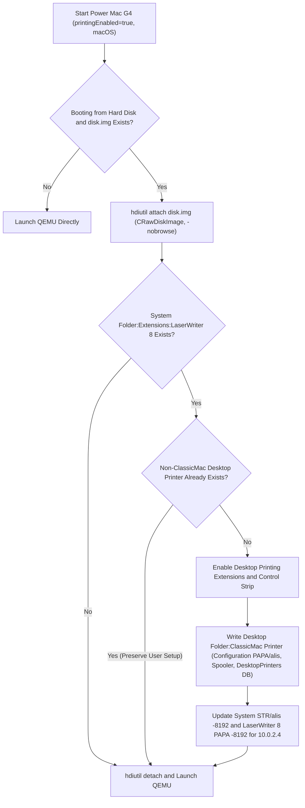

# 9. Networking & Virtual Printing

ClassicMac connects your classic Macs to the modern Internet through QEMU's zero-configuration user-mode (SLIRP) network stack, and includes a built-in **Virtual Print System** (`LPD`, `IPP`, and `JetDirect`) that turns PostScript jobs from System 7, Mac OS 8/9, and Mac OS X Tiger into **searchable PDFs** or sends them straight to **any real printer** on your host computer.

---

## QEMU SLIRP User-Mode Networking

Networking is enabled by default (`"networking": true`, controlled by **Use this computer's Internet connection** in **Get Info → General Information**). Because QEMU uses user-mode SLIRP (`-nic user,model=...`), no administrator privileges, TAP/TUN kernel extensions, or host firewall changes are required.

### Emulated Network Adapters

| Machine Family | Emulated NIC (`model=`) | Notes |
| :--- | :--- | :--- |
| **Quadra 800** | `dp83932` | Onboard National Semiconductor SONIC Ethernet. |
| **Power Mac G4 & Mac OS X** | `sungem` | Onboard Apple SunGEM Ethernet. |
| **Power Mac G4 (Legacy 8.5/8.6 Virtio profile)** | `rtl8139` | Realtek 8139 (`rtl8139.romfile=`, `rtl8139.tx-delay-ns=1000000`) when `useVirtioDisk` is enabled. |

### Virtual Network Addressing (`10.0.2.0/24`)

QEMU's SLIRP router provides a built-in DHCP server and virtual subnet:

| Role | IP Address | Purpose |
| :--- | :--- | :--- |
| **Guest Mac (DHCP)** | `10.0.2.15` | Default IP assigned to your classic Mac (subnet mask `255.255.255.0`). |
| **Gateway / Router** | `10.0.2.2` | Virtual SLIRP router to your host's network/Internet. |
| **DNS Server** | `10.0.2.3` | Virtual DNS proxy forwarding lookups through your host OS. |
| **Virtual Print Host** | `10.0.2.4` | Forwarded via QEMU `guestfwd` to ClassicMac's host `PrintServer`. |

### Classic Mac OS TCP/IP Setup

Ready-to-run Library editions come pre-configured for Ethernet DHCP. If you install Mac OS yourself:

1. Open **Apple Menu → Control Panels → TCP/IP**.
2. Set **Connect via:** to **Ethernet** (or **Ethernet built-in**).
3. Set **Configure:** to **Using DHCP Server** (or enter Manual values: IP `10.0.2.15`, Subnet Mask `255.255.255.0`, Router `10.0.2.2`, Name server `10.0.2.3`).
4. Close the window and click **Save** when prompted.

In **Mac OS X 10.4.11 Tiger**, **Built-in Ethernet** automatically receives `10.0.2.15` via DHCP out of the box.

### What Works & SLIRP Limitations

- **Web browsing & downloads:** Vintage TLS/HTTP clients such as **Classilla** (on Mac OS 8.6–9.2.2) and **Safari** (on Mac OS X Tiger) connect seamlessly through your host's Internet connection. *(Note: 1990s/2000s browsers lack modern TLS 1.2/1.3 ciphers for many current HTTPS sites; use an HTTP proxy or local archive mirror when needed.)*
- **FTP & AppleShare over TCP/IP:** **Transmit 1.6** (included on `ClassicMacTools.iso`) and **Chooser → AppleShare → Server IP Address…** connect cleanly to TCP/IP servers on your LAN or the Internet.
- **No raw ICMP `ping`:** QEMU SLIRP translates TCP and UDP sockets at user space without raw ICMP privileges, so `ping` from the guest to external hosts times out even when web browsing works normally.
- **No inbound LAN discovery or EtherTalk:** Guest Macs sit behind QEMU's NAT at `10.0.2.15` and cannot receive unsolicited inbound connections or broadcast AppleTalk DDP packets across your physical LAN.
- **Offline printing mode:** If you uncheck **Use this computer's Internet connection** (`networking: false`) while **Enable virtual printer** is checked, ClassicMac passes `user,restrict=on` so the guest stays isolated from the Internet while still reaching the virtual printer at `10.0.2.4`.

---

## ClassicMac 4.10.0 Virtual Print System

The virtual printer is **off by default** (`"printingEnabled": false`) and can be enabled per machine in **Get Info → Printing** (available on Quadra 800, Power Mac G4, and Mac OS X; unavailable on Copland D11E4).

  

### How Print Jobs Travel from Guest to Host

When virtual printing is enabled, ClassicMac starts a local `PrintServer` (macOS Swift `PrintServer.swift` / Windows & Linux `native/src/printer.cpp`) listening on host loopback `127.0.0.1` across three protocols, and wires QEMU's SLIRP `guestfwd` rules to forward traffic aimed at **`10.0.2.4`**:

| Protocol | Guest Target (`10.0.2.4`) | Host Loopback Listener | Notes |
| :--- | :--- | :--- | :--- |
| **LPD / LPR** (RFC 1179) | `10.0.2.4:515` (queue `classicmac`) | `127.0.0.1:<lpdPort>` | Used by Classic Mac OS **LaserWriter 8** Desktop Printers; handles Mac OS 9 `Desktop PrintMonitor` leading NUL padding and duplicate subcommand headers. |
| **IPP** (RFC 8010/8011) | `ipp://10.0.2.4:631/printers/classicmac` | `127.0.0.1:<ippPort>` | HTTP/1.1 binary IPP supporting `Get-Printer-Attributes`, `Validate-Job`, `Create-Job`, `Send-Document`, `Print-Job`, `Cancel-Job`, `Get-Job-Attributes`, `Get-Jobs`, chunked bodies, and `100-continue`. |
| **AppSocket / HP JetDirect** | `10.0.2.4:9100` | `127.0.0.1:<rawPort>` | Accepts raw PostScript or PDF TCP streams (up to 64 MiB per job, stripping `0x04` EOT bytes). |

On macOS, QEMU bridges each `guestfwd` stream via `/usr/bin/nc 127.0.0.1 <port>`; on Windows and Linux, QEMU invokes ClassicMac's built-in `--tcp-bridge 127.0.0.1 <port>` helper (`native/src/machine.cpp`).

### Output Destinations: Save as PDF vs. Host Printers

Use the **Printer:** pop-up in **Get Info → Printing** to choose where print jobs go:

- **Save as PDF (`"printerName": "pdf"`):**
  - Converts incoming PostScript jobs to searchable PDF using **Ghostscript** (`gs -q -dBATCH -dNOPAUSE -dSAFER -sDEVICE=pdfwrite` on macOS/Linux, or `gswin64c.exe` / `gswin32c.exe` on Windows; jobs already starting with `%PDF-` are saved directly).
  - **Output folder:** If the machine has a valid **Shared Folder** configured, PDFs are saved into **`<Shared Folder>/Printed PDFs/`** so they appear inside the guest too; otherwise they are saved into **`~/Documents/ClassicMac/Printed PDFs/`** (`HostPrinterManager.defaultPDFOutputDirectory`).
  - Filenames are timestamped and sanitized automatically: `YYYY-MM-DD HH.mm.ss - <Job Name>.pdf`.
- **System Default Printer (`"printerName": nil`) or Specific Host Printer:**
  - ClassicMac discovers local queues via `/usr/bin/lpstat -p -l` and `lpstat -d` on macOS/Linux (or `EnumPrintersW` on Windows). Click **Refresh Printers** to rescan queues.
  - When Ghostscript (`gs`) is installed (for example via `brew install ghostscript` on macOS), ClassicMac converts PostScript jobs to PDF before passing them to `/usr/bin/lp -d <queue>`, so modern **AirPrint** and raster inkjet/laser printers work without native PostScript hardware. Without Ghostscript, ClassicMac passes `document-format=application/postscript` directly to `lp` (requiring a PostScript-capable printer).
- **Print Test Page:** Click **Print Test Page** in **Get Info → Printing** at any time to verify your Ghostscript installation, PDF output folder, or physical printer without even booting a Mac.

---

## Zero-Config Offline Mac OS 9 Provisioning (`GuestPrinterProvisioner`)

On **macOS**, when you enable virtual printing for a **Power Mac G4** hard-disk boot (`GuestPrinterProvisioner.swift`), ClassicMac automatically provisions a ready-to-use **`ClassicMac Printer`** Desktop Printer before QEMU launches:

Specifically, `GuestPrinterProvisioner`:
1. Mounts `disk.img` temporarily using `hdiutil attach -imagekey diskimage-class=CRawDiskImage -nobrowse`.
2. Checks `System Folder:Extensions:LaserWriter 8` and aborts cleanly (without overwriting) if you already created your own custom Desktop Printer on the Desktop.
3. Re-enables `Desktop Printer Spooler`, `Desktop PrintMonitor`, `Desktop Printer Menu` (from `Extensions (Disabled)`), and `Printer Selector` (from `Control Strip Modules (Disabled)`).
4. Selects the best available PPD (preferring `LaserWriter Color 12/600 PS`), builds `Desktop Folder/ClassicMac Printer/` (`Configuration` resource fork `dtpc`/`dcdc` with `PAPA -8192` pointing to `10.0.2.4`, queue `classicmac`, zone `=LPR`), registers `TheVolumeSettingsFolder/DesktopPrinters DB`, and sets `System` and `LaserWriter 8` default printer resources (`-8192`).
5. Detaches the disk cleanly before QEMU boots—so **ClassicMac Printer** is already selected and ready on first launch.

---

## Manual Guest Printer Setup

If you are running **Mac OS 8 / System 7.5.5**, **Mac OS X 10.4 Tiger**, or a Power Mac on **Windows/Linux** (where offline `hdiutil` provisioning does not run), set up the printer once inside the guest:

### Mac OS 8.1 – 9.2.2 (Desktop Printer Utility)

1. Open **Macintosh HD → Applications (Mac OS 9) → Utilities → Desktop Printer Utility** (or **Apple Extras → Apple LaserWriter Software → Desktop Printer Utility**).
2. Choose **LaserWriter 8** and select **Printer (LPR)**, then click **OK**.
3. Under **PostScript Printer Description (PPD) File**, click **Change…** and choose **LaserWriter Color 12/600 PS** (or **Generic** for black-and-white / universal PostScript).
4. Under **LPR Printer Selection**, click **Change…**:
   - **Printer Address:** `10.0.2.4`
   - **Queue:** `classicmac`
5. Click **Verify** (optional), click **Create…**, save as **ClassicMac Printer** on the Desktop, and verify it is selected as the default printer (**Printing → Set Default Printer** or via the Control Strip **Printer Selector**).

> [!TIP]
> **System 7.5.5 on Quadra 800:** Stock System 7.5.5 predates Mac OS 8's built-in LPR Desktop Printer Utility. To print from System 7.5.5, select **LaserWriter 8** in **Chooser**, choose **Print → Destination: File** to save a `.ps` PostScript file into your **Shared Folder** (see [Chapter 8](08-media-tools-and-sharing.md)), or print via an add-on MacTCP LPR spooler targeting `10.0.2.4` queue `classicmac`.

### Mac OS X 10.4.11 Tiger (Printer Setup Utility)

1. Open **Applications → Utilities → Printer Setup Utility** (visible in [Chapter 7's Tiger screenshot](07-display-3d-graphics-and-sound.md)).
2. Click **Add** in the Printer List window, then select **IP Printer** in the toolbar.
3. Configure the connection:
   - **Protocol:** **Line Printer Daemon - LPD** *(or **HP JetDirect - Socket** or **Internet Printing Protocol - IPP**)*
   - **Address:** `10.0.2.4`
   - **Queue:** `classicmac` *(leave blank for JetDirect Socket `9100`; use `printers/classicmac` for IPP)*
   - **Name:** `ClassicMac Printer`
   - **Print Using:** **Generic PostScript Printer** *(or **Apple Color LaserWriter 12/600** for color PostScript)*
4. Click **Add**. Any document you print in Mac OS X now flows directly to **Printed PDFs** or your host printer.

---

**Previous:** [8. Media Drawer, ClassicMac Tools CD & Shared Folders](08-media-tools-and-sharing.md) · **Next:** [10. Creating, Packaging & Serving Custom Images](10-creating-and-serving-images.md)
