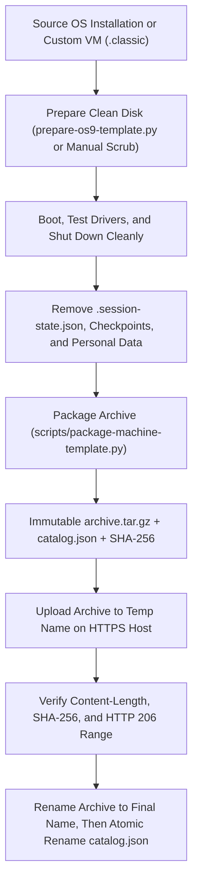
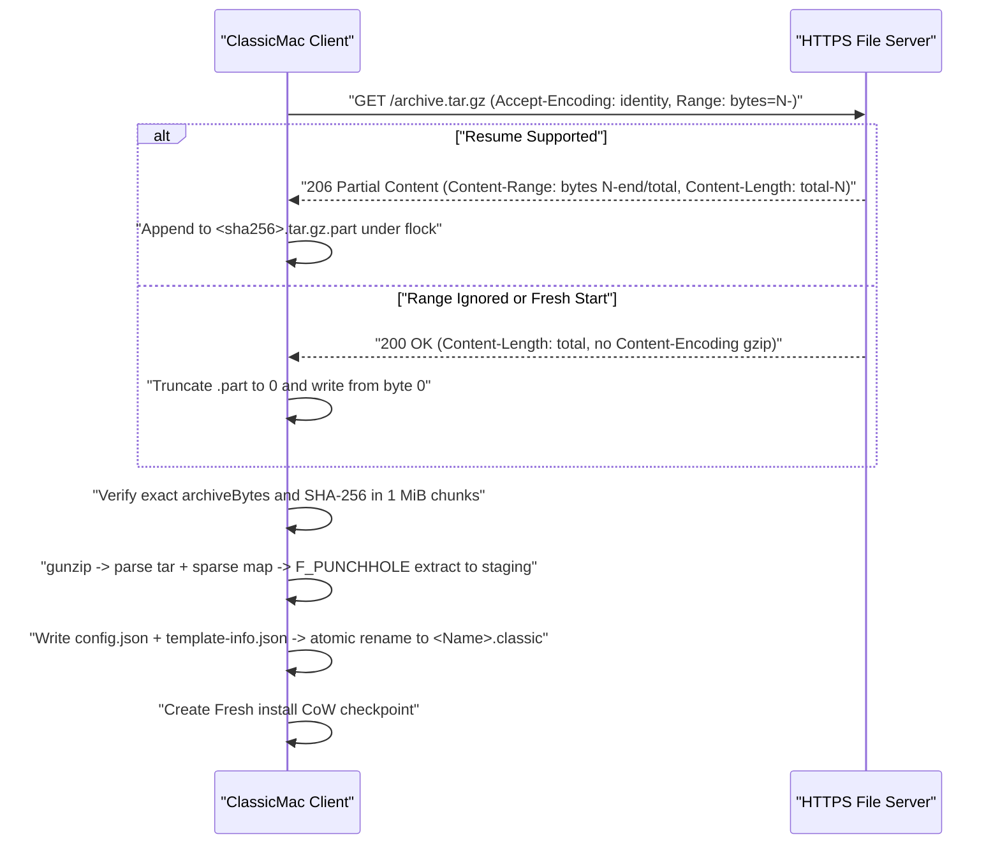

# 10. Creating, Packaging & Serving Custom Images

ClassicMac's **Mac OS Library** downloads ready-to-run virtual machines from HTTPS catalogs (`https://mcchord.net/classicmac/catalog-v2.json` and `https://mcchord.net/retroboot-downloads/catalog.json`). Using the repository's template preparation and packaging scripts, you can also build clean, sparse-aware `.tar.gz` machine archives and serve custom `catalog.json` feeds for your own organization, lab, or software distribution workflow.

For background on how the Library downloads and extracts these archives on user machines, see [4. Mac OS Library & Downloadable Editions](04-mac-os-library-and-editions.md). For full field-by-field definitions of `config.json` and `template-info.json`, see [12. Configuration, Bundles & Environment Reference](12-configuration-and-cli-reference.md).

---

## End-to-End Template Pipeline



---

## 1. Designing a Clean Template VM

Every ClassicMac template starts as a **stopped**, self-contained `.classic` package whose guest filesystem and metadata are safe for distribution.

### Required and Optional Files Inside a Source `.classic` Bundle

| File | Machine Family | Requirements & Limits |
| :--- | :--- | :--- |
| `config.json` | All | Required (`<= 64 KiB`). Hardware settings only; packager strips user paths. |
| `disk.img` | All | Required raw disk image (`>= 512` bytes, multiple of 512 bytes, `<= 140 GiB`). |
| `preview.png` | All | Optional screenshot (`<= 16 MiB`), included only when `--include-preview` is passed. |
| `Quadra800.rom` | `quadra800` | Optional in archive; if present, must be `1,048,576` bytes matching the pinned SHA-256. |
| `pram.img` | `quadra800` | Optional `256`-byte or `512`-byte Quadra PRAM image. |
| `bootrom.bin` | `powerMac7500` | Required for Copland (`4,194,304` bytes, pinned SHA-256). |
| `nvram.bin` | `powerMac7500` | Required for Copland (`8,209` bytes, `DINGUSPPCNVRAM\0\0\x20` header). |
| `nvram.img` | `powerMacOSX` | Optional `16,384`-byte dual-bank Power Mac OS X flash NVRAM. |

> [!IMPORTANT]
> ClassicMac template archives store **raw sector-aligned disk images** named `disk.img`—not `.qcow2` files. Raw images maximize compatibility with classic Apple SCSI/IDE drivers while remaining sparse on APFS, NTFS, ext4/Btrfs/XFS, and inside gzipped archives.

### Scrubbing User-Specific State Before Packaging

`scripts/package-machine-template.py` **does not inspect or scrub HFS/HFS+ filesystem contents**. Before packaging any manually built VM:

1. **Inside the guest OS:**
   - Remove personal documents, browser histories, AppleShare/network credentials, keychains, and `System Folder/Preferences` items containing user or host names.
   - Delete any Desktop aliases pointing to host shared folders (`sharedFolderPath`).
   - Empty the Trash and shut down cleanly (`Special -> Shut Down` or ClassicMac's **Shut Down** command) so the HFS/HFS+ volume is unmounted cleanly without a dirty-volume flag.
2. **Inside the `.classic` bundle on the host:**
   - Remove `Checkpoints/`, `.session-state.json`, and `template-info.json` if present from earlier test runs.
   - Verify `preview.png` (if passing `--include-preview`) shows a clean, representative desktop without sensitive window contents.
3. **Host path sanitization (`config.json`):**
   - You do not need to hand-edit `config.json` to strip local paths if using `scripts/package-machine-template.py`: the packager retains only an allowlisted set of hardware keys (`ramMB`, `diskSizeGB`, `width`, `height`, `depth`, `customResolution`, `networking`, `sound`, `useG4CPU`, `useVirtioDisk`, `tabletInput`, `classicInputHelpers`, `graphicsCard`, plus `toolsCDInserted`), resets `id` to `"00000000-0000-0000-0000-000000000000"`, forces `useEnhancedFramebuffer: false`, `useBrowserDisplay: false`, `bootFromCD: false`, and `toolsDeliveryVersion: 1`, and omits `sharedFolderPath`, `cdImagePath`, `floppyImagePath`, `bootFromFloppy`, `printingEnabled`, and `printerName`.
   - At import time, `MachineTemplateInstaller.swift` and `native/src/catalog.cpp` sanitize `config.json` a second time, assign a fresh UUID, merge `recommendedSettings`, and write `template-info.json`.

---

## 2. Preparing Clean Mac OS 9 Templates (`prepare-os9-template.py`)

For public or organizational **Mac OS 9** templates, copying files into a freshly formatted filesystem is far safer than deleting files from an existing image—deleted bytes in HFS+ free space can otherwise remain inside the distributed raw disk. `scripts/prepare-os9-template.py` automates this on macOS:

```sh
python3 scripts/prepare-os9-template.py \
  /path/to/audited-os9-source.img \
  /path/to/Mac-OS-9.2.1.classic \
  --graphics-source /path/to/os9-with-apple-ati.img \
  --ati \
  --capacity-gb 32
```

### What `scripts/prepare-os9-template.py` Does

1. **Read-only source verification:** Attaches the source image read-only (`diskutil image attach --noMount --readOnly`), checks the 512-byte Apple Driver Map (`"ER"`), Apple Partition Map (`"PM"`), and `Apple_HFS` partition, and parses `System Folder/System`'s `vers` resource (`09xx`) to verify Mac OS 9.
2. **Fresh sparse disk & HFS+ formatting:** Extracts only the Apple driver partitions (`partition_prefix`), creates a new zero-filled sparse `disk.img` at the chosen `--capacity-gb` (`8`, `16`, `32`, `64`, or `128` GiB; default `32`), and formats the volume with `/sbin/newfs_hfs -v "Macintosh HD"`.
3. **Allowlisted system copy:** Copies only explicit `SYSTEM_ITEMS` (`Appearance`, `Control Panels`, `Extensions`, `Finder`, `Fonts`, `Mac OS ROM`, `System`, `System Resources`, etc.), `APPLE_MENU_ITEMS`, and `APPLICATIONS` (`SimpleText`, `Graphing Calculator`) using `ditto --rsrc --extattr --noacl --noqtn`. Any item whose name contains `gxmetal` is excluded *before* writing so retired graphics bytes never enter free space. Empty directories (`Preferences`, `Startup Items`, `Shutdown Items`, `Servers`, `Favorites`, `Desktop Folder`, `Documents`, `Trash`) are created fresh.
4. **ATI Radeon & ClassicMac Display (`--ati`):** Copies verified Apple QuickDraw 3D/OpenGL extensions and ATI Radeon extensions (checking Apple/ATI resource fork signatures) from `--graphics-source` (or the primary source), decodes `guestcd/classicmac-display/bin/ClassicMacDisplayInit.bin` and `ClassicMacDisplay.bin` with both data and `..namedfork/rsrc` resource forks and `com.apple.FinderInfo`, and writes `"graphicsCard": "atiRadeon"` in `config.json`.
5. **Blessing & HFS wrapper geometry:** Touches `.metadata_never_index`, writes a MacRoman `Desktop Folder/Start Here` guide, records the `System Folder` CNID in both primary and alternate HFS+ volume headers (`bless_hfsplus`), and rebuilds the scaled classic HFS boot wrapper (`retain_classic_wrapper`).
6. **Audit report:** Writes `<Output>-preparation.json` alongside the `.classic` bundle recording the copied inventory, `systemFolderCNID`, `diskCapacityBytes`, `allocatedBytes`, and SHA-256 hashes of every Apple graphics component.

After running `prepare-os9-template.py`, boot the new `.classic` bundle once in ClassicMac to verify first-run preference generation, graphics, sound, and clean shutdown before packaging.

### Compacting or Converting Disk Images

- **Converting from QCOW2 to sparse raw `disk.img`:** If you built or shrank an image in `qcow2`, convert it back to a raw sector-aligned disk image before packaging:
  ```sh
  qemu-img convert -f qcow2 -O raw source.qcow2 disk.img
  ```
- **Why host `st_blocks` doesn't break sparse packaging:** `scripts/package-machine-template.py` computes `requiredStorageBytes` from the **actual byte payload** of `disk.img` in `1 MiB` (`1,048,576`-byte) chunks, not from the source file's `st_blocks`. Any `1 MiB` range that is all zeroes adds `0` to `requiredStorageBytes` and compresses away in gzip even if the source file was non-sparse. (If you deleted large files from an existing HFS+ disk instead of rebuilding with `prepare-os9-template.py`, zero-fill free space from inside the guest—for example by creating and deleting a temporary zero file or using a disk zeroing utility—before packaging.)

---

## 3. Packaging Archives & Sparse Storage Mechanics

Run `scripts/package-machine-template.py` against a stopped, scrubbed `.classic` bundle:

```sh
python3 scripts/package-machine-template.py \
  --bundle /path/to/Mac-OS-9.2.1.classic \
  --output /path/to/mac-os-9.2.1-ati-32gb-v4.tar.gz \
  --catalog-output /path/to/catalog.json \
  --archive-url https://example.com/classicmac/mac-os-9.2.1-ati-32gb-v4.tar.gz \
  --id mac-os-9.2.1-ati-32gb-v4 \
  --name "Mac OS 9" \
  --os-version "Mac OS 9.2.1" \
  --minimum-app-version 4.4.0 \
  --include-preview
```

### Exact Tar Archive Layout

Both `MachineTemplateInstaller.swift` (macOS) and `native/src/catalog.cpp` (Windows/Linux) enforce a deliberately narrow tar decoder—**no shell ever interprets archive contents**:

- **Flat entries only:** Archive members sit at the root of the tar stream (`config.json`, `disk.img`, optional `preview.png`, and optional family firmware). **Do not** wrap files inside a `<Name>.classic/` directory.
- **Rejected member types:** Any path containing `/`, symlinks, hardlinks, device nodes, duplicate filenames, extra non-sparse PAX headers, or unknown filenames are rejected with `unsafeArchive`.
- **Two supported `disk.img` encodings:**
  1. **Standard GNU tar (`GNU_FORMAT`)** generated by `scripts/package-machine-template.py`: Uses GNU positive base-256 size headers (`0x80` prefix) so raw disks larger than USTAR's 8 GiB limit pack cleanly.
  2. **GNU sparse 1.0 PAX (`thinArchive` / `tar --format=posix --sparse`)**: Parsed by `app/Sources/CMachineArchive/sparse_tar.c`.

### How `sparse_tar.c`, `F_PUNCHHOLE`, and the `256 MiB` Reserve Work

Because a 32 GiB raw disk (`34,359,738,368` bytes) typically contains only a few hundred MiB of OS files, ClassicMac avoids demanding 32 GiB of free space or preallocating zero blocks on sparse-capable filesystems:

1. **1 MiB chunk accounting (`SparseAccountingReader`):** `package-machine-template.py` scans `disk.img` in exact `1 MiB` (`1,048,576`-byte) chunks. Any `1 MiB` chunk containing only zero bytes contributes `0` bytes; any chunk with at least one nonzero byte (including a partial trailing chunk) contributes `1 MiB`. Non-disk files (`config.json`, `preview.png`, firmware) each round up to the next `1 MiB` boundary. The sum is written as `requiredStorageBytes`.
2. **APFS `F_PUNCHHOLE` on macOS:** When `MachineTemplateInstaller.supportsSparseFiles` confirms the destination is APFS with `volumeSupportsSparseFiles == true` and block size `<= 1 MiB`:
   - For flat `disk.img` streams, the installer truncates the target to logical `diskCapacityBytes`, seeks past all-zero `1 MiB` chunks, and issues `fcntl(fd, F_PUNCHHOLE, &hole)` so APFS does not allocate small seek gaps on close.
   - For GNU sparse 1.0 PAX streams, `cm_sparse_disk_size` validates the PAX header (`GNU.sparse.major=1`, `GNU.sparse.minor=0`, `GNU.sparse.name=disk.img`, `GNU.sparse.realsize`, limit `64 KiB`), and `cm_sparse_read_map` reads up to `8 MiB` (`262,144` extents max) of 512-byte-aligned `(offset, length)` pairs. `writeSparseDisk` writes only stored extents and calls `punchSparseGaps` (`F_PUNCHHOLE`) across gaps.
   - Throughout extraction, the installer verifies `st_blocks * 512 <= requiredStorageBytes`. If an archive understates its storage budget, extraction aborts and deletes staging.
3. **Cross-platform sparse support:** On Windows (`FILE_SUPPORTS_SPARSE_FILES` / `FSCTL_SET_SPARSE`) and Linux (non-FAT/exFAT filesystems), `native/src/catalog.cpp` also skips all-zero `1 MiB` chunks and reads GNU sparse 1.0 extent maps.
4. **256 MiB destination reserve:** Before downloading or extracting, both `MachineDownloadModel` and `native/src/catalog.cpp` require `requiredStorageBytes + 256 MiB` free on the destination volume—plus the remaining compressed download bytes if the download cache and destination share the same filesystem.

---

## 4. `catalog.json` / `catalog-v2.json` Schema & Server Rules

A catalog JSON document must be `<= 1 MiB` (`1,048,576` bytes) and decode under `schemaVersion: 1`:

```json
{
  "schemaVersion": 1,
  "machines": [
    {
      "id": "mac-os-9.2.1-ati-32gb-v4",
      "name": "Mac OS 9.2.1 (Clean)",
      "summary": "Clean Mac OS 9.2.1 with Apple ATI Radeon 3D drivers.",
      "osVersion": "Mac OS 9.2.1",
      "minimumAppVersion": "4.4.0",
      "machineFamily": "powerMacG4",
      "archiveURL": "https://example.com/classicmac/mac-os-9.2.1-ati-32gb-v4.tar.gz",
      "archiveBytes": 145678912,
      "installedBytes": 34359738907,
      "diskCapacityBytes": 34359738368,
      "requiredStorageBytes": 212860928,
      "sha256": "0123456789abcdef0123456789abcdef0123456789abcdef0123456789abcdef",
      "tags": ["Clean", "ATI 3D"],
      "highlights": [
        "32 GiB sparse raw disk with Apple ATI Radeon acceleration",
        "ClassicMac Tools ready to mount"
      ],
      "recommendedSettings": {
        "ram_mb": 512,
        "cpu": "g4"
      }
    }
  ]
}
```

### Complete Catalog Schema Reference

#### Top-Level Object (`MachineCatalog`)

| Field | Type | Required | Constraints |
| :--- | :--- | :--- | :--- |
| `schemaVersion` | Integer | Yes | Must be `1`. |
| `machines` | Array | Yes | `0` to `50` entries with globally unique `id` values. |

#### Machine Entry (`DownloadableMachine`)

| Field | Type | Required | Validation & Behavior |
| :--- | :--- | :--- | :--- |
| `id` | String | Yes | `1–100` chars matching `^[a-z0-9][a-z0-9._-]{0,99}$` (no leading `.`). Treat as immutable—publish a new ID for any byte change. |
| `name` | String | Yes | `1–100` non-whitespace chars, no ASCII control characters. |
| `summary` | String | Yes | `1–1000` chars (`\n` allowed; other control chars rejected). |
| `osVersion` | String | Yes | `1–80` non-whitespace chars, no control chars (e.g. `"Mac OS 9.2.1"`, `"10.4.11"`). |
| `minimumAppVersion` | String | Yes | `X.Y` or `X.Y.Z` numeric version (`1–6` digits per part, e.g. `"4.4.0"`). Clients older than this reject installation. |
| `archiveURL` | String | Yes | Must be `https://` with non-empty host, no username/password, and no `#fragment`. |
| `archiveBytes` | Int64 | Yes | Compressed `.tar.gz` byte length (`1` to `140 GiB`). |
| `installedBytes` | Int64 | Yes | Exact sum of all uncompressed file sizes in the archive (`512` to `140 GiB`), excluding tar headers/padding. |
| `sha256` | String | Yes | Exact `64`-character lowercase hex SHA-256 of the compressed `.tar.gz`. |
| `diskCapacityBytes` | Int64 | Optional | Exact logical size of `disk.img` (`>= 512`, multiple of `512`, `< installedBytes`). Non-disk members may total at most `16 MiB + 64 KiB + archiveFirmware.bytes`. |
| `requiredStorageBytes` | Int64 | Optional | Sparse initial allocation bound in `1 MiB` (`1,048,576`) multiples (`>= 1 MiB`). Requires `diskCapacityBytes`. On macOS, must not exceed `installedBytes + (3 + archiveFirmware.files) * 1 MiB` (on Qt native: `installedBytes + 5 MiB`). |
| `machineFamily` | String | Optional | `"powerMacG4"` (default if omitted), `"quadra800"`, `"powerMacOSX"`, or `"powerMac7500"`. |
| `thinArchive` | Object | Optional | `ThinArchive` object (see below). When `format == "retroboot-thin-1"` and all fields are valid, modern clients download the thin archive instead of `archiveURL`. |
| `tags` | `[String]` | Optional | Short badge labels displayed in the macOS Library browser. |
| `highlights` | `[String]` | Optional | Bullet list shown in the macOS edition detail card. |
| `recommendedSettings` | Object | Optional | `RecommendedSettings` object applied on import (see below). |
| `requiredRuntime` | String | Optional | Emitted by `package-machine-template.py` as `"macos8"` when `machineFamily == "powerMacG4"` and `useVirtioDisk == true`. |

#### `ThinArchive` Object

| Field | Type | Validation |
| :--- | :--- | :--- |
| `format` | String | Must equal `"retroboot-thin-1"` to take precedence. |
| `archiveURL` | String | HTTPS URL (`https://`, no userinfo/fragment) to the GNU sparse 1.0 `.thin.tar.gz`. |
| `archiveBytes` | Int64 | Byte length of the thin archive (`1` to `140 GiB`). |
| `sha256` | String | `64`-character lowercase hex SHA-256 of the thin archive. |

#### `RecommendedSettings` Object

If both the archive's `config.json` and the catalog entry contain `recommendedSettings`, the importer merges them (fields inside the archive's `config.json` take priority on macOS; catalog fields take priority on Qt native), clamping RAM to host memory and family limits:

| Field | Type | Effect on Import |
| :--- | :--- | :--- |
| `ram_mb` | Int | Recommended RAM in MiB (`powerMacG4`: clamped `128–896`; `quadra800`: clamped `64–1000` on macOS / `16–1000` on Qt). |
| `osx_ram_mb` | Int | Preferred RAM in MiB for `powerMacOSX` (clamped `256–2048`, and capped by host RAM: `512` on `< 2 GiB`, `1024` on `2–4 GiB`, `2048` on `>= 4 GiB` on macOS; `hostMB / 2` on Qt). |
| `cpu` | String | On `powerMacG4`, `"g3"` sets `useG4CPU = false`; `"7400"` / `"g4"` keeps `useG4CPU = true` (Qt). |
| `graphics` | String | Advisory metadata key decoded by `RecommendedSettings` (use `config.json` `"graphicsCard"` to select `"standard"` vs `"atiRadeon"`). |
| `guest_adapter` | String | Advisory metadata key decoded by `RecommendedSettings`. |

### HTTP Server & CDN Requirements

Both `MachineDownloadTransfer.swift` and `native/src/catalog.cpp` enforce strict transport guarantees:



Configure your web server or CDN with these exact behaviors:

1. **HTTPS only (`https://`) with same-host redirects:** Plain HTTP is rejected. Any `301`/`302`/`303`/`307`/`308` redirect **must keep `https`, the exact hostname, and the exact port**. Redirecting `example.com/archive.tar.gz` to a separate CDN hostname fails with *"The server redirected to an unexpected address."*
2. **Exact `Range` / `206 Partial Content` support:** To resume paused `.tar.gz.part` transfers, the server must return status `206` with exact `Content-Range: bytes <offset>-<archiveBytes - 1>/<archiveBytes>` and `Content-Length: <archiveBytes - offset>`. If a server returns `200 OK` instead, ClassicMac restarts the download cleanly from byte 0.
3. **Never double-encode `.tar.gz`:** ClassicMac sends `Accept-Encoding: identity`. Serve `.tar.gz` files with `Content-Type: application/gzip` and **omit `Content-Encoding`** (or set `identity`). A server returning `Content-Encoding: gzip` is rejected immediately.
4. **Caching and atomic promotion:**
   - Serve versioned `.tar.gz` archives with `Cache-Control: public, max-age=31536000, immutable`. Never overwrite an existing archive filename with different bytes—always bump the `-vN` suffix and `id`.
   - Serve `catalog.json` / `catalog-v2.json` as `application/json` with short/no caching (`Cache-Control: no-cache, max-age=60`).
   - Upload new archives to a temporary filename, verify size/SHA-256 and a byte-range `curl -r 0-1023` request on the server, rename the archive to its final name, back up the previous catalog, and atomically rename the new catalog into place last.

---

## 5. Testing a Custom Image Locally

ClassicMac 5.0.1 **does not expose a `CLASSICMAC_CATALOG_URL` environment variable**—the public catalog URLs (`MachineCatalog.defaultURL` in `app/Sources/ClassicMac/MachineCatalog.swift` and `Library::url` in `native/src/catalog.h`) are compiled constants. To test custom images and catalogs before deploying to production:

1. **Test the `.classic` bundle directly first:** Open your prepared `.classic` package with **File -> Open…** (or double-click it in Finder) and verify boot, display, sound, networking, and clean shutdown.
2. **Verify archive packaging and schema bounds:** Run the repository's unit tests covering packaging and catalog decoding:
   ```sh
   python3 -m unittest scripts/test_package_machine_template.py scripts/test-prepare-os9-template.py
   swift test --package-path app --filter MachineCatalog
   ```
3. **Test end-to-end HTTPS download and sparse extraction:**
   - Because plain `http://` (`python3 -m http.server`) is rejected by `DownloadableMachine.secureURL` and `secureURL()`, place a local TLS reverse proxy (such as `caddy`, `nginx`, or `apache2` with a locally trusted `mkcert` certificate) in front of your test directory and confirm HTTP `Range` works:
     ```sh
     curl -I -H "Range: bytes=0-1023" https://localhost/classicmac/my-image-v1.tar.gz
     # Expect: HTTP/2 206, Content-Range: bytes 0-1023/<total>, Content-Length: 1024
     ```
   - Point a disposable dev build at your local HTTPS catalog URL by editing `MachineCatalog.defaultURL` (macOS) or `Library::url` (Windows/Linux), or pass your test catalog URL to `MachineDownloadModel(catalogURL: ...)` in a Swift test.

---

**Previous:** [9. Networking & Virtual Printing](09-networking-and-virtual-printing.md) · **Next:** [11. Checkpoints, Updates & Troubleshooting](11-checkpoints-updates-and-troubleshooting.md)
