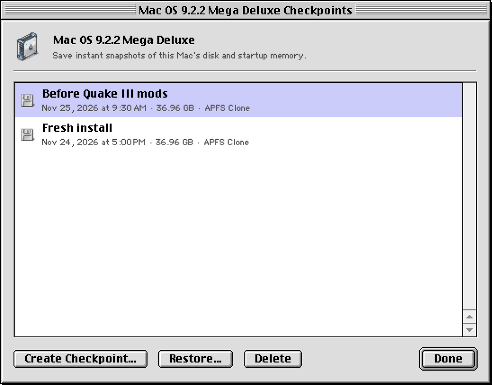
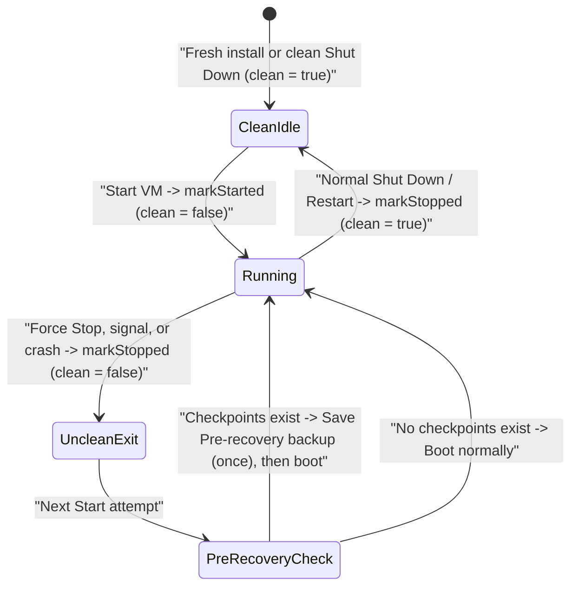
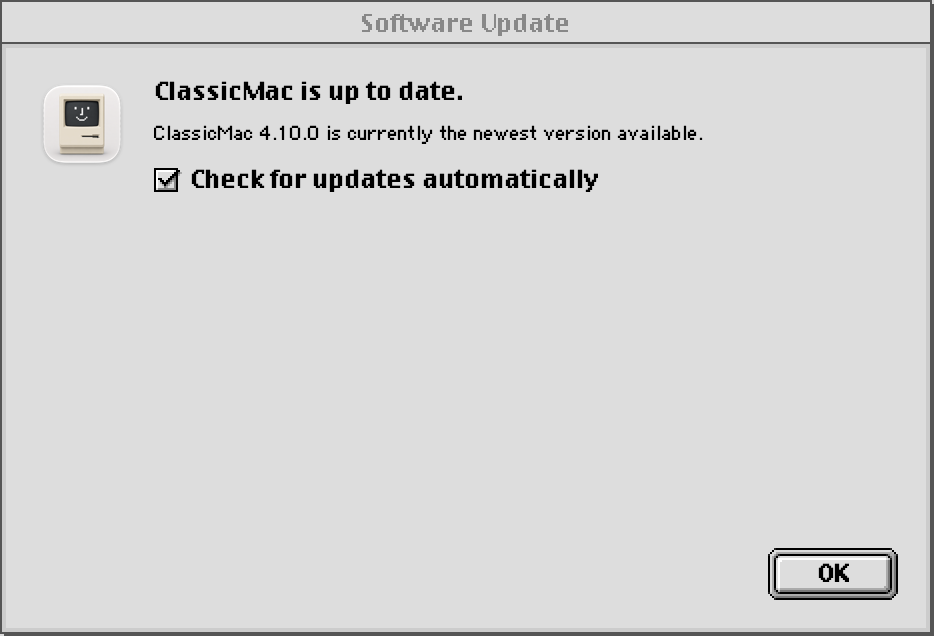
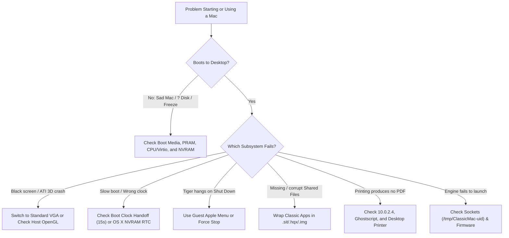

# 11. Checkpoints, Updates & Troubleshooting

ClassicMac protects your virtual machines with instant copy-on-write **Checkpoints**, automatic unclean-shutdown crash recovery, cryptographically verified **Software Updates**, and detailed per-subsystem diagnostics.

---

## Checkpoints (Instant Disk & NVRAM Snapshots)

<p align="center">
  
</p>

Select any stopped Mac and choose **Machine -> Checkpoints…** (or click **Checkpoints…** from the Home window) to create, restore, or delete snapshots.

### Copy-on-Write Mechanics by Platform

Because classic guest filesystems (HFS, HFS+) run inside raw disk images (`disk.img`), taking a live snapshot while the Mac is running would capture an inconsistent, half-flushed disk. ClassicMac therefore requires the Mac to be **shut down** (`VMCheckpointError.running`) before creating or restoring a checkpoint, and uses native copy-on-write (CoW) cloning wherever the host filesystem supports it:

| Host OS | Filesystem Mechanism | `method` in `checkpoint.json` | Storage Impact |
| :--- | :--- | :--- | :--- |
| **macOS** | APFS `clonefile(src, dst, 0)` | `"clonefile"` (*APFS Clone*) | Instantaneous; zero extra blocks until guest writes diverge. |
| **macOS (non-APFS)** | File copy fallback (`ENOTSUP`/`EXDEV`) | `"copy"` (*Copy*) | Copies used data on non-APFS volumes. |
| **Linux** | `ioctl(FICLONE)` on Btrfs/XFS, fallback `cp --reflink=auto --sparse=always`, then `sparseCopyFile` | `"reflink"`, `"sparse"`, or `"copy"` | Zero-copy reflink on Btrfs/XFS; `1 MiB` sparse hole-skipping elsewhere. |
| **Windows** | NTFS sparse copy (`FSCTL_SET_SPARSE`, `1 MiB` zero-skipping) | `"sparse"` or `"copy"` | Skips all-zero `1 MiB` chunks instead of allocating empty guest space. |

### On-Disk Checkpoint Layout & Automatic Safety Backups

Snapshots live inside the machine's own `.classic` bundle under `Checkpoints/<UTC-ID>/` (for example `20261125T143000Z`, with `-2`, `-3` suffixes for same-second collisions):

```text
My Mac.classic/
├── config.json
├── disk.img
├── .session-state.json
└── Checkpoints/
    └── 20261125T143000Z/
        ├── checkpoint.json    # id, label, kind, createdAt, diskBytes, allocatedBytes, method
        ├── disk.img           # Cloned/sparse raw disk snapshot
        ├── pram.img           # Cloned Quadra 800 PRAM (if quadra800)
        └── nvram.img          # Cloned & Adler-32-validated OS X flash NVRAM (if powerMacOSX)
```

ClassicMac creates three automatic checkpoint `kind` values alongside your `"manual"` checkpoints:

1. **`fresh-install` (*Fresh install*):** Created automatically right after a Mac finishes downloading and installing from the **Mac OS Library**. Always lets you reset a downloaded edition back to its clean initial state.
2. **`pre-restore` (*Pre-restore backup*):** Created automatically right before **Restore…** replaces your live `disk.img` (and `pram.img` / `nvram.img`) via atomic `rename()` / `MoveFileExW()`. Even if you restore the wrong snapshot, your previous state is preserved.
3. **`pre-recovery` (*Pre-recovery backup*):** Created automatically at the next startup after an unclean exit (crash, host power loss, or **Force Stop**) when at least one existing checkpoint is present.

### Session State & Crash Recovery Flow

ClassicMac tracks whether a Mac exited cleanly in `<bundle>/.session-state.json`:



---

## In-App Software Updates

<p align="center">
  
</p>

Choose **ClassicMac -> Check for Updates…** (macOS) or **Help -> Check for Updates…** (Windows/Linux) to check GitHub Releases manually, or leave **Check for updates automatically** enabled.

### How Update Verification Works

1. **24-hour GitHub Releases check:** ClassicMac queries `https://api.github.com/repos/amcchord/ClassicMac/releases/latest` at most once every **24 hours** (`86,400` seconds), ignoring drafts and prereleases. You can click **Skip This Version** to suppress automatic prompts for a specific release.
2. **Strict HTTPS host allowlist:** Both the feed request, redirects, `SHA256SUMS`, and release asset download must stay on `https://` and one of four hosts:
   - `api.github.com`
   - `github.com`
   - `objects.githubusercontent.com`
   - `release-assets.githubusercontent.com`
3. **Cryptographic integrity checks:**
   - **All platforms:** Downloads `SHA256SUMS` and verifies the exact SHA-256 hash of `ClassicMac-<version>.zip` (macOS), `ClassicMac-<version>-linux-x64.AppImage` (Linux), or `ClassicMac-<version>-windows-x64.exe` (Windows).
   - **macOS additional checks (`AppUpdater.swift`):** Extracts the zip via `/usr/bin/ditto -x -k` into `~/Library/Application Support/ClassicMac/Updates/`, runs `/usr/bin/codesign --verify --deep --strict`, confirms `codesign -dvvv` reports `Authority=Developer ID Application:` and `TeamIdentifier=7PTN7E8EDS`, and verifies `Contents/Info.plist` matches `CFBundleIdentifier=com.classicmac.emulator` and the expected version.
4. **In-place swap & relaunch:**
   - **macOS:** Enabled when running from a writable `.app` bundle outside `/Volumes/` (DMG) and `.build/` (source builds), typically `/Applications/ClassicMac.app`, with all VMs shut down. A detached `/bin/sh` helper waits for ClassicMac to exit, swaps the verified bundle atomically, cleans staging, and runs `open -n`.
   - **Linux:** Enabled when launched as an AppImage (`$APPIMAGE` set). Marks the verified file `0755`, atomically `rename()`s over `$APPIMAGE`, clears AppImage environment variables, and relaunches.
   - **Windows:** Enabled for portable builds when `CLASSICMAC_PORTABLE_EXE` is set. Launches a detached `%TEMP%\classicmac-update-<pid>.cmd` helper that waits for PID exit, rotates `.old` backup, moves the new `.exe` into place, and relaunches.
5. **Disabling automatic update checks:** Uncheck **Check for updates automatically** in the update dialog, or set `CLASSICMAC_DISABLE_UPDATE_CHECK=1` in the process environment. (Update checks are also disabled automatically during `CLASSICMAC_UI_SNAPSHOT`, `--self-test`, `--qualify`, `--display-test`, and `--catalog-check` runs.)

---

## Comprehensive Troubleshooting Playbook

Use the decision tree below to isolate the subsystem involved, then follow the matching recovery steps.



### 1. Boot Hangs, Sad Mac, or Blinking Question Mark (`?`)

| Symptom | Root Cause | Solution |
| :--- | :--- | :--- |
| Blinking floppy with `?` after OS install | `bootFromCD` or `bootFromFloppy` still enabled with empty or non-bootable media, or hard disk System Folder is unblessed. | Open **Get Info -> General** (or **Media**) while stopped and turn off **Boot from CD** / **Boot from Floppy**. Note that after a clean CD install leaves a blessed System Folder, ClassicMac automatically clears `bootFromCD` on exit (`hasBlessedSystemFolder`). |
| Quadra 800 ignores boot device or hangs at gray screen | Quadra ROM reads `DefStartRec` at offsets `0x78..0x7B` inside `pram.img` (`ff ff ff dc` = CD SCSI 3, `00 00 0c a0` = Virtio floppy, `ff ff ff df` = HD SCSI 0); corrupted or all-zero PRAM hangs `declrom`. | Shut down the VM, delete `pram.img` inside `<Name>.classic`, and start again—ClassicMac automatically recreates it from `pram-seed.img`. |
| Mac OS 8.5 or 8.6 installer/disk hangs on Power Mac G4 | Retail Mac OS 8.5/8.6 ROMs predate G4 CPUs and KeyLargo IDE boot support. | Set `"useG4CPU": false` (G3) and `"useVirtioDisk": true` in `config.json` (both are applied automatically when importing Mac OS 8.6 from the Library). |
| Mac OS X Tiger refuses to start (*"OS X startup memory is damaged"*) | `nvram.img` is not `16,384` bytes or both 8 KiB banks fail Adler-32 validation (`OSXNVRAM`). | Restore your latest checkpoint in **Checkpoints…**, or remove `nvram.img` only if you want ClassicMac to re-seed from `macosx-flash-seed.img` (resets NVRAM PRAM settings). |
| Copland (`powerMac7500`) stops at a debugger assertion | Experimental Copland D11E4 builds halt on internal developer assertions. | Click **Continue** in ClassicMac's running toolbar (`continueCopland`), or restart/restore a checkpoint if filesystem recovery loops. |

### 2. ATI Radeon 3D Black Screen or Crash

- **Expected startup behavior:** On `powerMacG4` with `graphicsCard: "atiRadeon"`, QEMU always starts at `640×480` (`ATIDisplay.startupSize`) and relies on `ClassicMacDisplay` / `ClassicMacDisplayInit` in `System Folder/Extensions` to switch to your chosen resolution (widths rounded down to a multiple of `8`, `640×480` up to `1920×1440`, refresh chosen from `75`/`60`/`50 Hz` staying `<= 162 MHz` pixel clock).
- **CD boot override:** When **Boot from CD** is active, `effectiveGraphicsCard` temporarily forces `"standard"` VGA for installer compatibility. Turn off **Boot from CD** once installed.
- **Recovery steps:**
  1. Shut down the Mac, open **Get Info -> Display**, and switch **Graphics** back to **Standard**.
  2. If testing whether host OpenGL/Metal 3D is causing a crash while keeping ATI 2D modes, launch ClassicMac with `CLASSICMAC_ATI_3D=off` in the environment.
  3. Ensure your Mac OS 9 System Folder actually has Apple's ATI/QuickDraw 3D/OpenGL extensions installed (Library ATI images include them; custom installs need them or should remain on **Standard**).

### 3. Slow Boot or Wrong Guest Clock

- **Mac OS 9 boot speed:** Standard Power Mac G4 hard-disk boots launch with `-icount shift=4,sleep=off` and `-global VGA.classicmac-boot-handoff=on` so guest startup hardware-polling timers finish rapidly without sleeping on the host. Once Finder's menu bar appears in VRAM, QEMU atomically returns to real-time emulation. If an unusual desktop theme or startup dialog prevents automatic detection, `BootClockHandoff` forces the switch after **15 seconds** (`classicmac-boot-complete`). If the guest still feels sluggish after 15 s, check whether **ATI Radeon** or **Virtio Disk** is selected (neither uses `-icount`, so startup runs in real time from power-on).
- **Mac OS X Tiger clock:** ClassicMac reads the signed 24-bit PRAM time offset at `XPRAM[0xEC]` in `nvram.img` (valid range `±86,400` seconds) and passes `-rtc base=...` to QEMU. Set the date, time, and time zone inside **System Preferences -> Date & Time** and shut down cleanly so `nvram.img` flushes.

### 4. Mac OS X Tiger Shutdown Modal or Hung Guest

- Unlike classic Mac OS (which responds directly to the ADB power key), Power Mac OS X (`powerMacOSX`) is shut down cleanly by `OSXShutdownController` (macOS) / `Engine::shutdown` (Qt), which sends `ctrl-f2`, `down`, `end`, `up`, `ret`, visually verifies the Apple menu and confirmation dialog via frame differencing, and presses `ret`.
- If a modal dialog, screensaver, custom menu modifier, or non-standard layout blocks visual detection, ClassicMac shows *"Couldn't Shut Down ... Automatically"*. Open the guest window and choose **Apple -> Shut Down…** manually, or choose **Shut Down -> Force Stop** if the guest is genuinely frozen. (Force Stop marks `.session-state.json` `clean: false` and triggers a `Pre-recovery backup` before the next start if checkpoints exist.)

### 5. Shared Folder Missing Files or Corrupted Classic Mac Apps

- **Platform & mode limits:** Host folder sharing (`sharedFolderPath`) is supported on **Quadra 800** and **Power Mac G4** on **macOS and Linux** (not Windows hosts, not `powerMacOSX`, not `powerMac7500`, and automatically disabled while **Boot from CD** is active).
- **Corrupted classic apps or missing icons:** QEMU exposes shared folders via Virtio 9p (`virtio-9p`) without native HFS+ resource forks or Finder Type/Creator codes. Copy `.sit`, `.hqx`, `.bin` (MacBinary), or `.img`/`.dsk` disk images through the shared folder and unpack them inside the guest using **StuffIt Expander** or **Disk Copy** from **ClassicMac Tools**.
- **Volume name truncation:** ClassicMac strips `:` and `,` from the folder name and truncates the guest volume name to 27 characters (`sharedVolumeName`).

### 6. Virtual Printing Not Producing PDFs

Verify each link in the `10.0.2.4` virtual printing chain (covered in depth in [9. Networking & Virtual Printing](09-networking-and-virtual-printing.md)):

1. **Host Ghostscript installed:** Converting guest PostScript to PDF requires `gs` (`gswin64c.exe` on Windows). On macOS, if Ghostscript is not bundled, install it via Homebrew (`brew install ghostscript`). Check **Get Info -> Printing -> Print Test Page** to verify host PDF conversion independently of the guest.
2. **Stopped-VM auto-provisioning (macOS OS 9):** When `printingEnabled: true`, `machineFamily == "powerMacG4"`, and `bootFromCD == false`, ClassicMac uses `hdiutil` at launch (while the disk is unmounted) to enable Desktop Printing extensions and create the `ClassicMac Printer` desktop printer pointing to `10.0.2.4` queue `classicmac`.
3. **Offline/paused Desktop Printer inside guest:** If an earlier print attempt failed, Mac OS 9 may mark the Desktop Printer icon with a tiny stop sign or `X`. Double-click **ClassicMac Printer** on the Mac OS desktop and choose **Printing -> Start Print Queue**, or recreate it in **Desktop Printer Utility** (**Printer (LPR)** -> TCP/IP address `10.0.2.4`, queue `classicmac`).
4. **Networking off still prints:** Even with **Networking** unchecked (`networking: false`), ClassicMac configures SLIRP with `user,restrict=on` plus `guestfwd` rules for `10.0.2.4:515` (LPD), `631` (IPP), and `9100` (RAW), so printing works without exposing internet access.

### 7. Unix Socket Path Too Long or Engine Won't Start

- On macOS, `sockaddr_un.sun_path` is strictly capped at **104 bytes**. Because `<UUID>.qmp.sock` and `<UUID>.vnc.sock` consume up to 45 bytes, ClassicMac places runtime sockets in `/tmp/ClassicMac-<uid>/` (falling back to `$TMPDIR/cm-<uid>` or `/tmp/cm-<uid>-<pid>`) rather than inside `~/Library/Application Support/ClassicMac`.
- If a Mac fails immediately at launch with socket or permission errors, check `/tmp/ClassicMac-$(id -u)`: it must be a real directory owned by your user with `0700` permissions (`ls -ld /tmp/ClassicMac-$(id -u)`). If stale or misowned, remove it while no VMs are running and relaunch ClassicMac.
- If a crash dialog offers **View Log**, check the saved diagnostic log for exact QEMU stderr output.

### 8. Resetting Corrupted `pram.img`, `nvram.img`, or Restoring a Checkpoint

1. **Shut down** the Mac (use **Force Stop** if hung).
2. To undo guest software/driver damage: open **Checkpoints…**, select your last good snapshot (or **Fresh install** / **Pre-recovery backup**), and click **Restore…**.
3. To reset only Quadra parameter RAM (resolution/boot order/extensions glitch): delete `pram.img` inside `<Name>.classic` while stopped; ClassicMac automatically seeds a valid `pram.img` on next boot.

---

**Previous:** [10. Creating, Packaging & Serving Custom Images](10-creating-and-serving-images.md) · **Next:** [12. Configuration, Bundles & Environment Reference](12-configuration-and-cli-reference.md)
