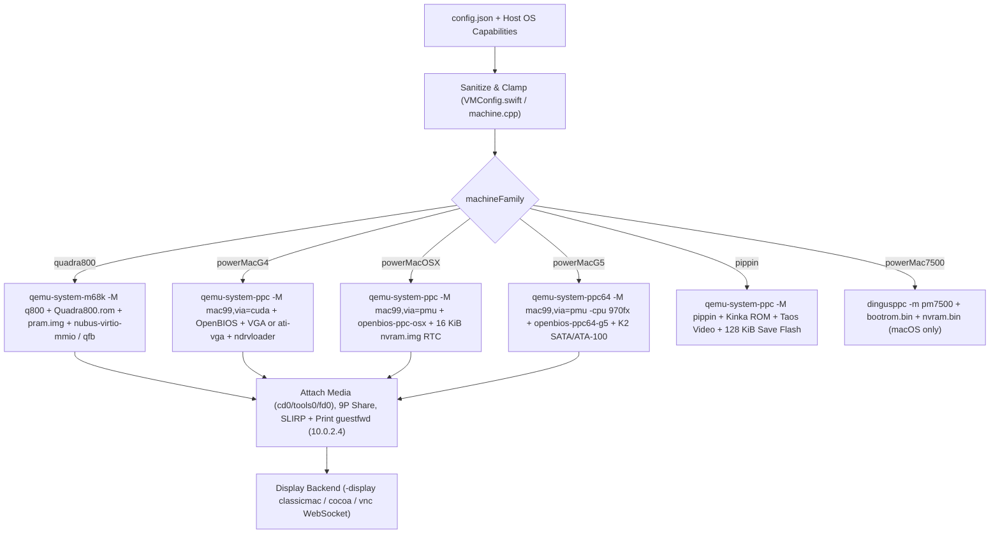

# 12. Configuration, Bundles & Environment Reference

This chapter is the complete technical reference for `.classic` bundle files, every key in `config.json`, ancillary metadata files (`template-info.json`, `.session-state.json`, `checkpoint.json`, `library.json`), `CLASSICMAC_*` environment variables, native CLI flags, UI snapshot automation, and repository helper scripts.

---

## How `config.json` Compiles to QEMU Arguments



---

## Complete `config.json` Schema Reference

Every virtual machine stores its settings in `<Machine>.classic/config.json`. All settings in **Get Info** require the VM to be **shut down** before editing; live media hot-swaps during a session use the **Media** menu (`classicmac-media` HMP command) and update `config.json` when changed or on clean exit.

> [!NOTE]
> ClassicMac launches QEMU with `-action reboot=shutdown`. When a guest restarts (or you choose **Restart**, which sends `system_reset`), QEMU exits cleanly with reason `"guest-reset"` or `"host-qmp-system-reset"` (`relaunchReasons` in `QEMURunner.swift`), allowing ClassicMac to re-read the latest saved `config.json` (and clear `bootFromCD` if a clean CD install blessed `disk.img`) before relaunching.

### Identity & Hardware Core

| JSON Key | Type | Default | Valid Values / Bounds (`sanitize` / `validate`) | Restart / Platform Notes |
| :--- | :--- | :--- | :--- | :--- |
| `id` | String (UUID) | Generated `UUID` | Standard 36-char UUID; regenerated on template import or duplicate `.classic` open. | Identifies runtime sockets (`/tmp/ClassicMac-<uid>/<id>.*`). |
| `name` | String | Family default (`"Mac OS 8.1"`, `"Mac OS 9.2"`, `"Mac OS X"`, `"Copland D11E4"`) | Non-empty trimmed string (`1–100` chars on Qt, no control chars). | Window title and `-name` argument. |
| `machineFamily` | String | `"quadra800"` (legacy decode fallback) / `"powerMacG4"` | `"quadra800"`, `"powerMacG4"`, `"powerMacOSX"`, `"powerMacG5"`, `"pippin"`, `"powerMac7500"`. | Selects emulator binary (`pippin` reuses `qemu-system-ppc`; `powerMacG5` uses `qemu-system-ppc64`); `powerMac7500` is macOS-only. |
| `ramMB` | Int | `128` (Quadra), `512` (G4), `1024` (G4 OS X), `2048` (G5), `13` (Pippin), `32` (Copland) | `quadra800`: `16–1000` (presets `64, 128, 256, 512, 1000`); `powerMacG4`: `32–896` (presets `128–896`, capped at `896` for OS 9 stability); `powerMacOSX`: `256–2048`; `powerMacG5`: `512–16384` (presets `512, 1024, 2048, 4096, 8192, 16384`); `pippin`: `5–16` (`13` default); `powerMac7500`: fixed `32`. | Passed as `-m <ramMB>` (or `--rambank1_size 32` for Copland). Must stop VM to change. |
| `cpuCount` | Int | `2` (`powerMacG5`) / `1` (others) | `powerMacG5`: `1–16` (`2` default; use `1–2` for Mac OS X 10.3); clamped to `1` outside `powerMacG5`. | Passed via `-smp <cpuCount>` on `powerMacG5`. Must stop VM to change. |
| `diskImageName` | String | `"disk.img"` | Local filename inside the `.classic` bundle (no `/`, `\`, `:`, or `..`). | Unused on `pippin`; Copland requires `"disk.img"`. |
| `pramImageName` | String | `"pram.img"` | Local filename inside the `.classic` bundle. | Used for `quadra800` PRAM and `pippin` CUDA 256-byte PRAM (`if=mtd,index=1`). |
| `flashImageName` | String? | `null` (`"flash.img"` on `pippin`) | Local filename inside the `.classic` bundle (`pippin` only; `null` for other families). | 128 KiB Save Flash (`0xFF`-initialized, `if=pflash`) storing Pippin settings and saves. |
| `pippinROMPath` | String? | `null` | Absolute path to a 4 MiB Pippin Kinka boot ROM (`pippin` only; `null` falls back to bundle `pippin.rom` / `kinka13.rom` or `~/Library/Application Support/ClassicMac/ROMs/pippin.rom`). | Passed via `-bios` on `pippin`. Must stop VM to change. |
| `diskSizeGB` | Int | `2` (Quadra), `32` (G4/OS X), `0` (Pippin), `1` (Copland) | Presets `1, 2, 4, 8, 16, 32, 64, 120` (`0` on `pippin`). | Metadata for initial disk creation; `disk.img` actual size governs capacity. |
| `useG4CPU` | Bool | `true` (`init`) / `false` (decoded legacy) | `true` (`-cpu 7400`) or `false` (`-cpu g3`). Forced `false` outside `powerMacG4`. | Set `false` for retail Mac OS 8.5 / 8.6. Must stop VM to change. |
| `useVirtioDisk` | Bool | `false` | `true` boots `disk.img` via `virtio-blk-pci` (`addr=0xf`); `false` uses MacIO IDE. Forced `false` outside `powerMacG4`. | Used for Mac OS 8.5/8.6; disables `-icount` boot handoff when `true`. |

### Display & Graphics

| JSON Key | Type | Default | Valid Values / Bounds (`sanitize` / `validate`) | Restart / Platform Notes |
| :--- | :--- | :--- | :--- | :--- |
| `graphicsCard` | String | `"standard"` | `"standard"` (`-vga std`), `"atiRadeon"` (`ati-vga,model=r100` on `powerMacG4`, forced `"standard"` when `bootFromCD` is active), or G5-only `"atiRadeon9800"` (`ati-radeon9800`) and `"atiRadeon7000"` (`ati-vga,model=rv100,agp=on`). | Must stop VM to change. G4 ATI requires Mac OS 9 ATI/OpenGL extensions; G5 ATI requires a Mac card ROM (`g5GraphicsROMPath`). |
| `g5GraphicsROMPath` | String? | `null` | Absolute path to a Mac FCode card ROM for G5 Radeon 9800 / 7000 (`powerMacG5` with ATI only; `null` otherwise). | Required when `machineFamily == "powerMacG5"` and `graphicsCard` is `"atiRadeon9800"` or `"atiRadeon7000"`. |
| `g5GraphicsGLMode` | String | `"fast"` | `"fast"`, `"on"`, or `"off"` (`powerMacG5` with `"atiRadeon9800"` only; forced `"fast"` otherwise). | Passed as `,gl=<mode>` on `ati-radeon9800`. |
| `width` | Int | `1024` | Clamped `512–3840` on macOS (`480–3840` on Qt). Fixed `640` on `powerMac7500`. Clamped to `640–1920` (multiple of 8) for `atiRadeon`. | Must stop VM to change. |
| `height` | Int | `768` | Clamped `384–2160`. Fixed `480` on `powerMac7500`. Clamped to `480–1440` for `atiRadeon`. | Must stop VM to change. |
| `depth` | Int | `16` | `8` (256 Colors), `16` (Thousands), `24` (Millions; Qt bundles may store `32`, normalized to `24` on macOS). `powerMacG4` allows `16` or `24`; `powerMacOSX` and `powerMacG5` force `24`/`32`; `powerMac7500` forces `8`; Quadra standard FB at `>=1152` forces `8`. | Must stop VM to change. |
| `useEnhancedFramebuffer` | Bool | `true` (Quadra) / `false` (others) | `true` uses `nubus-qfb`; `false` uses built-in `macfb`. Forced `false` outside `quadra800`. | When `false` on Quadra, `width`/`height` snap to `640x480`, `800x600`, or `1152x870`. |
| `customResolution` | Bool | `false` | `true` preserves arbitrary `width` × `height`; `false` snaps to nearest `ResolutionPreset` (`640x480`, `800x600`, `1024x768`, `1152x870`, `1280x1024`, `1440x900`). | Forced `false` on Copland and non-enhanced Quadra; auto-synced for ATI modes. |
| `useBrowserDisplay` | Bool | `false` | `true` launches private loopback VNC/WebSocket + bundled noVNC page; `false` uses Platinum window (or native Qt/Cocoa window). | macOS option (forced `false` on `powerMac7500`). Must stop VM to change. |
| `pippinVideoOut` | String? | `null` (`"ntsc"` on `pippin`) | `"ntsc"` (`640 × 480`), `"pal"` (`640 × 512`), or `"vga"` (`640 × 480`) when `machineFamily == "pippin"`; `null` otherwise. | Selects Apple Taos video output mode (`-M pippin,video-out=...`). |

### Media, Boot & Shared Folders

| JSON Key | Type | Default | Valid Values / Bounds (`sanitize` / `validate`) | Restart / Platform Notes |
| :--- | :--- | :--- | :--- | :--- |
| `cdImagePath` | String? | `null` | Absolute path to `.iso`, `.img`, `.toast`, or `.cdr` image (`null` on `powerMac7500`). | Can also be hot-swapped while running via **Media** (`cd0`). |
| `bootFromCD` | Bool | `true` (`init`) / `false` (decode) | `true` boots from `cdImagePath` (`-boot d` or Virtio compatibility mirror). | Automatically cleared to `false` after clean CD exit if `disk.img` has a blessed System Folder. |
| `floppyImagePath` | String? | `null` | Absolute path to writable raw floppy image. Forced `null` outside `quadra800`. | Can be hot-swapped while running via **Media** (`fd0`) on Quadra. |
| `bootFromFloppy` | Bool | `false` | `true` writes `00 00 0c a0` to Quadra PRAM `0x78..0x7B`. Forced `false` if not `quadra800`, if `floppyImagePath` is empty, or if `bootFromCD` is `true`. | Must stop VM to change boot preference. |
| `toolsCDInserted` | Bool | `true` (`powerMacG4`), `false` (others) | `true` attaches `ClassicMacTools.iso` (`virtio-blk-pci` on Power Mac, SCSI ID 4 on Quadra). Forced `false` on `powerMacOSX`, `powerMacG5`, and `powerMac7500`. | Can also be toggled while running via **Media** (`tools0`). |
| `toolsDeliveryVersion` | Int | `1` | Internal migration version (`1`). Moves legacy 1.8.0 Power Mac VMs to Virtio Tools once, then preserves explicit user choice. | Persisted automatically on save. |
| `sharedFolderPath` | String? | `null` | Absolute path to host directory (`quadra800`, `powerMacG4`, and PCI-X `virtio-9p-pci` `macos_compat=on` on `powerMacG5` for `osx9p`, macOS/Linux only; `null` on `powerMacOSX`, `powerMac7500`, and Windows). | Inactive while `bootFromCD` is `true`. Derived guest volume name strips `:` / `,` and caps at 27 chars. |
| `sharedVolumeName` | String? | `"Shared Files"` (Qt) / folder basename (macOS) | Optional explicit mount-tag override read by `native/src/machine.cpp` (`<= 27` chars, no `:` or control chars). | On macOS, `VMConfig.sharedVolumeName` is computed dynamically from `sharedFolderPath`. |

### Networking, Sound, Printing & Input

| JSON Key | Type | Default | Valid Values / Bounds (`sanitize` / `validate`) | Restart / Platform Notes |
| :--- | :--- | :--- | :--- | :--- |
| `networking` | Bool | `true` | `true` enables SLIRP user-mode NIC (`dp83932`, `sungem`, or `rtl8139`); `false` disables NIC (or sets `,restrict=on` if printing is enabled). | Forced `false` on `powerMac7500`. Must stop VM to change. |
| `sound` | Bool | `true` | `true` enables CoreAudio / PulseAudio / DirectSound audio; `false` passes `-audiodev none,id=snd0`. | Forced `false` on `powerMac7500`. Must stop VM to change. |
| `printingEnabled` | Bool | `false` | `true` starts virtual LPD/IPP/RAW server (`515`/`631`/`9100`) forwarded to `10.0.2.4` and auto-provisions OS 9 printer on macOS. | Forced `false` on `powerMac7500`. Must stop VM to change. |
| `printerName` | String? | `null` | `null` or `"pdf"` saves to **Printed PDFs**; any other non-blank string names a host print queue (`<= 256` chars on Qt). | Cleared on `powerMac7500` or when blank. |
| `tabletInput` | Bool | `true` | `true` attaches `virtio-tablet-pci` / `virtio-tablet-device` / `usb-tablet` for seamless pointer; `false` uses relative mouse (capture on click). | Forced `false` on `powerMac7500`. Must stop VM to change. |
| `classicInputHelpers` | Bool | `true` | `true` maps right-click to `Control+click` and scroll wheel to arrow keys. Forced `false` on `powerMacOSX`, `powerMacG5`, and `powerMac7500`. | Turn off if using USB Overdrive inside the guest. |
| `legacyMouseTracking` | Bool | `true` | `true` normalizes relative captured mouse motion to classic 200 DPI baseline; `false` passes raw host deltas. | Applies to captured relative mouse mode. |
| `mouseDPI` | Int? | `null` (`0` in Qt) | `null` (`0`) = Auto (`1000` DPI); explicit values clamped to `100–100,000`. | Used when `legacyMouseTracking == true`. |
| `pippinControls` | Object? | `null` (defaults apply on `pippin`) | `PippinControlConfig` (`keyboardMappingEnabled`, `keyboardBindings`, `gamepadEnabled`, `gamepadBindings`, `stickMode`, `stickSensitivity` `0.25–3.0`, `stickDeadzone` `0.05–0.50`) on `pippin`; `null` otherwise. | Maps keyboard keys & `GCController` inputs to Pippin AppleJack buttons and analog stick trackball motion; editable live in **Get Info → Controls** (`pippin`). |
| `swapAltCommand` | Bool | `false` | `true` swaps Alt and Windows/Super keys when mapping to Mac Option/Command on Windows and Linux hosts (`native/src/machine.cpp` & `vnc.cpp`). | Windows/Linux Qt desktop edition setting. |

---

## Ancillary Bundle & Library File Schemas

### `template-info.json` (`VMTemplateMetadata`)

Written inside `<Machine>.classic/template-info.json` when importing from the Library (never altered by later guest edits):

```json
{
  "schemaVersion": 1,
  "templateID": "mac-os-9.2.1-ati-32gb-v4",
  "osVersion": "Mac OS 9.2.1",
  "archiveSHA256": "0123456789abcdef...",
  "importedAt": 817273700.0
}
```

*(Native Windows/Linux writes `importedAt` as an ISO-8601 UTC string; Swift decodes `Date` using default `JSONDecoder` or `template-info.json` <= 16 KiB.)*

### `.session-state.json`

Tracks clean vs. unclean shutdown for crash recovery (`Pre-recovery backup`).

- **macOS (`VMSessionState`):** `clean` (bool), `lastExitReason` (string, optional), `lastStartedAt` (ISO-8601), `lastStoppedAt` (ISO-8601), `recoveryPrompted` (bool).
- **Windows/Linux (`native/src/checkpoint.cpp`):** `clean` (bool), `updatedAt` (ISO-8601), `reason` (string).

### `Checkpoints/<UTC-ID>/checkpoint.json`

- `schemaVersion`: `1` (native)
- `id`: UTC folder identifier (e.g., `"20261125T143000Z"`)
- `label`: User or automatic label (max 80 chars)
- `kind`: `"manual"`, `"fresh-install"`, `"pre-restore"`, or `"pre-recovery"`
- `createdAt` (macOS) / `created` (native): ISO-8601 UTC timestamp
- `diskBytes`: Logical `disk.img` size in bytes
- `allocatedBytes`: Actual host blocks allocated (`st_blocks * 512` or `GetCompressedFileSizeW`)
- `method`: `"clonefile"`, `"reflink"`, `"sparse"`, or `"copy"`

### `library.json`

A JSON array of absolute filesystem path strings pointing to known `.classic` bundles:

- **macOS:** `~/Library/Application Support/ClassicMac/library.json`
- **Linux:** `$XDG_CONFIG_HOME/classicmac-desktop/library.json` (usually `~/.config/classicmac-desktop/library.json`)
- **Windows:** `%APPDATA%\classicmac-desktop\library.json`

Missing paths (for example on an unmounted external drive) are preserved in `library.json` across reloads (`unavailablePaths` on macOS) instead of being silently dropped.

---

## Environment Variables & UserDefaults Reference

All `CLASSICMAC_*` variables recognized by the application, emulators, and build/test scripts:

### Application Runtime & Update Variables

| Variable | Platform / Component | Purpose |
| :--- | :--- | :--- |
| `CLASSICMAC_DISABLE_UPDATE_CHECK=1` | macOS, Windows, Linux | Disables automatic 24-hour GitHub Releases update checks. |
| `CLASSICMAC_PIPPIN_ROM_URL` | macOS, Windows, Linux (`PippinROMDownloader` / `catalog.cpp`) | Overrides the default Archive.org HTTPS mirrors used when downloading the 4 MB Pippin Kinka 1.3 boot ROM to `ROMs/pippin.rom` (must use `https://` and match Kinka 1.3's SHA-256 digest). |
| `CLASSICMAC_ATI_3D=off` | QEMU (`ati-vga`) | Diagnostic toggle: disables host OpenGL/Metal 3D acceleration while keeping ATI 2D display modes. |
| `CLASSICMAC_PORTABLE_EXE` | Windows (`updater.cpp`) | Absolute path to the running portable `.exe` enabling in-place self-updates. |
| `CLASSICMAC_RESOURCES` | macOS (`swift run` dev) | Overrides `AppPaths.resourcesDir` when running unbundled from source. |
| `CLASSICMAC_REPO` | macOS (`swift run` dev) | Overrides repository root path in `AppPaths`, `AboutView`, and `IconPacksDialog`. |
| `CLASSICMAC_RUNTIME` | Windows/Linux (`machine.cpp`) | Overrides the bundled `runtime/` directory containing QEMU binaries and firmware. |
| `CLASSICMAC_TEST_HOME` | Windows/Linux | Isolates `library.json`, `settings.json`, and download cache (`Downloads/`) for testing. |
| `CLASSICMAC_TEST_DOCUMENTS` | Windows/Linux | Isolates the default `Documents/ClassicMac` bundle folder for testing. |
| `CLASSICMAC_QUALIFY` | Windows/Linux | Marks an automated qualification run (disables first-run/update prompts). |
| `CLASSICMAC_ORIG_LD_LIBRARY_PATH` / `CLASSICMAC_ORIG_QT_PLUGIN_PATH` | Linux AppImage | Restores original host library/Qt paths when spawning child QEMU processes. |
| `UserDefaults: ClassicMacUseQEMUWindow` | macOS (`GuestWindow.swift`) | `defaults write com.classicmac.emulator ClassicMacUseQEMUWindow -bool true` uses QEMU's Cocoa window instead of Platinum's window. |

### Emulator Subprocess Variables (Injected by `QEMURunner.swift`)

ClassicMac sets these internally on child emulator processes: `CLASSICMAC_VM_ID`, `CLASSICMAC_TOOLS_CD` (Quadra Tools path), and for Copland (`powerMac7500`): `CLASSICMAC_CONTROL=1`, `CLASSICMAC_MACHINE_NAME`, `CLASSICMAC_PREVIEW_PATH`, `CLASSICMAC_STATUS_PATH`, and `CLASSICMAC_RTC_PATH`.

### UI Snapshot & Tour Automation (`DebugSnapshots.swift`)

Used with an isolated `HOME` and `CFFIXED_USER_HOME` (see `docs/manual/scripts/capture_manual_shots.py`):

| Variable | Purpose |
| :--- | :--- |
| `CLASSICMAC_UI_SNAPSHOTS=<folder>` | Enables automated UI tour mode, saves window PNGs (and `*-displays.json` / raw frames) into `<folder>`, and quits when finished. *(Also set `CLASSICMAC_UI_SNAPSHOT=1` or `CLASSICMAC_DISABLE_UPDATE_CHECK=1` to suppress update prompts.)* |
| `CLASSICMAC_UI_TOUR=<steps>` | Comma-separated actions: `library`, `about`, `newmac`, `icons`, `guestwindow`, `settings`, `checkpoints`, `update`, `paste`, `delete`, `media`, `shutdown`, `alert`, `start`, `collapse`, `stop`, `addicons`, `wait:<seconds>`, `shot:<prefix>`, `select:<index>`, `guest-size:<WxH>`, `guest-activate`. |
| `CLASSICMAC_UI_STAY=1` | Keeps the app running after the tour instead of stopping VMs and terminating. |
| `CLASSICMAC_UI_SETTINGS_PANE` | Pre-selects a Get Info tab: `general`, `display`, `controls` (`pippin`), `sharing`, or `printing`. |
| `CLASSICMAC_UI_NEWMAC_FAMILY` | Pre-selects the **New Mac** machine family during snapshot tours (for example `powerMacG5`). |
| `CLASSICMAC_UI_PASTE_SAMPLE` | Pre-fills the **Paste Text** dialog text box during snapshot tours. |
| `CLASSICMAC_UI_ICON_SOURCES` | Pipe-separated (`\|`) paths imported when the `addicons` tour step runs. |

---

## Native Desktop CLI Flags (`native/src/main.cpp`)

On Windows and Linux, the `ClassicMac` binary accepts:

- `<path/to/Machine.classic>` or `file://...`: Adds and opens the specified `.classic` bundle.
- `--catalog-check`: Fetches and validates both live HTTPS catalogs and verifies required core edition IDs.
- `--self-test <dir> <out>`, `--display-test <dir> <out>`, `--qualify <dir>`, `--qualify-osx <dir>`, `--qualification-engine`: Automated test and qualification harnesses (require `CLASSICMAC_TEST_HOME`, `CLASSICMAC_TEST_DOCUMENTS`, and `CLASSICMAC_QUALIFY` for `--qualify`).
- `--tcp-bridge <host> <port>`: Internal loopback TCP forwarder invoked by QEMU SLIRP `guestfwd` for virtual printing (`10.0.2.4:515/631/9100`).

---

## Helper Scripts & Documentation Tools Reference

| Script | Purpose | Example Usage |
| :--- | :--- | :--- |
| `scripts/prepare-os9-template.py` | Build a clean, blessed sparse Mac OS 9 `.classic` package from an audited source disk. | `python3 scripts/prepare-os9-template.py src.img Out.classic --graphics-source gfx.img --ati --capacity-gb 32` |
| `scripts/package-machine-template.py` | Package a stopped `.classic` bundle into a flat `.tar.gz` and `catalog.json` with `requiredStorageBytes` & SHA-256. | `python3 scripts/package-machine-template.py --bundle In.classic --output out.tar.gz --catalog-output catalog.json --archive-url https://... --id id-v1 --os-version "Mac OS 9.2.1"` |
| `docs/manual/scripts/capture_manual_shots.py` | Regenerate all manual screenshots in an isolated `/tmp/cm-manual-home` synthetic library. | `python3 docs/manual/scripts/capture_manual_shots.py --app /path/to/ClassicMac.app` |
| `docs/manual/scripts/check_docs.py` | Validate all Markdown links, `#anchors`, image existence/widths (`<= 840px`), Mermaid syntax, privacy, and `VMConfig` key coverage. | `python3 docs/manual/scripts/check_docs.py` |

*(For QEMU/iPadOS/build-time environment variables such as `CLASSICMAC_PREPARE_ONLY`, `CLASSICMAC_ATI_GL_OPTIONAL`, `CLASSICMAC_IOS_BUILD_DIR`, and `CLASSICMAC_OPENBIOS_DATE`, see `scripts/build-qemu.sh`, `scripts/build-osx-qemu.sh`, `scripts/build-g5-qemu.sh`, `scripts/build-g5-openbios.sh`, `scripts/build-ipad.sh`, and `scripts/build-openbios.sh`.)*

---

**Previous:** [11. Checkpoints, Updates & Troubleshooting](11-checkpoints-updates-and-troubleshooting.md) · **Up:** [Manual Table of Contents](README.md)
