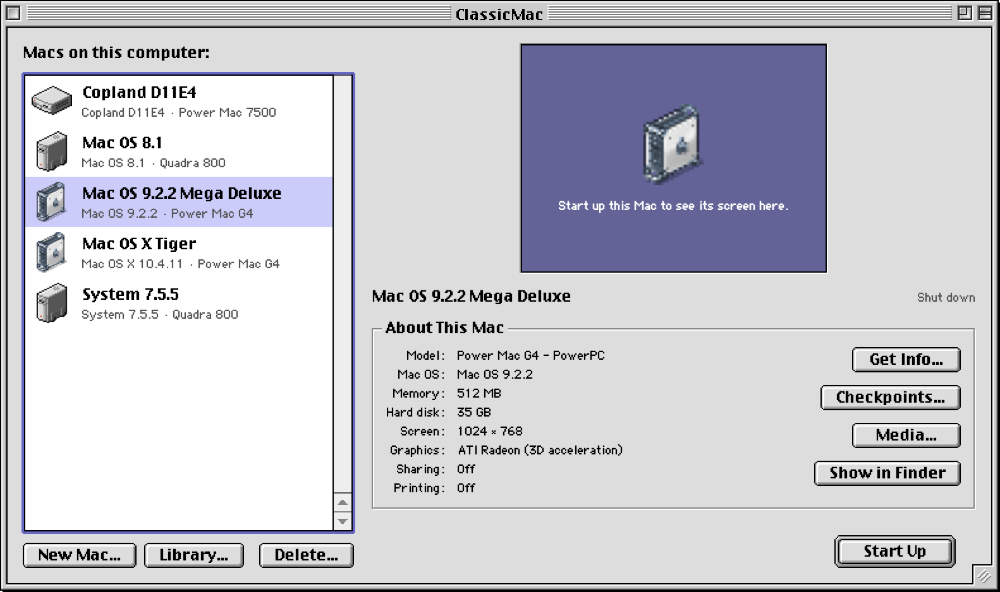
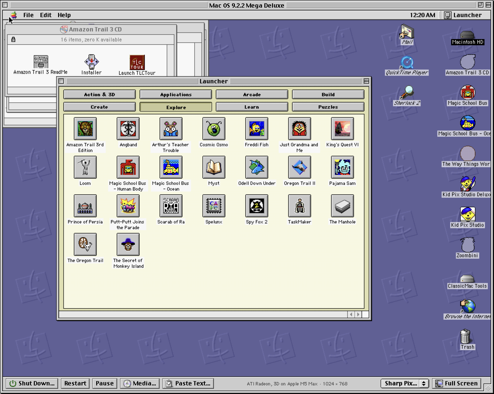
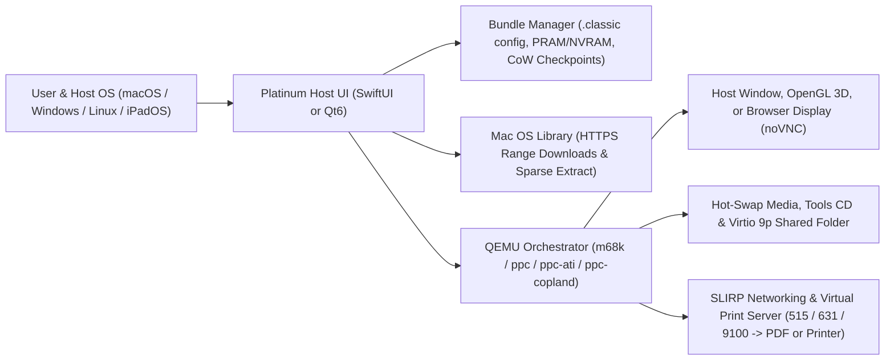

# ClassicMac 4.10.1 User Manual

Welcome to the complete **ClassicMac User Manual** for **ClassicMac 4.10.1**. ClassicMac runs genuine 68k Macintosh (Quadra 800), PowerPC Macintosh (Power Mac G3 / G4 with optional ATI 3D OpenGL acceleration and Copland D11E4), and early PowerPC Mac OS X (10.4.11 Tiger) machines inside a classic Apple Platinum interface across **macOS**, **Windows**, **Linux**, and **iPadOS (beta)**.

  
  

## How ClassicMac Fits Together

## Start Here by Goal

| What you want to do | Go straight to |
| :--- | :--- |
| Check supported macOS/Windows/Linux hosts, RAM, GPU, and QEMU targets | [1. System Requirements & Supported Platforms](01-system-requirements.md) |
| Understand `.classic` bundles, boot clock handoff, Tiger NVRAM, and QEMU engines | [2. Architecture & How It Works](02-architecture-how-it-works.md) |
| Install ClassicMac, complete the first-run wizard, and tour the Home window | [3. Installation & First Run](03-installation-and-first-run.md) |
| Download ready-to-run System 7, Mac OS 8/9, Tiger, and Copland editions | [4. Mac OS Library & Downloadable Editions](04-mac-os-library-and-editions.md) |
| Build a blank VM and install classic Mac OS or OS X from your own CDs/floppies | [5. Creating Custom Macs & Manual OS Installation](05-installing-your-own-mac-os.md) |
| Master keyboard shortcuts, mouse/tablet tracking, and Paste Text | [6. Everyday Use, Controls & Input](06-everyday-use-and-input.md) |
| Enable ATI Rage 128 / Radeon 3D OpenGL, Browser Display, and Screamer audio | [7. Display, 3D Graphics, Browser Display & Sound](07-display-3d-graphics-and-sound.md) |
| Hot-swap CDs/floppies, use ClassicMac Tools, and share files cleanly with FAT | [8. Media Drawer, ClassicMac Tools CD & Shared Folders](08-media-tools-and-sharing.md) |
| Connect to TCP/IP networks and print straight to PDF or host printers | [9. Networking & Virtual Printing](09-networking-and-virtual-printing.md) |
| Package sparse `.tar.gz` templates and host your own HTTPS catalog | [10. Creating, Packaging & Serving Custom Images](10-creating-and-serving-images.md) |
| Snapshot with Checkpoints, recover crashes, verify updates, and troubleshoot | [11. Checkpoints, Updates & Troubleshooting](11-checkpoints-updates-and-troubleshooting.md) |
| Look up every `config.json` key, bundle file, and `CLASSICMAC_*` variable | [12. Configuration, Bundles & Environment Reference](12-configuration-and-cli-reference.md) |

## Complete Table of Contents

1. [System Requirements & Supported Platforms](01-system-requirements.md) — Host OS minimums, CPU/RAM/disk budgets, Quadra 800 vs. Power Mac G3/G4 hardware matrix, bundled firmware, and platform feature comparison.
2. [Architecture & How It Works](02-architecture-how-it-works.md) — Swift/Qt host architecture, four QEMU binaries, Unix socket workaround (`/tmp/ClassicMac-<uid>`), `.classic` bundle internals, Boot Clock Handoff, 16 KiB dual-bank Tiger NVRAM, Apple-menu visual shutdown detection, and APFS sparse/clone storage.
3. [Installation & First Run](03-installation-and-first-run.md) — Installing signed releases on macOS, Windows, and Linux; building from source; First-Run Welcome wizard; Platinum Home window, ScreenPreview, and WindowShade; per-OS storage paths.
4. [Mac OS Library & Downloadable Editions](04-mac-os-library-and-editions.md) — Dual HTTPS catalog browsing, HTTP `Range` resumable `.part` transfers, SHA-256 verification, APFS `F_PUNCHHOLE` sparse extraction, classic Mac OS / Mac OS X / Copland editions, and Iconfactory icon packs.
5. [Creating Custom Macs & Manual OS Installation](05-installing-your-own-mac-os.md) — Using the New Mac dialog, importing `.img`/`.qcow2`/`.dsk` disks, Drive Setup & Disk Utility formatting, full install walkthroughs (System 7 / 8.1, OS 9, Tiger, Copland D11E4), and safely archiving or deleting bundles.
6. [Everyday Use, Controls & Input](06-everyday-use-and-input.md) — Boot/Shut Down/Force Quit lifecycle, ScreenPreview, ADB Tablet vs. legacy relative mouse, right-click & host Command/Alt swapping, and UTF-8-to-US-ADB `Paste Text`.
7. [Display, 3D Graphics, Browser Display & Sound](07-display-3d-graphics-and-sound.md) — Resolutions, color depth, enhanced framebuffer, ATI Rage 128 Pro and Radeon 7500/9200 OpenGL 3D passthrough, Browser Display (`127.0.0.1` token-authenticated noVNC), and ASC / Screamer / ES1370 audio.
8. [Media Drawer, ClassicMac Tools CD & Shared Folders](08-media-tools-and-sharing.md) — Live QMP/HMP optical & floppy hot-swap, every utility on `ClassicMac Tools.iso`, QEMU Virtio 9p shared folders, and preserving Mac HFS resource forks with `.sit`/`.hqx`/`.img`.
9. [Networking & Virtual Printing](09-networking-and-virtual-printing.md) — QEMU SLIRP networking (`10.0.2.15`, gateway `.2`, DNS `.3`, virtual print host `.4`), offline Mac OS 9 Desktop Printer provisioning (`hdiutil` + `PAPA`/`alis`), and LPD (515) / IPP (631) / JetDirect (9100) printing to **Printed PDFs** or real host printers.
10. [Creating, Packaging & Serving Custom Images](10-creating-and-serving-images.md) — Preparing clean templates with `prepare-os9-template.py`, creating GNU sparse 1.0 PAX `.tar.gz` archives with `package-machine-template.py`, `catalog-v2.json` schema, and CDN/HTTP server requirements.
11. [Checkpoints, Updates & Troubleshooting](11-checkpoints-updates-and-troubleshooting.md) — Copy-on-write APFS `clonefile` / Linux `FICLONE` checkpoints, `Fresh install` & crash recovery backups, Developer ID signed self-updates, and symptom-by-symptom diagnostics.
12. [Configuration, Bundles & Environment Reference](12-configuration-and-cli-reference.md) — Exhaustive schema for `config.json`, `template.json`, `.session-state.json`, `library.json`, `CLASSICMAC_*` environment variables, snapshot tour automation, and helper scripts.

## Visual & Keyboard Conventions

- **Modifier notation:** `Command` (`⌘`) refers to the Apple Command key inside the guest Mac (mapped from Command on macOS hosts, and configurable between Alt/Windows via `swapAltCommand` on Windows/Linux).
- **Host paths:** User home folders are shown as `~` on macOS/Linux (typically `~/Documents/ClassicMac` and `~/Library/Application Support/ClassicMac`) and `%USERPROFILE%` on Windows.
- **Documentation maintenance:** Whenever code, configs, catalogs, or UI strings change, consult [Documentation Maintenance Guide](MAINTENANCE.md) and run `python3 docs/manual/scripts/check_docs.py`.
