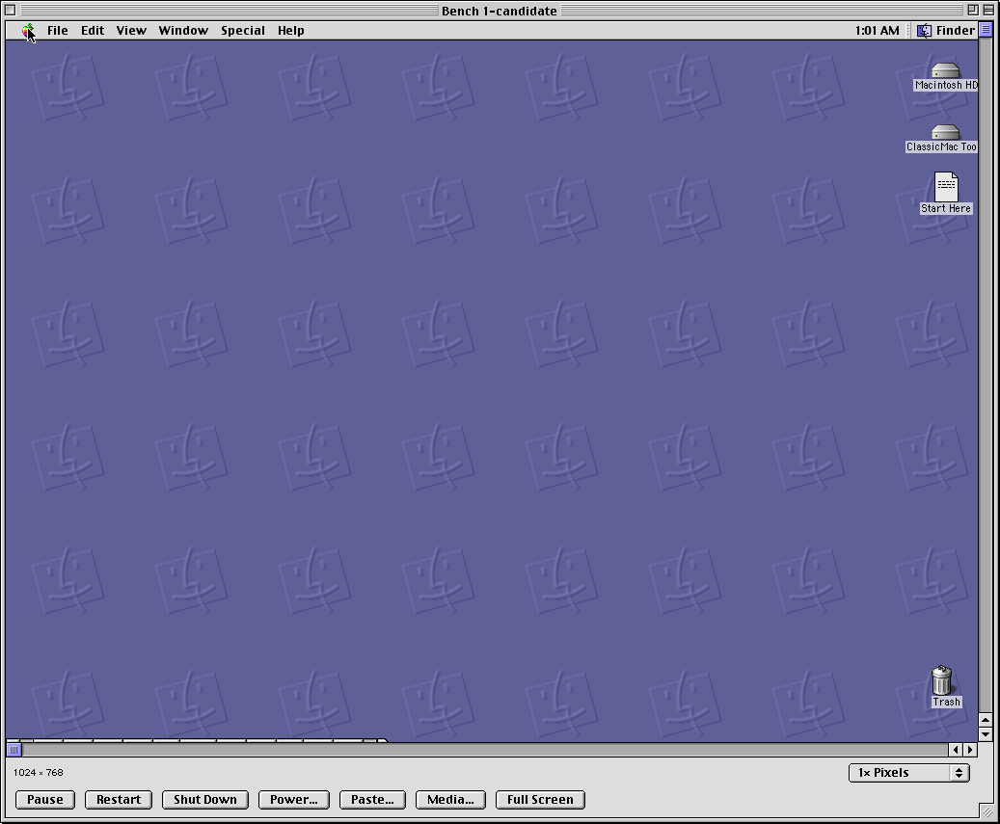

# Ubuntu release validation — November 15, 2026

ClassicMac 4.6.3 incorporates [PR #44](https://github.com/amcchord/ClassicMac/pull/44)
and fixes a Linux Power Mac startup fault found during this qualification.
The actual AppImage passes configuration, public download, running-guest and
repeated performance checks on Austin's requested Proxmox host.

## Tested package and system

| Item | Value |
| --- | --- |
| Package | `ClassicMac-4.6.3-linux-x64.AppImage`, 60,611,064 bytes |
| SHA-256 | `d8a60b874891075713386d11c02da59cd13c49d2060e64c7088e9c90dc672c62` |
| Compiled source | `36c1084da3722d673b298b3cb2917b5c46ea1928`; subsequent benchmark scripts and documentation do not change shipped application code |
| Build | [Linux CI 43782609513](https://github.com/amcchord/ClassicMac/actions/runs/43782609513) |
| Host | Proxmox 9.2.26 / QEMU 11.1.3, `192.168.1.100`; AMD Ryzen AI 9 HX PRO 370, 24 logical CPUs, 123 GiB RAM |
| Dedicated VM | 402, `classicmac-ubuntu-qa`; 6 host CPU cores, 8 GiB RAM, 80 GiB sparse NVMe-backed disk, q35/OVMF, virtio display/network/storage |
| Ubuntu | 24.04.5 LTS, kernel `6.8.0-147-generic`, GNOME 46, Xorg, 1920 × 1440 |
| Graphics | Mesa 25.2.8 llvmpipe, LLVM 20.1.2, software rendering; no GPU passthrough |

The official Noble cloud image was checked against its published SHA-256:
`04e8f2461a16a44e78a370284471f29616cdd9baf1893df25807b71f985b6c94`.
The VM uses SSH public-key access. Only this QA desktop's idle lock was disabled
while testing. No unrelated VM, container, public catalog or website was changed.

The AppImage runs on the real desktop with its bundled engines and libraries.
There is no runtime-path override or offscreen display in these measurements.
The baseline is the published 4.6.2 AppImage, SHA-256
`cbf562c441c15f4a82f5e888fdc5f18bb7ee15e665d1c1f787d06b66730c9fb7`.

## Changes and startup fix

PR #44 adds searchable/filterable current Library editions, edition details,
naming before download, progress and pause/resume, and direct startup after
installation. Home supports narrow windows. Manage distinguishes removing a
list entry from moving its files to Trash. Power and confirmed Force Stop
remain available when a guest's control connection hangs. These are shared
Windows/Linux native UI changes; the existing RetroBoot 2.0.1 engine is retained.

The old Linux default ATI configuration put the tablet at PCI slot 18,
sharing Sungem's interrupt. With networking and Tools enabled, the public
Mac OS 9.2.1 image remained near 20% of startup at 60 seconds and did not reach
Finder within the 65-second observation. The [retained startup frame](evidence/4.6.3/linux/os9-4.6.2-startup.png)
records that failure; it is not an old-version performance measurement.

4.6.3 extends the already qualified Windows allocation to Linux: the tablet
uses slot 19 (`addr=0x13`) for ATI + networking + Tools. Sound, networking,
tablet input and Tools remain enabled. The identical image now completes all
three boots, accepts real pointer input, pauses/resumes and shuts down cleanly.
The Linux-specific argument golden checks assert the allocation. The engine,
firmware and guest image were not modified for this fix.

## Configuration and public Library flows

| Check on final AppImage | Result |
| --- | --- |
| 1× interface | 150 steps passed; 27 desktop captures |
| 2× interface | 150 steps passed; 27 desktop captures |
| Public network and guest | 40 steps passed; nine desktop captures |
| Native reference gate on actual GNOME desktop | 122 independent comparisons, 672 glyphs, zero differences; configuration/input/display/model checks pass |
| Final desktop comparison set | 72 exact matches, including the nine performance captures; no masks or tolerance |
| Whole-pixel interface | 81 uniform title-bar captures; full pure-UI surfaces repeat whole pixels at 1×/2× |
| Visible Sharp Pixels guest comparisons | 20 captures, 8,582,784 pixels, zero differences against raw guest frames |

The 150-step fixture uses tiny generated archives and a labeled mock guest.
It tests search/filter/no-results, obsolete revision hiding, unavailable systems,
update requirements, corrupt-cache rejection, real checksum/extraction, naming,
narrow forms, removal with files retained, reopening, Trash confirmation,
running-machine protection and hung-engine Force Stop within 1.5 seconds.
It does not pretend that the mock guest boots a Mac OS.

The separate public flow loads all seven current editions, pauses and resumes
Deluxe with byte progress, then downloads/verifies/installs System 7.5.5. It
starts the installed Mac from Library, shows Finder, pauses/resumes, closes
into Power and shuts down. Deluxe is not fully downloaded or booted in this
flow. Selected actual captures: [public Library](evidence/4.6.3/linux/public-library.png),
[paused download](evidence/4.6.3/linux/download-paused.png),
[System 7 Finder](evidence/4.6.3/linux/system7-finder.png),
[guest close/Power](evidence/4.6.3/linux/power-close.png),
[2× fixture Library](evidence/4.6.3/linux/library-2x.png).

The initial final-package comparison had 71/72 exact desktop matches. The
remaining 14 pixels form one blinking text caret, which changed phase between
widget and desktop grabs. The entire unchanged 150-step 1× flow was repeated
once; all 27 captures then matched exactly. Both original frames and the
[observation](evidence/4.6.3/linux/capture-observation.json) are retained.
The final set uses that repeated 1× run plus the original 2×, network and
performance captures. There was no artwork change, masking or loosened checker.

Early desktop-lock captures and benchmark development failures also remain in
ignored task output. The runner was corrected to wait for actual Finder before
sampling, synchronize Pause through qualification-only files, settle mouse
motion and target the center of the Apple menu. These corrections preceded
the complete repeated measurements below; partial probes are not mixed into
their statistics. GNOME focus activation now waits for actual keyboard focus
before reference capture, with a bounded deadline.

## Performance method

Each run sparsely clones an identical stopped public image into an isolated
profile. Original images are never booted or altered. System 7 alternates
baseline/candidate order over three pairs. OS 9 has three candidate runs;
the default baseline cannot supply valid Finder/input timings.

The public source archives are `system-7.5.5-base-v1` (SHA-256
`68b8ffb1993664644435e7c9bb4f4d58737a7da6c63e6cb794b7c48830c38246`)
and `mac-os-9.2.1-ati-32gb-v4` (SHA-256
`0e2449c5444ee77fb919fc31c52745b438e3972944cbf4cc3d206d19d3775e48`).
The native importer checked the HTTPS downloads before extraction.

System 7 uses Quadra 800, 128 MiB guest RAM, 640 × 480 × 8, built-in video,
sound/network/tablet on and Tools off. OS 9 uses Power Mac G4, 512 MiB guest
RAM, 1024 × 768 × 16, ATI Radeon, sound/network/tablet/Tools on. Every capture
uses explicit 1× guest pixels. Per-run JSON records the complete configuration.

Timing observes actual X11 root pixels: engine creation to a visible Finder
menu bar, then XTest button-down to the visible Apple menu. A connected RFB
socket or successful control reply does not count as a visible result. Each
run has eight menu openings, six seconds of idle CPU/RSS sampling, five seconds
paused, resume and clean shutdown. Input timing begins after a 60 ms pointer
settle; it excludes that preparatory motion. Page caches warm across runs;
these are process/guest boot timings, not cold-storage startup measurements.

## Repeated results

Values are medians of three runs; input p95 uses all 24 menu samples per column.
CPU percentages refer to one logical core. RSS includes shared libraries.

| Measurement | System 7 / 4.6.2 | System 7 / 4.6.3 | OS 9 ATI / 4.6.3 |
| --- | ---: | ---: | ---: |
| Engine → visible Finder | 8.447 s | 8.309 s | 29.678 s |
| Finder range | 7.471–8.460 s | 7.889–8.458 s | 29.569–30.139 s |
| Pointer → visible menu, median | 48.6 ms | 50.7 ms | 45.8 ms |
| Pointer → visible menu, p95 | 127.0 ms | 127.7 ms | 123.4 ms |
| Interface RSS | 59.18 MiB | 59.33 MiB | 64.54 MiB |
| Interface idle CPU | 0.17% | 0.17% | 0.50% |
| Engine idle CPU | 100.50% | 100.50% | 53.67% |
| Paused engine CPU | 0.00% | 0.00% | 0.00% |
| Successful runs / clean shutdowns | 3 / 3 | 3 / 3 | 3 / 3 |

System 7 shows comparable boot/input/resource behavior to 4.6.2; the small
differences do not establish a significant speedup or regression. Unpaused
System 7 still occupies an emulation core. Pause reduces measured engine
work to 0–0.20% across all runs. The interface remains inexpensive in these
samples; OS 9's default configuration is now usable.

Raw samples: [System 7](evidence/4.6.3/linux/system7-runs.json),
[OS 9](evidence/4.6.3/linux/os9-runs.json). Summaries:
[System 7](evidence/4.6.3/linux/system7-summary.json),
[OS 9](evidence/4.6.3/linux/os9-summary.json). The VM's load averages before
samples are recorded per run. Windows VM 401 stayed stopped during performance
sampling. Other existing host workloads remained running; measurements are
not from an otherwise empty physical host.

## Reproduction and other platforms

The [Linux runner instructions](../native/tests/linux/README.md) give exact
commands. `native/scripts/run-ui-ux.py`, `benchmark-linux.py`, the public
recipe and unchanged pixel checkers are committed. Full captures, logs and
disposable disks stay under the task's ignored output and the retained QA VM.
Committed evidence includes hashes, result JSON, raw samples and selected
actual screenshots, with no guest disk or ROM uploads.

The final Windows CI [43782612504](https://github.com/amcchord/ClassicMac/actions/runs/43782612504)
passes the engine/native/package gates, including 122 comparisons and 672
glyphs. Source preparation now preserves LF on Windows, including copied
device C/H sources, while retaining Copland's intentional raw patch exceptions.
The Windows runner reads UTF-8 explicitly for compatibility with Windows
PowerShell 5.1; its original ANSI read corrupted the recipe's ellipsis.

The exact final Windows EXE (SHA-256
`9361491663944a4a13395f2fe7c010968c9c91a8b3893cf80d1999c7f4c67fc1`)
also passes both 150-step flows on the owned Windows 11 Pro VM 401. The real
1920 × 1440 RDP desktop uses 100% OS DPI with separate 1×/2× app zoom. All 54
rendered captures have uniform title-bar pixels; 50 desktop comparisons are
exact. Four 2× Home captures are covered by an unrelated OneDrive backup
promotion, retained in the [desktop observations](evidence/4.6.3/windows/desktop-observations.json)
and [original desktop frame](evidence/4.6.3/windows/onedrive-obstruction.png).
They are not counted as exact matches. Two mock-guest captures compare 614,400
pixels exactly; real Windows guest coverage is retained in PR #44 and the
earlier five-DPI report, rather than claimed as a new full guest matrix here.
The release scheduled task was removed and the VM shut down after collection.

From the integration checkout, 143 Swift tests (three optional fixture skips),
the native reference/input/model suite and 11 Python tests pass. The Mac DMG
and app are signed, notarized and stapled; full distribution verification passes.
A disposable actual Quadra boot shows [Happy Mac as the first revealed frame](evidence/4.6.3/mac/quadra-happy-mac.png),
then [Finder](evidence/4.6.3/mac/quadra-finder.png), followed by shutdown.

## Limits

This validates Ubuntu GNOME/Xorg on one virtual display, two public guests and
the listed flows. It does not qualify Wayland, mixed-monitor/DPI transitions,
physical GPU or accelerated 3D performance, audible output, all editions,
long-running games or alternate input layouts. Software llvmpipe has a different
performance profile from a physical GPU. The [earlier UI audit's remaining
appearance/layout gaps](ui-fidelity-audit-2026-11.md#remaining-work-in-priority-order)
remain explicit; these measurements do not certify every UI state as a
pixel-perfect reproduction of classic Mac OS.

The release retains v4.6.2 and its assets for rollback. Only GitHub source and
release assets are promoted; the public guest catalog is unchanged. Temporary
desktop auto-login is disabled and the owned QA VMs are stopped after testing.

Publication completed at 2026-11-16 01:27:02 UTC (November 15 locally).
[4.6.3](https://github.com/amcchord/ClassicMac/releases/tag/v4.6.3) is stable/latest,
with nine uploaded assets verified by size and SHA-256 before promotion.
All nine were then independently downloaded without credentials and matched;
[public verification](evidence/4.6.3/public-downloads.json) records the results.
The annotated tag points to `c3cc9126d681174254550b5e72c3f252c95a47bc`;
shipping product code matches qualified `36c1084` exactly. Later changes are
benchmark/runner scripts, documentation and evidence. PR #44 is merged.
